# Signal Harbor: demo guide for the ten use cases

For: Nitin, to demonstrate to a family-office client (CIO, finance, operations, risk).
Demo company: Evergreen Office, a made-up family office. All names, funds and figures are synthetic.
Length: 30 minutes plus questions.
Checked: every click path, figure and agent answer below was walked on a live demo server on 10 October 2026, with the demo data as seeded on 9 October. Where something did not work as you would hope, the guide says what actually happens, and the list at the end ("Found while writing") collects them.

Screenshots are in `docs/guides/demo-shots/` (uc1.png to uc10.png, 1440x900, plus uc9-sop.png and uc10-dashboard.png).

---

## 1. What Signal Harbor is (one page)

Signal Harbor takes an office from "what do we want to know?" to "here it is, and here is what to do about it", without anyone copying figures between spreadsheets. A person says what they need; the product builds it, checks it, and keeps every figure traceable.

**Four centres** (the top bar), plus a map:

| Centre | In one line | Who mostly lives here |
|---|---|---|
| **Intent** | Where work starts. You say what you need in a conversation; the product writes it down as a signed "intent of work" with a process map. | CIO, finance |
| **Action** | Things to do. What changed, who owns it, what to do next: cases, reconciliations (cash, limits, trades), the manager statements inbox. | Operations, risk, finance |
| **Build** | Makes the data. Takes the signed intent, designs the tables, loads the files, runs the pipeline. | Head of data, data engineer |
| **Consume** | Everything to read: the office view, the CIO brief, manager research, the benchmark, dashboards. | CIO, finance |
| **Map** | How data, work and numbers connect: data flow, process maps, definitions, health. | Everyone who builds or checks |

**Four agents** (helpers that draft and explain; they never decide):

| Agent | Where | Ask it |
|---|---|---|
| **North** | Intent | To write down a report, check or process from your own words. "A quarterly report on how each private fund is pacing against its commitment." |
| **Tally** | Action, on every case | To explain a break, a limit breach, a revision or a capital call. "Is this timing?" "Is this breach real or stale data?" |
| **Span** | Build | Which tables exist, what the three layers are, where a figure is stored. "Which tables hold cash by entity?" |
| **Lumen** | Build > Dashboard studio (proposes tiles); Consume (answers questions about published figures) | To draw a figure the way you want it. "Show net worth USD by entity per month as a line chart." "Make it dots." |

**Why it is safe, in three sentences.**
1. The data stays on your machine: each company has its own folder, and nothing reads another company's folder.
2. People approve: agents propose, a named person signs. Official figures change only through a recorded source and an approver.
3. Every figure has a "Where is this from?" button that shows the source, the file, who read it, who checked it and where it is used.

---

## 2. Before the demo

### Start it and reset it

From the repository folder, in a terminal (Python from the project's virtual environment):

```
python tools/make_test_env.py demo --seed
python tools/serve_test.py --port 8690 --data-root .sh-tmp/testenv/demo/data
```

- The first command makes a fresh copy of the Evergreen data (about 30 seconds). Run it again, with the server stopped, to reset everything back to the start of the story.
- The second starts the product at http://127.0.0.1:8690 . It writes its log to `.sh-tmp/testenv/demo/server.log`, not to the terminal.
- **Date.** The story is set on 9 October 2026 and uses the computer's date. The demo is right from 9 to 14 October. From 15 October the Cedarpoint statements change from "Not due yet" to late, so run the demo on a day inside that window (or expect different words on the Managers screen).
- **Time zone.** Stamps such as "Last refreshed" and "Signed" show the time the demo data was made, in the browser's time zone. On a laptop in Singapore they read 10 Oct. Do not make a point of them.

### The people and what they see

Sign in on the login page with an email and password. The six demo people, plus one administrator:

| Person | Seat | Sign in to show | The top bar shows |
|---|---|---|---|
| Daniel Foo | Chief Investment Officer (sponsor) | Office view, CIO brief, manager research, signed intent | Intent, Action, Consume, Map |
| Mei Chen | Operations analyst | Action: cases, reconciliations, manager statements | all five |
| Raj Patel | Finance (approver) | Benchmark, liquidity, the capital-call case | Intent, Action, Consume, Map |
| Sofia Reyes | Risk (participant) | The limits and the limit cases | Intent, Action, Consume, Map |
| Anita Rao | Head of data | Build, Map | all five |
| Leo Park | Data engineer | Build, Map | all five |
| Grace Ong | Company administrator | Settings (rules, agent runs, mode) | all five |

Emails follow the pattern `first.last.evergreen@example.test`. The passwords are in `.sh-tmp/testenv/demo/data/_control/seed_credentials.txt` (a local file; never share it or paste it anywhere). Keep one browser window per person if you want to switch quickly (use private windows).

### The Testing / Real use switch

At the top right of every page there is a switch: **Testing** and **Real use**. It is one switch for the whole company.
- **Testing**: the agents use a free test model tier. The chat shows "Testing models (free tier)". Use this for the demo.
- **Real use**: the agents use the full model tier and the chat shows "Real-use models". In both modes the model sees only the minimum it needs, with names replaced.
Leave it on Testing. Settings (account menu, "Testing or Real use") shows the same switch.

### What to have open

1. Daniel Foo signed in on Consume (main window).
2. Mei Chen signed in on Action, in a second window.
3. Optional: Raj Patel and Sofia Reyes windows, for use cases 4, 5 and 6 (or just use Daniel and Mei and mention who would normally do it).
4. Open the case "Cash differs · Entity B" and the case "Limit breached · Harborview" in Mei's window one minute before you need them. Tally's panel takes between 5 and 25 seconds to appear the first time (it writes the explanation); after that it is instant.
5. This guide.

---

## 3. The 30-minute demo script

**The story.** Evergreen's September report went to the CIO on 3 October. Since then four things happened: a fund manager revised Fund A (Evergreen Growth I); the administrator and the trading desk disagreed on Entity B's cash; a capital call arrived that Entity B cannot fully cover; and two allocation limits were breached. Signal Harbor finds each one, explains it, and shows who has to act.

| Time | Where | Who | What you say and click |
|---|---|---|---|
| 0:00 | Slide / this page | You | "Four centres, four agents, every figure traceable." Read section 1 in 60 seconds. |
| 1:00 | **Consume > Office view** | Daniel | "This is the report you got on 3 October: 57.6 million. Scroll to *Issued versus known now*: it is 57.78 million today. The 180,000 is Fund A, revised on 7 October." Click **SGD** to flip the same table to Singapore dollars (77,253,120 to 77,494,536). Click *Where is this from?*. (UC1) |
| 5:00 | **Action > Today**, then the case | Mei | "Mei opens the day. The first card is the revision." Open the case, show Tally's summary and the source chips. (UC1) |
| 8:00 | **Action > Cases > Cash differs · Entity B** | Mei | "The administrator says 880,400, the trading desk says 868,000: 12,400 over the 5,000 allowance." Show Tally's finding (one wire, booked a day apart), type **is this timing?**, show *Where is this from?*. (UC2) |
| 12:00 | **Action > Managers** | Mei | "Nine funds, six managers: who sent what, who is late." Click **Draft a follow-up** on Cedarpoint Opportunities II (63 business days overdue); "the product writes it; a person sends it". (UC3) |
| 15:00 | **Consume > Managers > Kestrel Ridge** | Daniel | Click **Show what changed**: "Thirteen dated items since your last meeting, including the newsletter that says the portfolio manager changed." (UC7) |
| 18:00 | **Consume > Office view > Liquidity** | Raj | "Entity B has 880,400. Two calls fall due in 30 days: 1,050,000. If both are paid it is short by 169,600." Show the unconfirmed Saltmarsh call, then the *Fund the capital call* case. (UC6) |
| 21:00 | **Action > Reconciliations** (Limits, then Trades) | Sofia / Mei | "Four signed limits; two breached. Harborview is a real breach; Cedarpoint is probably stale data." Then scroll to trades: "13 trades compared, three differences." (UC5, UC8) |
| 25:00 | **Consume > Benchmark** | Raj | "The liquid book beat the office benchmark by 1.46 points in September, and the figure is certified because the benchmark is approved." (UC4) |
| 27:00 | **Intent** (signed intent), **Map**, dashboard | Daniel | "Everything started with this signed intent and its process map. The product wrote the procedure from it." Show the procedure, the Map data flow and the dashboard. (UC9, UC10) |
| 29:00 | Close | You | "One place, every figure traceable, people approve." Questions. |

If you are short of time, cut UC3 and UC8 to a one-line mention.

---

## 4. The ten use cases

Each section has: the problem in the client's words; who uses it; the click path (walked on the live server); what appears; the agent; the value; a screenshot.

### UC1. Why did the number change? (P&L and NAV explanation)

**The problem, in their words.** "The September report said 57.6 million. Today it says something else. What changed, who knew, and is it timing, a revision or an exchange rate?"

**Who:** Daniel Foo (CIO) reads it; Mei Chen (operations) investigates. Sign in as Daniel, then Mei.

**Click path**
1. Daniel: **Consume > Company reports > Office view**. The page is one long scroll.
2. Scroll to **Issued versus known now**. Click **SGD** (top of the page) to flip currency; click **USD** to flip back.
3. Click **Where is this from?** under the table.
4. Scroll on to **Investment total against administrator NAV**.
5. Scroll to **Why did this move**.
6. Optional: **Consume > Shared with you > CIO Brief** shows the issued report with *Why did this move?* on each line that changed since the report was issued (Evergreen Growth I, +180,000). The liquid book did not change since issue (41,200,000 then and now), so its line has no button; its month move (+1,648,000) is the Office view's *Why did this move* (step 5).
7. Mei: **Action > Today**, the first card, "Revised · manager final". Click **Where is this from?**, then **Open case**.

**What appears**
- Issued versus known now (USD): total **57,600,000** as issued on 3 Oct, **57,780,000** known now (Revised). Evergreen Growth I 10,000,000 to **10,180,000** (+180,000, 1.8% of that fund); Evergreen Income II 6,400,000 (Official); Evergreen Liquid Book 41,200,000 (Official). In SGD at 1.3412: **77,253,120** to **77,494,536**.
- The banner names the open case, CASE-0001 (180,000, over the 100,000 / 0.5% materiality rule).
- NAV bridge, 30 Sep (investment view against administrator NAV): Evergreen Growth **16,580,000 against 16,400,000, difference 180,000, all "Revisions"**; Entity B operating 22,875,000 against 22,525,000, difference 350,000 (revisions, Fund E's September value arrived on 8 Oct); Evergreen Funds 22,750,000 against 22,550,000, difference 200,000 (revisions: the two Kestrel estimates); Evergreen Liquid 41,200,000 against 41,200,000, nothing to explain. Timing, exchange rates and unexplained are all 0.
- Why did this move (default, the liquid book, 31 Aug to 30 Sep): 39,552,000 to 41,200,000, **+1,648,000 (+4.1667%)**. Largest contributors: Northwind Logistics +132,000, Silverpine Software +130,400.
- The Where-is-this-from panel for Fund A reads: (1) Source: manager statements by email; (2) File: the amended statement, received 7 Oct; (3) Read: page 2, line 13; (4) Checked: confirmed by a person (Mei Chen, 7 Oct); (5) Stored: confirmed, replacing the earlier estimate; (6) Used by: the case and the September report.
- Do not confuse the two totals: the report covers Fund A, Fund B and the liquid book (57.6 million); the *All holdings* line at the bottom of the Holdings section is every holding in the office (USD 103,405,000, or SGD 138,438,614).

**The agent: Tally** (on the case, Action > Cases > CASE-0001). The summary says in plain words: the manager-reported valuation of Evergreen Growth I is now 10,180,000 against 10,000,000 in the issued report, Mei Chen confirmed the amended statement on 7 Oct, official NAV is untouched, and the September report stays as issued. If you type "Why did the total change since the September report?" Tally answers "I cannot tell that from the records of this case" and then repeats those facts; so read out the summary rather than asking.

**Value.** The CIO sees which number he was given, which number is true now, and the one document that explains the gap, in one screen, in either currency.

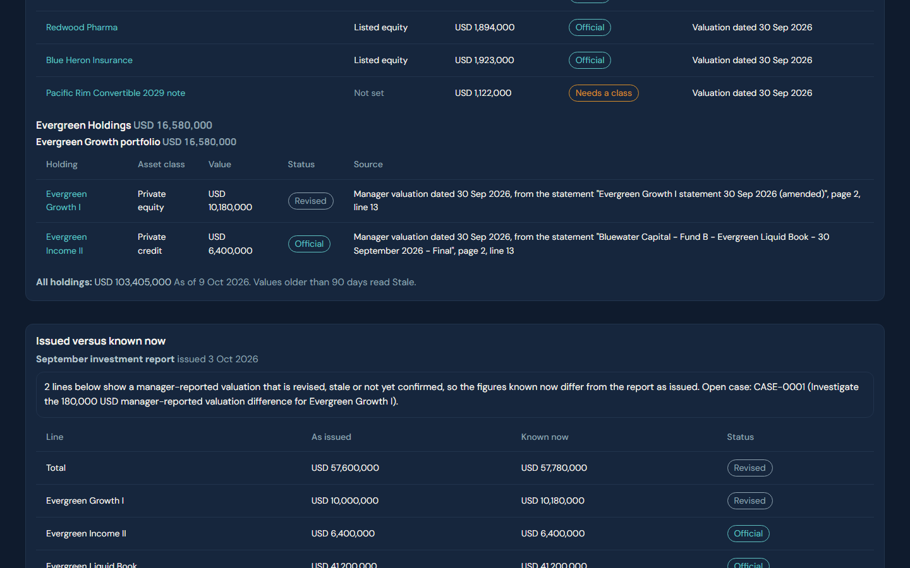

---

### UC2. Why does cash not agree? (Reconciliation and break desk)

**The problem.** "Our administrator says one cash balance, our trading desk another. Is it real or just timing, and who deals with it?"

**Who:** Mei Chen (operations analyst). Raj Patel (finance) sees the same case.

**Click path**
1. Mei: **Action > Reconciliations**. The first section is **Cash by entity**.
2. **Action > Cases**, click the case number **CASE-0003**, "Cash differs · Entity B · 2026-10-08".
3. Wait for Tally's panel (up to 25 seconds the first time).
4. In **Ask Tally**, type `is this timing?` and press **Ask Tally**.
5. Click **Where is this from?** on the case.

**What appears**
- Reconciliations, Cash by entity: 3 compared. **Entity B: 880,400 against 868,000, difference 12,400, over the allowance of 5,000** (opens the case). Evergreen Family Trust: 1,150,000 against 1,148,200, difference 1,800, inside the allowance, no case. Evergreen Holdings: 2,300,000 against 2,300,000, nothing.
- Tally's summary on the case: the signed tolerance is 5,000, so the difference is 7,400 over it; the two sides agreed on 7 Oct, so the difference is new today; **the best candidate is wire WIRE-20261008-B01 for 12,400, dated 8 Oct at the trading export and reaching the administrator only on 9 Oct: a timing difference that clears that day.** Source chips open the exact file and row. Next steps: Operations confirms with the administrator; the case owner records the cause and sends it for check by another person.
- Answer to "is this timing?": one item appears on one side only, the 12,400 wire, equal to the difference, reaching the administrator on 9 Oct, "a timing difference that clears that day", and how each side moved since 7 Oct.
- *Where is this from?* shows six steps: Source, File, Read, Checked (the check, rule version and tolerance), Decided, Shown.

**The agent: Tally.** Ask `is this timing?`. Try also asking it to change a figure ("Please change the administrator balance to 868,000"): it refuses, "Official figures change only through a recorded source and an approver, not on request. I only look and propose; the case owner acts."

**Value.** The break is found at source, explained in one sentence with the line it came from, and sits with a named owner. Nobody retypes anything.

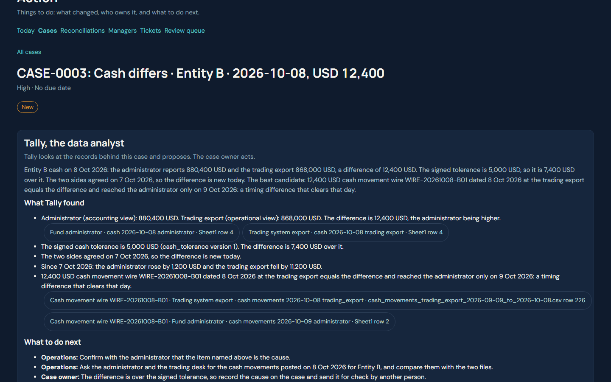

---

### UC3. Who has sent us what? (External manager information inbox)

**The problem.** "Nine funds, six managers. Some reported, some are late, some revised. I never know what is still outstanding."

**Who:** Mei Chen.

**Click path**
1. **Action > Managers**.
2. Read down the six manager boxes.
3. In the **Cedarpoint Ventures** box click **Draft a follow-up**. (The draft is for Cedarpoint Opportunities II, the fund with the missing June statement.)

**What appears** (statements for 30 Sep 2026, due 14 Oct 2026)
- Bluewater Capital: Evergreen Income II, received 1 Oct, USD 6,400,000 (Official).
- **Cedarpoint Ventures: Opportunities II "Earlier statement missing", "Not due yet", last value 4,650,000 on 31 Mar 2026 (Stale); "Still missing: the statement for 30 Jun 2026, due 14 Jul 2026, 63 business days late."** Ventures III "Not due yet", last value 8,275,000 on 30 Jun (Stale).
- Kestrel Ridge Advisors: Equity Long/Short received 7 Oct, 5,180,000 (Estimated); Macro received 6 Oct, 7,320,000 (Estimated).
- Meridian Index Managers: Global Bond Index 4,100,000 and Global Equity Index 6,150,000, both received 1 Oct (Official).
- Northgate Partners: Evergreen Growth I received 2 Oct, **Revised once**, 10,180,000.
- Saltmarsh Real Assets: Infrastructure Fund II received 8 Oct, 9,950,000 (Unverified, not yet confirmed by a person).
- The draft email (not sent): subject "Statement request: 30 Jun 2026 (Cedarpoint Opportunities II)", "Dear Hana Sato (Cedarpoint Ventures)", listing the statement, "due 14 Jul 2026, 63 business days overdue", signed "Kind regards, Mei Chen". The screen says "This email has not been sent. Copy it into your own email to send it."
- Late and revised history for each manager is on Consume > Managers (UC7): for example Kestrel's August Long/Short statement came 6 business days late.

**The agent.** None is needed here: the table and the draft are written by fixed rules from the signed due-date rule ("a manager statement is due within 10 business days of the period end"). Say that: the product never sends mail.

**Value.** One list of who is outstanding, with the right follow-up written for you, in your name, and nothing goes out without a person.

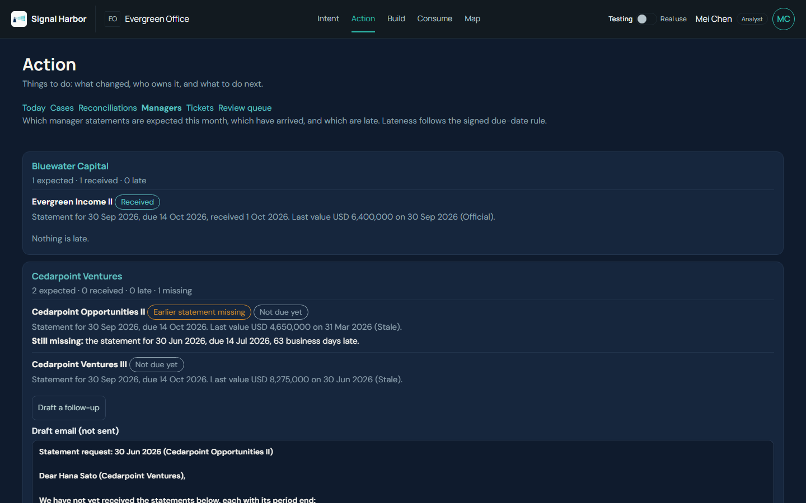

---

### UC4. Did we beat the benchmark, and is the figure certified? (Certified reporting and benchmark factory)

**The problem.** "Which benchmark did we use? Is the number certified, or are we still arguing about the definition?"

**Who:** Raj Patel (finance).

**Click path**
1. Raj: **Consume > Company reports > Benchmark**.
2. Portfolio: **Evergreen Liquid portfolio**. Benchmark: Evergreen office benchmark. From and To: 2026-09 (already set). Click **Show**.
3. Click **Where is this from?** on the row.
4. The page header link, "Open the question on the Evergreen office benchmark", goes to the policy question (CASE-0009 in Action > Cases).
5. Optional (company administrator): account menu > **Rules** shows the benchmark row.

**What appears**
- "Benchmark version 1 (approved)." September 2026: **portfolio 4.1667%, benchmark 2.7072%, difference +1.4595 points, Certified.** The benchmark is made of global equity index 42% (3.5002%), global bond index 28% (0.4002%) and a private-markets sleeve 30% (equity index plus 300 bps a year, 3.7502%). The liquid sleeve alone returned 2.2602%, so against the 60/40 sleeve the difference is **+1.9065 points**.
- The page header says: "Evergreen office benchmark, version 2: In progress: not used for certified figures." Version 2 (36 / 24 / 40) is still being defined, so a period from 1 October is refused for certified output and raised as a question. In Rules the benchmark reads "version 1 (2026-01-01) approved by Daniel Foo; version 2 (2026-10-01) still in progress", waiting for a signature.
- Figures are worked out by the product from the index levels, never by an agent.

**The agent: Lumen.** In **Build > the project > Dashboard studio** (data team, see UC10) ask Lumen under the grid `Show the portfolio against the benchmark by month`. Lumen proposes one tile and waits for you to press **Accept** or **Not this**. It draws what the product has computed; it does not compute. In Consume, Lumen only answers questions about published figures.

**Value.** A certified return comes only from an approved definition, and a definition still under discussion cannot slip into a report.

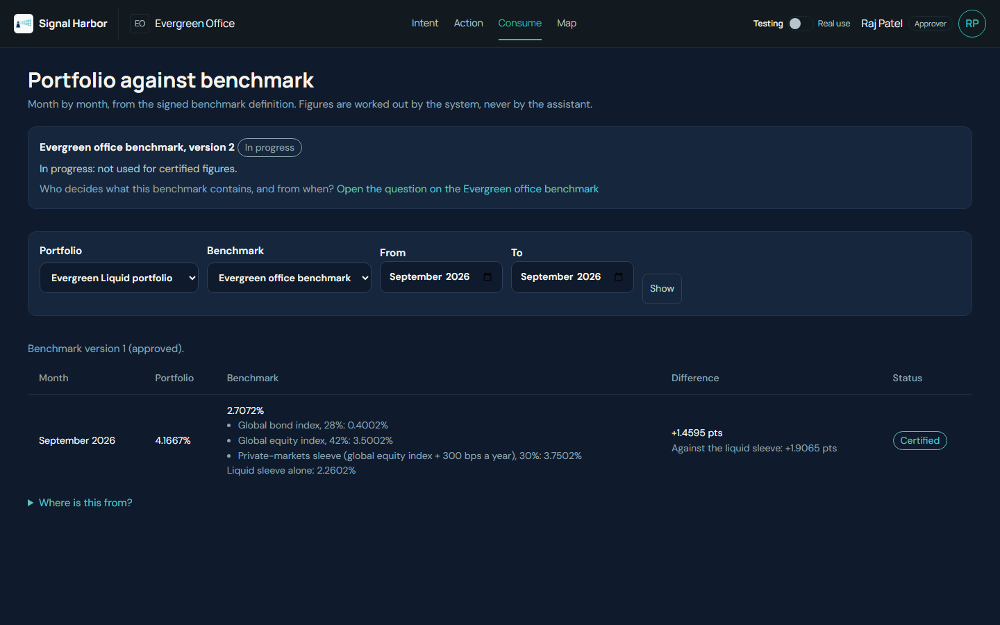

---

### UC5. Are we inside our limits? (Allocation and limit monitoring)

**The problem.** "Our policy has limits. When one is breached, is it real, or is the data just old?"

**Who:** Sofia Reyes (risk, who owns the limits), Mei Chen.

**Click path**
1. Sofia: **Action > Reconciliations**, scroll to the **Limits** section. (It is a section of that page, not a separate tab.)
2. Click **Open the case** on the Harborview line, then do the same for Cedarpoint.
3. On each case, wait for Tally and ask `Is this breach real or stale data?`

**What appears**
- "2 limits breached"; 4 compared (one line for each signed limit):
  - **Harborview Semiconductor, Evergreen Liquid: 2,368,000 = 5.75% against a maximum of 5%. Outside the limit; real breach, over by 308,000** (CASE-0008).
  - **Cedarpoint Ventures, Entity B operating: 12,925,000 = 56.50% against a maximum of 55%. Outside the limit; stale data, over by 343,750** (CASE-0007). Inputs: Cedarpoint Ventures III valued 30 Jun (101 days), Cedarpoint Opportunities II valued 31 Mar (192 days), Saltmarsh Infrastructure Fund II 9,950,000 not yet verified.
  - Listed equity, Evergreen Liquid: 33,210,500 = 80.61% (limit 60 to 90%): inside.
  - Hedge funds, Evergreen Funds: 12,500,000 = 54.95% (limit 20 to 60%): inside.
- A fifth line: **Pacific Rim Convertible 2029 note, 1,122,000 (2.72% of the portfolio): "Needs a class"**. It has no asset class, is counted in no bucket and opens no breach; Holdings shows the same words.
- Tally on Harborview: "Harborview Semiconductor is at 5.75% against a maximum of 5%. All 21 input values in the portfolio are recent and verified, so this looks like a real breach." Next step: the investment lead decides whether to rebalance or ask for an exception; "Tally does not decide."
- Tally on Cedarpoint: "3 input values of the 3 in the portfolio are older than 90 days or not yet verified ... The share may be out of date: a stale-data cause, not yet a proven breach."

**The agent: Tally.** `Is this breach real or stale data?`

**Value.** Risk acts on the real breach first and chases the valuations for the other one.

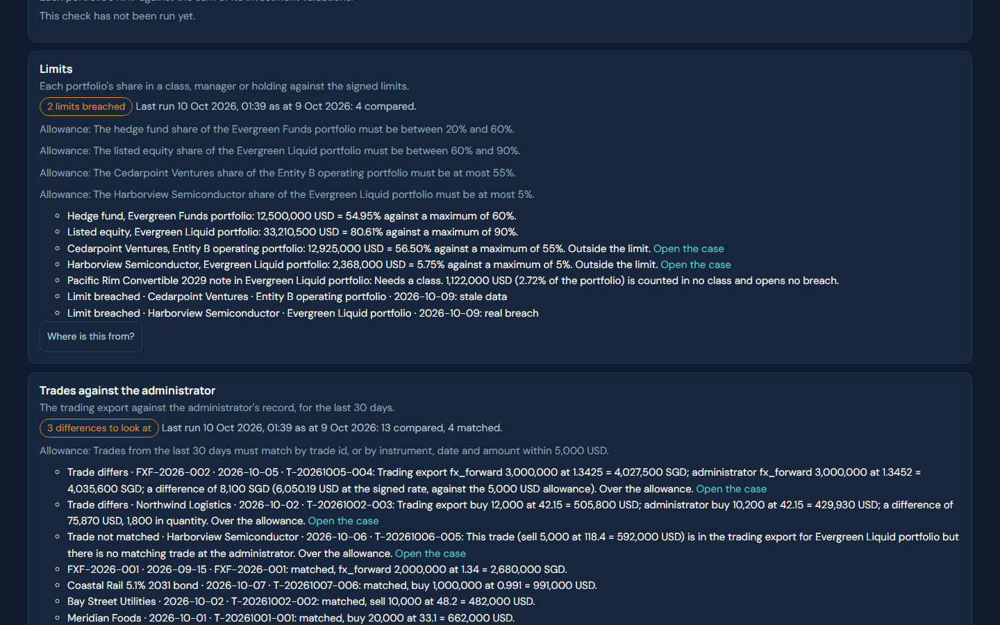

---

### UC6. Can we meet the capital calls? (Private-asset liquidity and commitments)

**The problem.** "Calls are coming in on notices. How much cash do we have, which calls are certain, and when do we run short?"

**Who:** Raj Patel (finance).

**Click path**
1. Raj: **Consume > Company reports > Office view**, scroll to the bottom, **Liquidity**.
2. Click **Where is this from?** next to Entity B.
3. **Action > Cases**, click **CASE-0002**, "Fund the capital call · Cedarpoint Ventures III · Entity B · 2026-10-20".
4. Optional: **Consume > Managers > Cedarpoint Ventures**, **Commitments**.

**What appears** (as of 9 Oct 2026)
- **Entity B: available cash 880,400; still to be called 8,200,000.**
  - Within 30 days: calls **1,050,000** (Cedarpoint Ventures III 450,000 due 20 Oct, confirmed; Saltmarsh Infrastructure Fund II 600,000 due 30 Oct, **not confirmed yet**). Cash after the calls **-169,600 (shortfall)**; after confirmed calls only **430,400**.
  - 31 to 60 days: calls 250,000 (Cedarpoint Opportunities II, due 4 Dec); cash after the calls -419,600; after confirmed calls only 180,400.
- Evergreen Holdings: cash 2,300,000; **distribution expected 320,000 on 16 Nov** (Evergreen Growth I, not confirmed); still to be called 4,550,000. Evergreen Family Trust: cash 1,150,000, nothing due.
- Commitments (committed / called / not yet called): Evergreen Growth I 15,000,000 / 11,250,000 / 3,750,000; Evergreen Income II 8,000,000 / 7,200,000 / 800,000; Cedarpoint Ventures III 6,000,000 / 4,050,000 / 1,950,000; Cedarpoint Opportunities II 5,000,000 / 4,750,000 / 250,000; Saltmarsh Infrastructure Fund II 10,000,000 / 4,000,000 / 6,000,000.
- CASE-0002 is a Finance case (medium, due 20 Oct, USD 450,000). Tally: "after this call of 450,000 USD it would hold 430,400 USD. If the Saltmarsh ... call of 600,000 USD due 30 Oct 2026 is confirmed too, it would hold -169,600 USD." Next steps: Finance arranges the payment by 20 Oct; Operations confirms the notice against the commitment and the fund's bank details before paying. There is an **Ask Finance** button.
- There is no case for the Saltmarsh call yet because it has not been confirmed.

**The agent: Tally** on CASE-0002. Asking "When is this due and is it confirmed?" answers only "The due date is 20 Oct 2026"; the summary already says the call is confirmed, so read the summary instead.

**Value.** The shortfall is seen three weeks early, with the one uncertain call clearly marked.

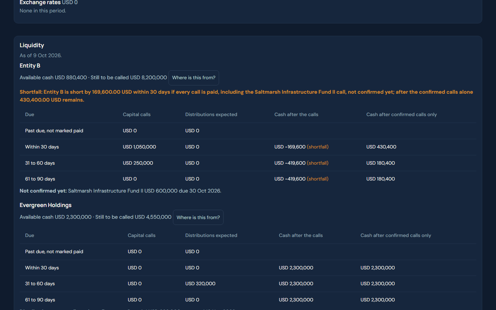

---

### UC7. What do we know about this manager? (Manager diligence workspace)

**The problem.** "Before I meet Kestrel: what funds, what changed, and where are our notes?"

**Who:** Daniel Foo (CIO), Mei Chen.

**Click path**
1. Daniel: **Consume > Company reports > Managers > Kestrel Ridge Advisors**.
2. Under "What changed since the last meeting?" click **Show what changed**.
3. Scroll to **Statements and revisions**, **Notes and meetings**, **Open questions**, **Diligence documents**.
4. Optional: go back and open **Cedarpoint Ventures** for the open question about the missing June statement.

**What appears**
- Last meeting on record: 12 Jun 2026. **"Since 12 Jun 2026: 13 dated items, newest first"**, including:
  - 7 Oct and 6 Oct: the September estimates arrived (Equity Long/Short 5,180,000; Macro 7,320,000).
  - 28 Sep: the Q3 newsletter was added. Its passage says Thomas Lindqvist left the firm on 30 September and Priya Nair is sole portfolio manager of the Macro Fund from 1 October.
  - 22 Sep: the August Long/Short statement arrived, 6 business days late.
  - **20 Aug: the Macro Fund value for 31 Jul was revised from 7,050,000 to 7,012,500 (-37,500).**
- The page ends with: "Every line is a dated record. This does not say whether the manager is doing well or badly."
- Notes and meetings: the 12 Jun on-site meeting (the Macro fund is run by two co-portfolio managers). Diligence documents: the meeting note, the 2026 questionnaire (no team changes reported at that date) and the newsletter, each with the sentence that matters.
- Kestrel's funds are hedge funds, so the Commitments block says none are recorded. Use Cedarpoint to show commitments, the open question ("Fund D's 30 June 2026 statement ... has not arrived"), and the due-diligence questionnaire (statements within 45 days, 10 business days under the side letter, auditor change in Q2 2026).
- You can add a note, meeting or question in the box on the page.

**The agent: Lumen** cannot answer "What changed at Kestrel Ridge Advisors since the last meeting?" from the Consume landing (it says it cannot tell and offers definitions). Use the **Show what changed** button, which reads dated records only. Asking Lumen "Is Kestrel Ridge a good manager?" is politely refused: it says that is subjective and not something it can assess. Good to show.

**Value.** The team change, the revision and the late statement are in one dated list with the source of each, before the meeting.

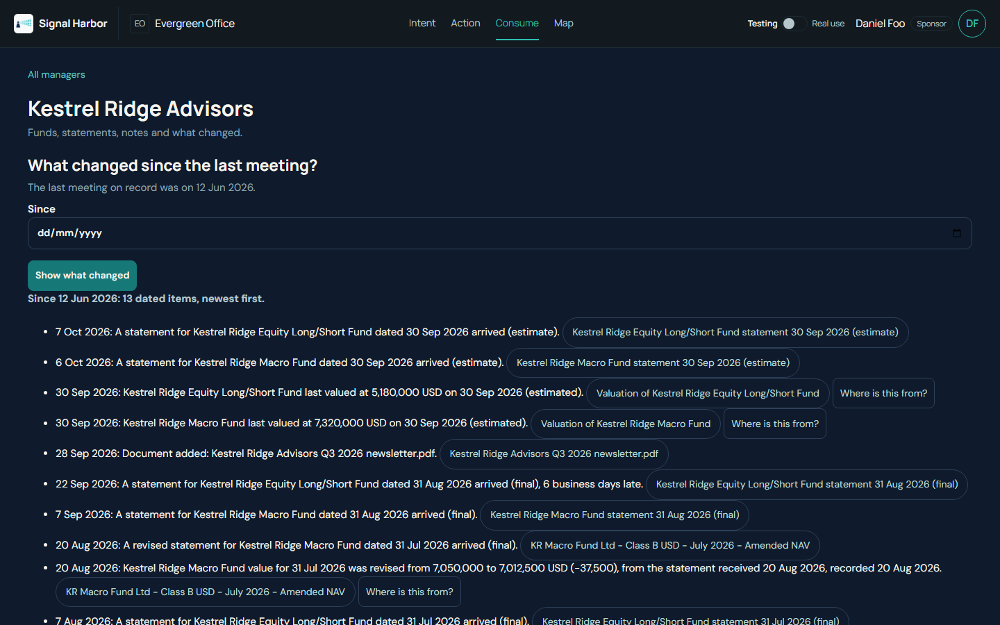

---

### UC8. Do our trades agree with the administrator? (Liquid and OTC trade control)

**The problem.** "The trading desk says we sold something the administrator does not have. Or the quantities differ."

**Who:** Mei Chen.

**Click path**
1. **Action > Reconciliations**, scroll to **Trades against the administrator**.
2. Click **Open the case** on a difference.
3. On the case, wait for Tally; read the summary.

**What appears**: "3 differences to look at", **13 compared, 4 matched**, last 30 days, allowance 5,000 USD.
- **Northwind Logistics, T-20261002-003** (CASE-0005): trading export buys 12,000 at 42.15 = 505,800; administrator 10,200 at 42.15 = 429,930; **difference 75,870, 1,800 shares**. Tally: "Ask the administrator and the trading desk which quantity and amount is right"; 70,870 over the allowance.
- **Harborview Semiconductor, T-20261006-005** (CASE-0006): sell 5,000 at 118.40 = 592,000 in the trading export, **no matching trade at the administrator**. Tally, asked "What is missing and who should chase it?": "The trade ... is missing at the administrator. Operations should ask the administrator."
- **FXF-2026-002** (CASE-0004, Low): trading export 3,000,000 at 1.3425 = SGD 4,027,500; administrator 3,000,000 at 1.3452 = SGD 4,035,600; **difference SGD 8,100 = USD 6,050.19, 1,050.19 over the allowance**.
- Matched, no case: FXF-2026-001 (2,000,000 at 1.34 = SGD 2,680,000), Coastal Rail 5.1% 2031 bond T-20261007-006 (buy 1,000,000 at 0.991 = 991,000), Bay Street Utilities T-20261002-002 (sell 10,000 at 48.2 = 482,000), Meridian Foods T-20261001-001 (buy 20,000 at 33.1 = 662,000).
- The Today list and the case list rank them by size: Harborview (592,000) is "High", Northwind and the forward are "Low" by materiality.

**The agent: Tally** on each case ("What is different between the two records?" answers: quantity and amount differ, the money at stake is 75,870 and it is over the signed tolerance).

**Value.** Three small trade differences are found and ranked; none waits for month end.

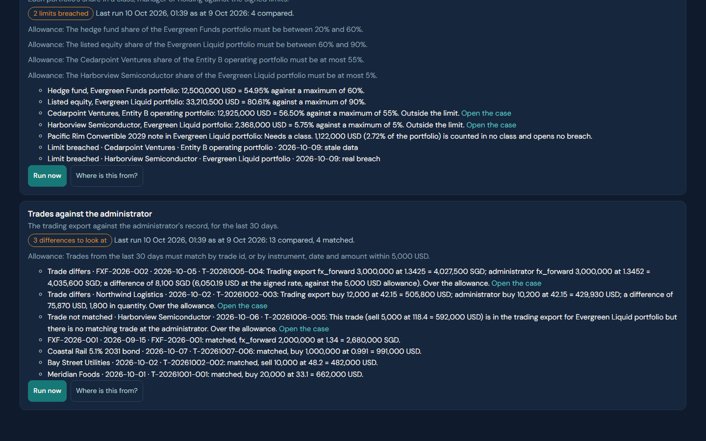

---

### UC9. Write down how we do it (Process map and procedure builder)

**The problem.** "Our month-end report depends on three people and a lot of habit. Who does what, with which system, and what are the controls?"

**Who:** Daniel Foo (CIO) owns the intent; Mei Chen and Raj Patel are the people in the process.

**Click path**
1. Daniel: **Intent**. Under "Your recent intents" click **Monthly investment report in USD and SGD** (status Live). If the page opens on a draft instead, use the link in the Map step below.
2. On the right, the **Intent of work** and **Process map** are signed. Below the conversation click **Read the procedure here**, or **Download the procedure**.
3. **Map > Process maps** shows the swim lane (the screenshot).
4. To show North live: **Intent > Start a new intent** (or the box "What do you need?"), type a sentence about a report you want, press **Start**.

**What appears**
- Signed intent: goal "Monthly investment report in USD and SGD"; readers Daniel Foo and Raj Patel; needed by the 3rd business day of each month; four measures (net worth by entity, cash by entity, holdings by status, portfolio against benchmark); three sources (administrator export, trading export, manager statements by email).
- The process map: **six steps in three lanes**. 1 Collect the exports (Mei Chen, File drop); 2 Check cash against the administrator (Mei Chen, Excel); 3 Collect manager statements (Mei Chen, Email); 4 Convert to SGD (Raj Patel, Excel); 5 Review and approve the report (Raj Patel, Report pack); 6 Read the report (Daniel Foo, Report pack). Steps 1 to 4 are flagged **Manual** (candidates for automation). Hand-overs 1 to 2, 2 to 3, 3 to 4, 4 to 5, 5 to 6.
- The procedure (a downloadable Word file, SOP-Monthly-investment-report-in-USD-and-SGD-v1.docx; a server without the python-docx package gives the same content as .md) has for each step the person, system, input, output, **control** and **what happens if it goes wrong**, in plain words. For example step 2: control "Difference per entity per day within the cash tolerance of 5,000 USD"; if it goes wrong "Over tolerance opens a break case (Entity B, 12,400 USD on 8 Oct 2026)". Step 5: "Maker never checker; a manager estimate is used in the investment report only"; a revision over 100,000 USD or 0.5% of a fund reopens the review. It ends with the manual steps flagged for automation, controls, definitions, and "Open points: None".
- The project page (**Build > Project page**) offers the same signed intent as **Download .docx** and **Download .md**.

**The agent: North.** The signed intent ends with North saying, "The intent of work is ready. You signed it and sent it to Build; nothing is waiting for you here." To show North drafting, start a new intent: with "A quarterly report on how each private fund is pacing against its commitment, for Raj and me." North replies in a few seconds, restates it, asks the next question ("Why is this report important now?"), and shows its first proposed change on the right ("Accept" or "Not this"). Say "yes" to accept. The right-hand document fills as you talk, with the required sections still to fill in.

**Value.** The way the work is done is written down once, signed, and turned into a procedure nobody had to type.

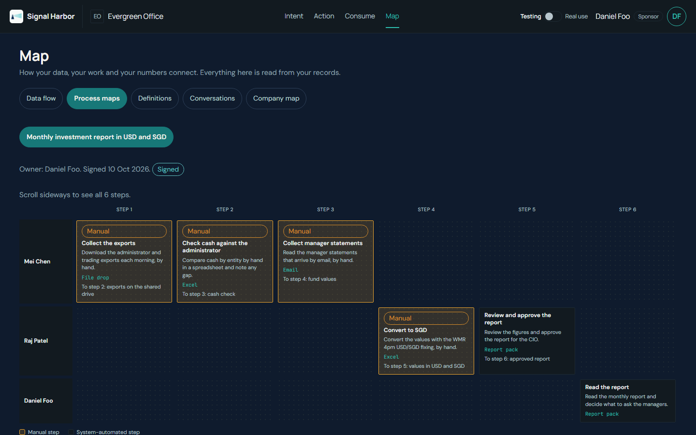

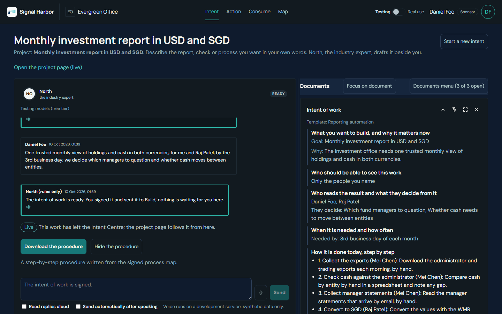

---

### UC10. From files to a dashboard (Data pipeline and insight builder)

**The problem.** "Where does this dashboard number come from, and can we change what we see without waiting for IT?"

**Who:** Anita Rao and Leo Park (data), Daniel Foo and Raj Patel (readers).

**Click path**
1. Anita: **Map > Data flow**. Click the box **Investment report holdings monthly**.
2. **Consume > Shared with you > Monthly investment report in USD and SGD** (the dashboard); click **Where is this from?** under a tile.
3. **Consume > Your projects**, click the project, then the dashboard link (or **Open the project**). This opens the published dashboard with its three tiles, the list **Figures available** and **Share**. Lumen here answers questions about the figures; a request to build or change a tile gets "Dashboards are built in Build > Dashboard studio."
4. Leo (data engineer): **Build**, click the project, then **Dashboard studio**, then **Open** on the dashboard. Under the grid, **Talk to Lumen**: `Show net worth USD by entity per month as a line chart`. Lumen proposes one tile with **Accept** and **Not this**; press **Accept** (the tile goes into the first free slot), then **Submit for approval**.
5. Anita (head of data): the same studio page shows **Waiting for your approval**; press **Approve and publish**. Consume, and Daniel and Raj through their "shared with you" card on Action > Today, now show the new tile. The maker can never approve their own version.
6. **Build** also shows the project's rooms filled by the seed: the plan is **Live**, "Approved by Anita Rao", last run ok, scheduled daily at 06:00.

**What appears**
- Map, Data flow, left to right: **Sources** (Fund administrator, Manager contacts, Manager statements by email, Market data file, Security master, Trading system export) then **Raw data** (Administrator positions, Trading export positions), then **Ready for reports** (Investment report benchmark monthly, cash daily, holdings monthly), then **Dashboards** (Monthly investment report in USD and SGD), then **People** (Daniel Foo, Raj Patel). Clicking holdings monthly shows owner Leo Park, status Live, fed by Administrator positions and Trading export positions.
- The dashboard has **3 accepted tiles**: Net worth by entity (bars: Entity B 22,875,000, Evergreen Family Trust 63,950,000, Evergreen Holdings 16,580,000, total 103,405,000, the same figures as the Office view), Cash by entity (administrator view next to the trading view) and Holdings by status (official, revised, estimated, unverified). The charts do not print numbers on the bars; use the Office view for readable figures.
- The project's Consume page lists the tables it draws from: benchmark monthly (9 rows), cash daily (114 rows), holdings monthly (351 rows). It shows who the dashboard is shared with (Daniel Foo and Raj Patel) and offers Daily or Weekly refresh.
- In the studio, Lumen (rules wording while the model is off): "I have proposed one tile, Net worth by entity, per month (USD). It is waiting for you: accept it or choose Not this." It may add a care note that September 2025 holds only Entity B. The proposal shows as a line chart marked Proposed, "Proposed by fixed rules from your words; the model was not used." After **Accept** and **Submit for approval** the page reads "This dashboard is waiting for the head of data or the sponsor"; after Anita approves it reads "Approved by Anita Rao".

**The agent: Span** (Build page, "Talk to Span"). `Which tables hold cash by entity?` answers "The cash_movements table in the silver layer holds cash by Entity." Asking it to change data is refused: `Drop the holdings table` gets "I can't drop tables." For a plain-words view of the three layers, say: bronze is what arrived, silver is the checked company model (42 tables), gold is what the reports read.

**Value.** Every dashboard number can be walked back to the file it came from, and a reader can change a chart by talking, with a person accepting each change.

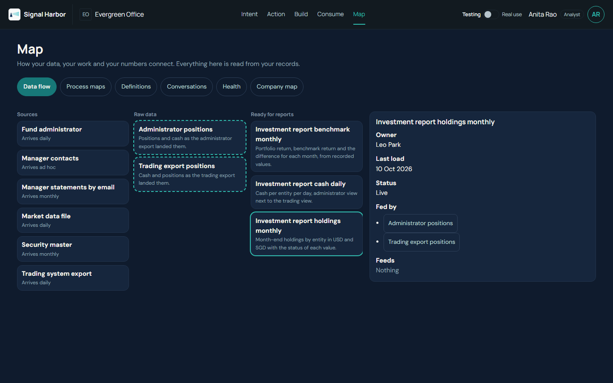

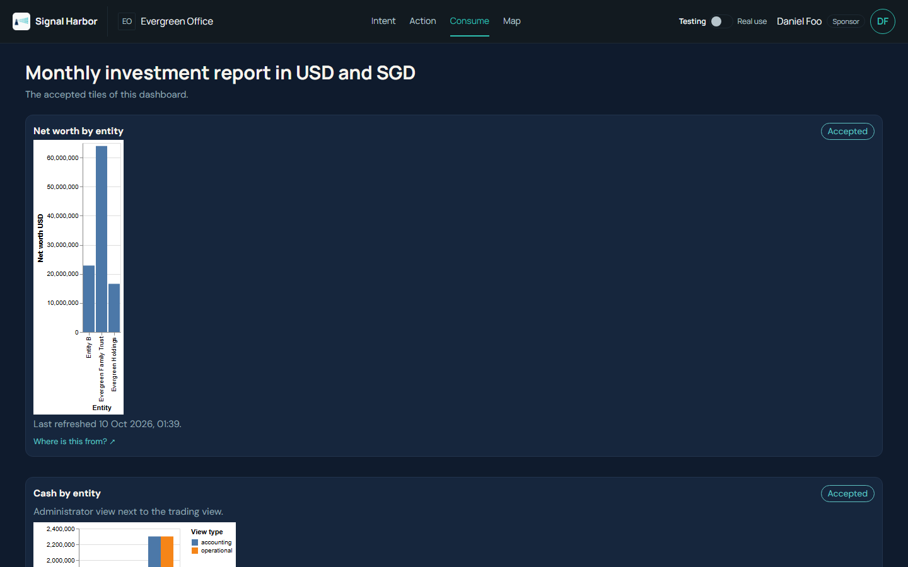

---

## 5. Talking to the agents

Everyone can talk to every agent. Enter sends; Shift+Enter adds a line. The agents read only what the signed-in person may see.

| Agent | Where to find it | Good questions (verified) | What it will not do |
|---|---|---|---|
| **North** | Intent: the box on the landing, or any open intent | Describe what you need in your own words. Reply "yes" to accept what it proposes. "Always keep answers short." | Decide anything; it drafts and you sign. |
| **Tally** | Action > Cases > a case (the "Ask Tally" box) | "Is this timing?" (cash case). "Is this breach real or stale data?" (limit case). "What is different between the two records?" (trade case). "What is missing and who should chase it?" | Change a figure ("Official figures change only through a recorded source and an approver"). Decide: "Tally does not decide." |
| **Span** | Build: "Talk to Span", or inside a project | "Which tables hold cash by entity?" "Drop the holdings table" (refused). | Change or drop tables or data. |
| **Lumen** | Build > project > Dashboard studio ("Talk to Lumen" under the grid) to propose tiles; Consume (landing and project page) to ask about published figures | In the studio: "Show net worth USD by entity per month as a line chart", "Make it dots", "Show the portfolio against the benchmark by month". | Say whether a manager is good or bad. Invent numbers. Work out a figure itself. |

**Follow-ups** keep the thread. In the studio's Lumen chat: "Make it dots", "monthly rather than daily", "by entity", "in blue". In Tally: "is this timing?" after the first answer.

**Memory.** Tell an agent something lasting and it says what it will remember. Examples that worked:
- North: "Always keep answers short." It answers "I will remember: you like short answers. You can change or remove this under Settings, What the agents remember about you."
- Lumen: "From now on show SGD first." Lumen's page then shows "Lumen remembers: From now on show SGD first. Change this". (When tested, the next proposed tile still said USD; see section 8.)
- See and edit all memory in the account menu, **What the agents remember about you**, where each item can be corrected or forgotten. It never keeps figures, emails or account numbers.

**What they refuse, in their own words** (all tried): "I cannot determine if a manager is 'good' as it is subjective" (Lumen); "I can't drop tables" (Span); "I cannot do that: Official figures change only through a recorded source and an approver, not on request" (Tally).

**Where agent answers are weaker today** (so you can steer around them in a live demo): Lumen on the Consume landing cannot answer figure questions (it offers definitions); Span's "Where does the holdings monthly table come from?" is answered as "that is not a figure"; Tally's "When is this due and is it confirmed?" answers only the due date. The reliable demo moves are the ones in the table.

**The product tells you what produced an answer.** Settings > **Agent runs and cost** (company administrator) lists every run by agent, with steps, tokens and time. "Worded from the recorded facts by fixed rules" at the foot of a Tally panel means the model was not used for that wording.

---

## 6. Questions clients ask

**Does our data leave the office?** Company data lives in the company's own folder on the machine running Signal Harbor, and one company cannot read another's. The only thing that leaves is a short question to the model service, sent through one controlled gateway: names are replaced with tokens first, rows are never sent, figures leave only as totals over groups, and an uploaded document never leaves in full (only a few relevant passages, as text). Every call is logged. Today the model service is outside the machine; the gateway is the only exit.

**Can it run in our own cloud?** The design keeps everything in one company data folder, so it can sit in your environment. A cloud push of data needs two named approvals and, in a pilot, carries synthetic data only. We would scope the hosting with you.

**Who can see what?** Each person sees only the centres and items their role allows; the demo shows it (Raj and Daniel have no Build tab). Documents can be open to the office or internal; the two investment-committee notes are internal to Mei Chen until she grants access.

**Who approves?** Agents propose; people sign. An intent is signed by the sponsor. A rule changes only when someone other than its proposer signs the new version. A case is closed by the owner and checked by another person.

**Can we trust a number?** Every figure has "Where is this from?": the source system, the file and its row, who read it, who checked it, where it is used. Numbers are worked out by the product, never by the agent.

**How do we get data in today?** By dropping files (spreadsheets, CSV, PDF statements and notices) in the inbox folder or uploading them on **Build > Data intake**. A file loads only if it adds up; statements are read and a person confirms them. Direct feeds are not built yet: see section 7. In conversation you can say what is planned, but do not promise dates: email inbox, secure file transfer (SFTP), cloud folders, bank statement files (camt.053 and MT940), custodian messages (SWIFT), market-data feeds and the accounting system are the connectors a family office will ask for, and none of them is in this build.

**What if the model service is unavailable?** The checks (cash, limits, trades), the cases and the manager statements table run without any model. Tally and Span fall back to a plain wording written by fixed rules ("Rules-only reply"; "Worded from the recorded facts by fixed rules"). Agents that draw or draft (Lumen, North) will say they cannot answer.

**What does it cost?** Testing mode uses a free test tier. Real use calls a paid model per question. Settings > Agent runs and cost shows runs, tokens and time per agent; the cost column reads "Not available yet" because no price list has been loaded. Commercial terms are not part of this build: do not quote a price.

**What if a figure is wrong?** Nobody edits a figure in place. A correction arrives as a new statement or file, is confirmed by a person, and the old value is kept and marked superseded. A manager estimate may be used in the investment report only; the report as issued stays as issued.

---

## 7. Known limits today (say them before the client finds them)

- **No direct connectors.** Files only (upload or inbox folder). No email inbox, SFTP, cloud folder, bank statement, custodian or market-data feed yet.
- **Agents are uneven.** Tally and the "Show what changed" button are the strongest; Lumen on the Consume landing and Span's lineage questions often cannot answer (see section 5). Model wording varies from run to run.
- **Tally takes 5 to 25 seconds** the first time a case is opened.
- **The demo plan is already approved.** The seed fills the Build rooms and approves Span's plan (Live, "Approved by Anita Rao", last run ok), so the "waiting for the head of data" step of the plan cannot be replayed on the demo project. Show approval on the dashboard studio instead (UC10 steps 4 and 5), or on a new project from Intent.
- **Date-driven demo.** Some screens use today's date; the demo is right from 9 to 14 October 2026.
- **Dashboard charts are plain** (small, no numbers on the bars); the readable figures are on the Office view.
- **Sofia (risk)** has Consume in the top bar; show her the limits in Action.
- **Costs and price are not available yet.**

---

## 8. Found while writing (for the orchestrator)

Product points found by walking the guide on the live server on port 8692. None blocks the demo; the guide steers around them.

1. **Lumen on the Consume landing cannot answer figures.** "What is the net worth of Entity B?" gets "I cannot answer that question, but I can tell you about the definition of terms or KPIs." "What changed at Kestrel Ridge Advisors since the last meeting?" and "Which holdings are revised or unverified?" are not answered. Same from Sofia's login ("What is Entity B's cash?" returns an unrelated note about a call "$not available yet USD").
2. **Lumen ignores "in SGD" and the "show SGD first" memory.** After "From now on show SGD first" (shown at the top of Lumen's page), the next proposed tile was still "Net worth USD" and "Now show cash by entity as bars in SGD" gave "Cash USD by entity".
3. **Span:** "Where does the holdings monthly table come from?" is answered "that is not a figure" with "I could not use a tool I asked for", although lineage tools exist. "What are the three layers?" returned a "Rules-only reply" with a list of 42 core tables in Testing mode.
4. **Tally follow-ups are thin on some cases.** On CASE-0001 "Why did the total change since the September report?" answers "I cannot tell that from the records of this case" (then repeats the facts). On CASE-0002 "When is this due and is it confirmed?" answers only the due date. On CASE-0004 "Is this over the allowance?" answers "Nothing needed for this check is missing." The panel text itself is good.
5. **Build rooms (resolved 10 Oct, PF1).** The seed now fills Design with Span, Scan, Mapping sheet, Pipeline room and Run log; the plan is Live and approved by Anita Rao, so its approval walk cannot be replayed (JUC4A-01).
6. **Mode switch is company-wide and the Settings text contradicts the behaviour.** The page says "Testing uses made-up answers only", but in Testing the agents give real model answers from the free tier. Also, one click on the top-bar switch flips the whole company (it changed every person's window), which is easy to do by accident.
7. **Dates on screen follow the browser's time zone.** The signature, last-refresh and "As of 10 Oct" stamps read 10 Oct on a Singapore laptop although the data is 9 Oct, and "Signed" shows the day the demo was made (not 3 Oct).
8. **Answer key wording (corrected 10 Oct):** Raj Patel sees all 9 cases (the approver is one of the policy roles); Sofia sees 8. The key lists matched trades by id only; on screen they are FXF-2026-001, Coastal Rail 5.1% 2031 bond, Bay Street Utilities and Meridian Foods. The key's role table does not say that Sofia has no Consume tab.
9. **Dashboard charts** render narrow with no value labels, and "Net worth by entity" is a one-month bar chart, not a 13-month line.
10. **Signed register** (Settings) says "0 measures aligned" and "Nothing has been signed yet" although the intent and its four measures are signed.
11. **The SOP downloads as .docx** (resolved: python-docx is installed in the serving environment).
12. **Standing note from the answer key:** after 14 October the Cedarpoint rows and the stale-data case change with the date, so the demo must be run in the 9 to 14 October window or the clock set accordingly.

---

## Appendix: figures to have in your head

| Fact | Figure |
|---|---|
| September report, as issued 3 Oct | USD 57,600,000 (SGD 77,253,120 at 1.3412) |
| Known now after the Fund A revision (7 Oct) | USD 57,780,000 (SGD 77,494,536), +180,000 |
| All holdings in the office | USD 103,405,000 (Holdings 16,580,000; Family Trust 63,950,000; Entity B 22,875,000) |
| Entity B cash, 8 Oct | administrator 880,400, trading desk 868,000, difference 12,400, allowance 5,000 |
| Capital calls in 30 days (Entity B) | 450,000 (20 Oct, confirmed) + 600,000 (30 Oct, not confirmed) = 1,050,000; after both -169,600; after the confirmed one 430,400 |
| Limit breaches | Harborview 5.75% against 5% (real, over by 308,000); Cedarpoint Ventures 56.50% against 55% (stale data, over by 343,750) |
| Trade differences | Northwind 75,870; Harborview sale 592,000 missing at the administrator; FX forward SGD 8,100 (USD 6,050.19) |
| September benchmark | portfolio 4.1667%, benchmark 2.7072%, +1.4595 points, certified (version 1) |
| Missing statement | Cedarpoint Opportunities II, 30 Jun 2026, due 14 Jul, 63 business days overdue |
| Kestrel | Macro 31 Jul revised 7,050,000 to 7,012,500 on 20 Aug; Long/Short August statement 6 business days late; portfolio manager change on 1 Oct |

Evergreen Office is synthetic: three entities (Evergreen Holdings, Evergreen Family Trust, Entity B), four portfolios (Growth, Liquid, Entity B operating, Funds), six managers, nine funds, a liquid book of 20 securities, thirteen months of history.
