# Signal Harbor User Guide

How the office works with Signal Harbor, as it is today (13 October 2026).

Evergreen Office is a synthetic family office. All people, figures and files in this guide are invented for the demo.

## 1. What Signal Harbor does

Signal Harbor turns the office's own files and figures into reports people can trust.

- You say what you need, in your own words.
- Agents draft the plan, the data design and the first dashboard.
- People check and sign at the points that matter.
- Figures are read from the sources you already receive, such as exports, statements and reports.
- Every figure can be traced back to its source.

The work runs in four centres:

| Centre | What it is for |
|---|---|
| **Action** | What needs you today |
| **Build** | Turning a need into a live, approved report |
| **Consume** | Reading the results: today, health, markets, reports, what if |
| **Map** | How the office's people, projects, data and numbers fit together |

Four agents help. They draft and check. They do not sign.

| Agent | What it does |
|---|---|
| **North** | Listens to you and drafts the intent of work and the process map |
| **Span** | Plays two roles. The architect designs the data. The builder connects, runs and checks it |
| **Lumen** | Proposes a starter dashboard and drafts the delivery previews |
| **Tally** | Helps with cases and Action items, and answers questions about them |

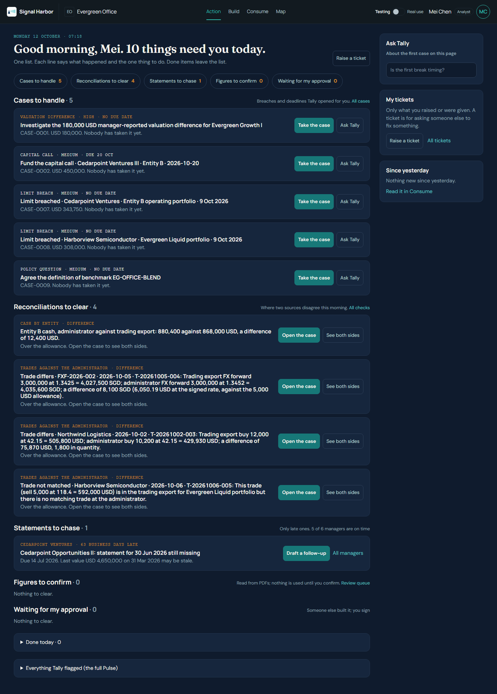

## 2. Signing in and roles

### Signing in

- Your company administrator sends you the link, your email address and your password.
- There is no sign-up page. The administrator creates every account.
- Emails follow the pattern name.evergreen@example.test in the demo.
- Use the link on any modern browser. The page works on a phone too.

### Who does what

Agents draft. People sign.

| Role | In the demo | What you do | What you sign or approve |
|---|---|---|---|
| **Business owner** | Mei Chen, Operations | Describes the need to North, hands the build to the data engineer, asks Lumen for the dashboard, reads Consume and Map, acts on her Action items | Sends work for approval. Does not approve her own dashboard. Is not part of the data team |
| **Sponsor** | Daniel Foo, Chief Investment Officer | Decides what the office needs | Signs the intent of work. Approves the dashboard and each delivery channel |
| **Approver** | Raj Patel, Finance | Clears cases and confirms figures in Action | Approves what is sent to him, never his own work |
| **Head of data** | Anita Rao | Owns the data design | Approves the design pack, the build plan drawn from it, verified Map items and changes to the data model |
| **Data engineer and operations** | Leo Park | Confirms the sources, uploads samples, answers the few questions, corrects definitions, takes the pipeline live, watches Operations, connects APIs | Confirms the sources and the design questions. Goes live |
| **Company admin** | Grace Ong | Looks after access and settings | Gives people access to Build and other centres |
| **Participant** | Sofia Reyes, Risk | Reads the results and the Map | Nothing to sign |

Some rules hold for everyone:

- The person who makes a thing cannot approve it.
- Approval locks the item. Changes after approval go into a new version, and the old version stays on record.
- Only the data team sees Operations and the full data view on the Map.
- Every role opens on Action and can read Consume. The figures are filtered by each person's access.

### What each person sees

The top bar shows Action, Build, Consume and Map. What sits inside follows the role.

| Person | In the centres | Settings items |
|---|---|---|
| **Sponsor** (Daniel) | Action, Build (his own intent and steps), Consume, Map (read only) | 3: what the agents remember about you, Testing or Real use, Activity trail (own activity) |
| **Business owner** (Mei) | Action, Build (her projects, North), Consume, Map (read only). No Operations, no reconciliations | The same 3 |
| **Approver** (Raj) | Action, Consume, Map | 4: the 3 above plus Rules (read only) |
| **Head of data** (Anita) | Everything the data team sees, plus the approvals: design pack, build plan, verified Map items, model changes | 7: Activity trail (all), Rules, Identifiers and other names, Instruments and asset classes, Sources and data model (decides), and the 2 above |
| **Data engineer** (Leo) | Operations, Pipelines, Connect an API, and the build steps | 8: Activity trail (all), Identifiers and other names, Instruments and asset classes, Sources and data model (view and propose), Connectors, Jobs and events, and the 2 above |
| **Administrator** (Grace) | All centres | 16: every item above, plus Delivery channels, People and access, Intent admin, Templates and skills, Outside assistants, Agent runs and cost |

The **Activity trail** lists signed intents, measures, rules and plans, and the newest runs. The data team and the administrator see every row. Everyone else sees only their own.

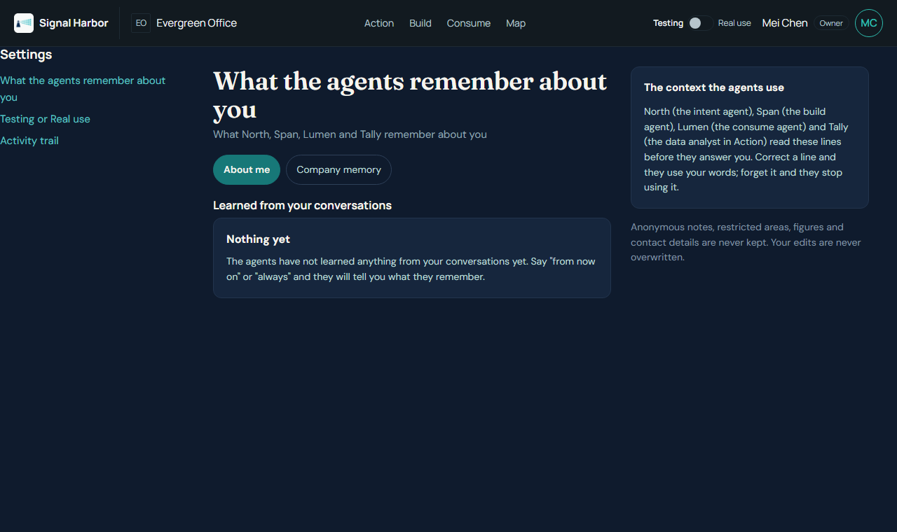

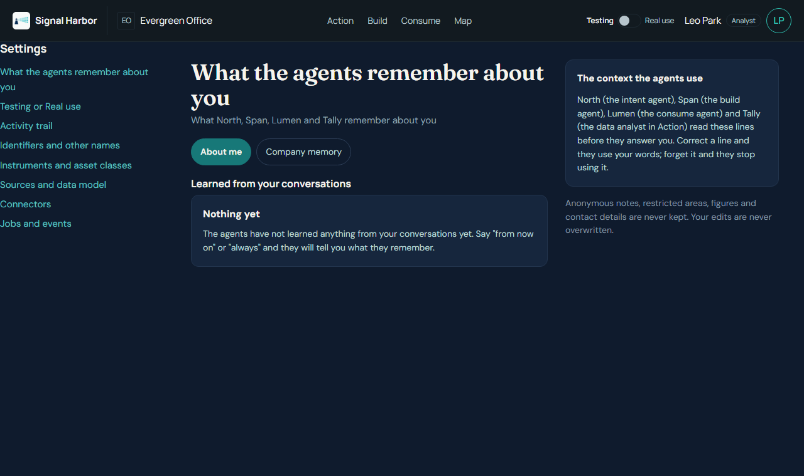

## 3. The four centres

### Action: one page of things to do

Open Action to see what needs you. The greeting shows how many items are waiting.

Action has these groups. A group with nothing in it says "Nothing to clear."

| Group | What it holds | What you can do |
|---|---|---|
| **Cases** | Open issues | Take the case, or open it |
| **Reconciliations** | Checks that do not match | Close as timing (only when the cause is timing and you are allowed), or open the case |
| **Statements to chase** | Late fund statements | Draft a follow-up. You copy it and send it yourself |
| **Figures to confirm** | Figures read from files | Confirm, or correct in the review queue |
| **Waiting for my approval** | Designs, plans, dashboards, deliveries, Map items and model changes | Review and approve |
| **Assigned to me**, **Waiting on others** | Your own items, and items you are waiting on | Open or mark done |
| **Done today** | What you and the team closed today | Read only |

The side panel has Ask Tally, My tickets and Since yesterday. Action shows only the groups your role can use, so a business owner does not see reconciliations.

### Build: from a need to a live report

Build has a four-step landing page. Each step has a named agent beside it.

**Step 1. Intent (North).** You describe the need. North asks one question at a time and drafts the intent of work and the process map as you talk. When every section is filled, the sponsor reads it and signs. A signed intent is read only.

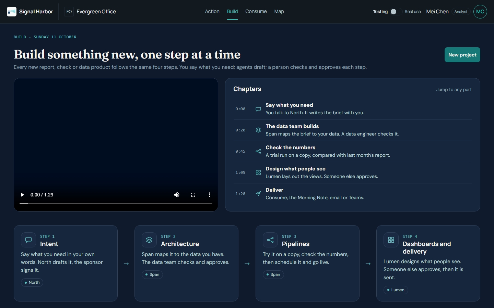

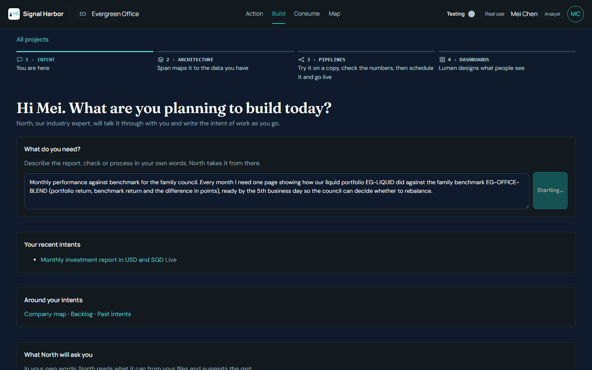

**Step 2. Architecture (Span, the architect).** Span reads the signed intent and never asks again for what you already said. It shows each source as the intent recorded it. You confirm it.

- Span asks only what the intent and its scan cannot answer. Each question has a proposed answer you can accept.
- Questions cover how each source arrives, the level of each figure, which history to keep, which checks must hold, the definitions, when the data must be ready and who can see it.
- You upload one sample of each new source. For a PDF you mark the fields to read, once.
- Span drafts one design pack. It is versioned. It holds the target model, the data catalogue, the mapping sheet, the rules and the sources.
- You settle any open rows and send the pack to the head of data.

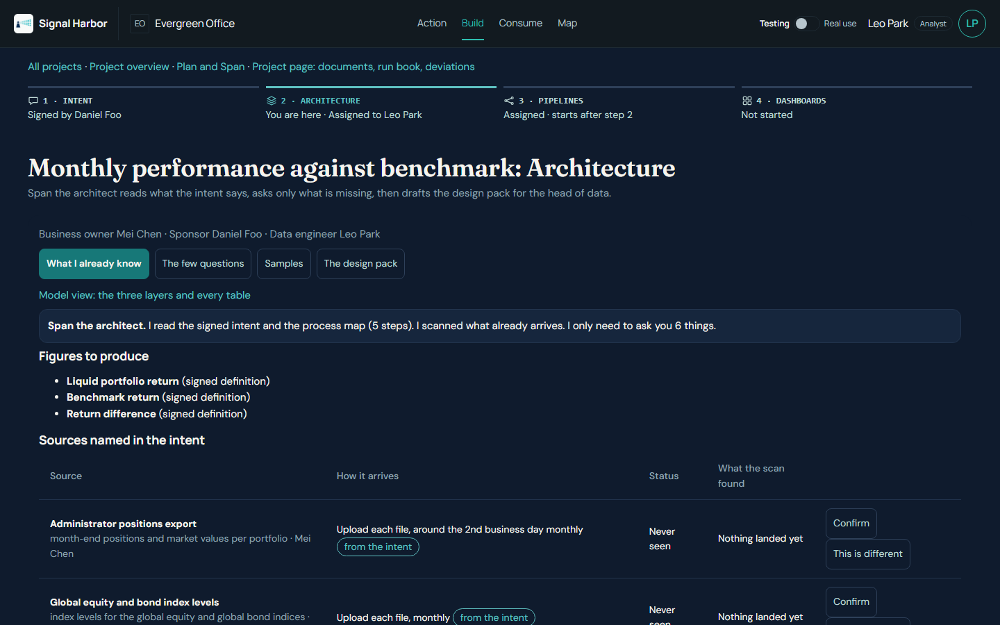

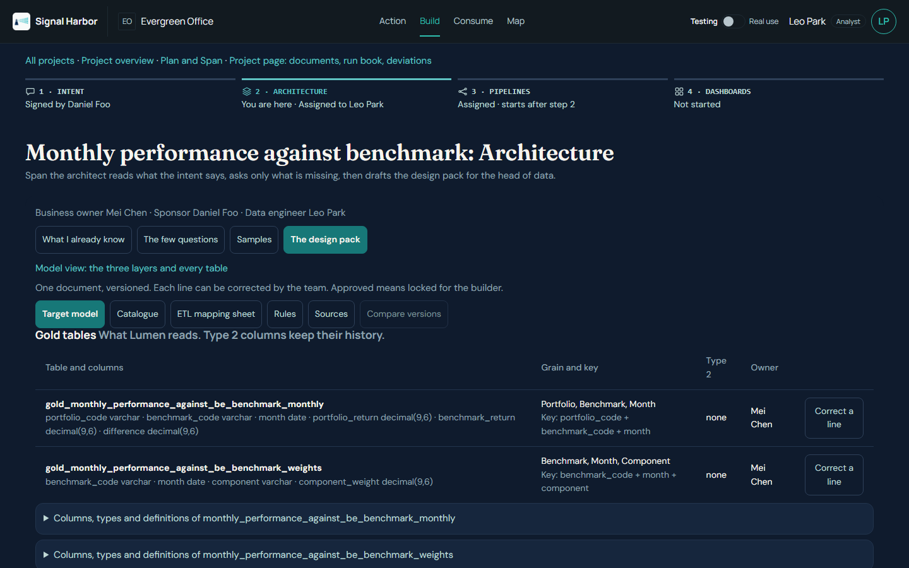

**Step 3. Pipelines (Span, the builder).** Span builds from the approved pack and runs on a copy. You do not need to click to start it.

- Span connects each source exactly as the pack says.
- It asks for last month's report to check against. You upload it.
- It compares each figure it can find in the report with its run, line by line. Each line shows a variance.
- If something does not match, Span sends the case back to the architect with the evidence. The architect issues a new version, and the builder runs again.
- When the check is clean, you press **Go live**. The schedule comes from the pack.

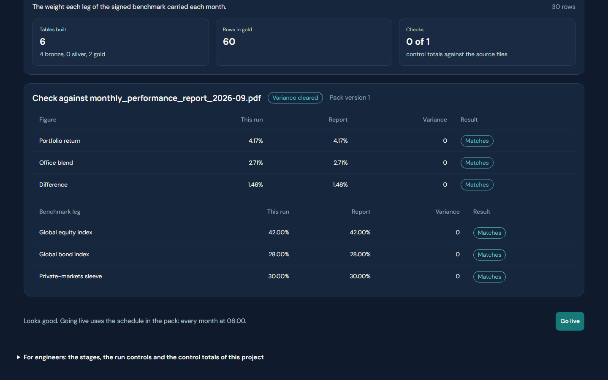

**Step 4. Dashboards (Lumen).** When the pipeline goes live, Lumen proposes a starter dashboard from the signed intent. It has the key figures, their trend against the benchmark, the breakdowns the intent names and the checks status.

- Accept the starter as it is, or ask Lumen for one specific addition.
- Send it for approval. Someone else approves it.
- A draft you no longer need can be deleted (only before it has ever been published). Older drafts can be archived and shown again with **Show archived drafts**.
- Then choose the channels: Consume, and an email digest on a schedule. Each channel is approved separately before delivery goes live.

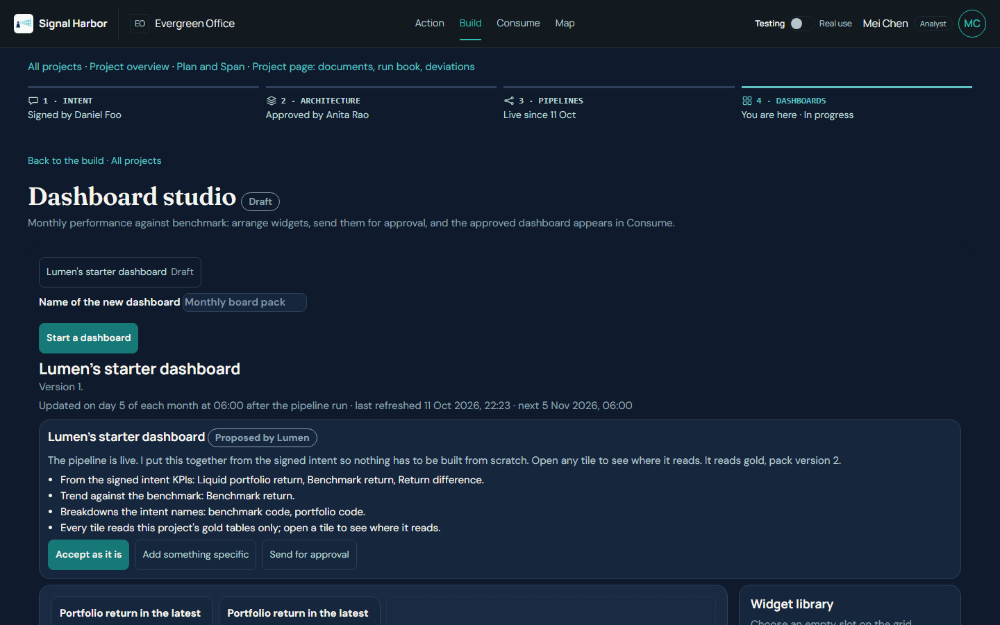

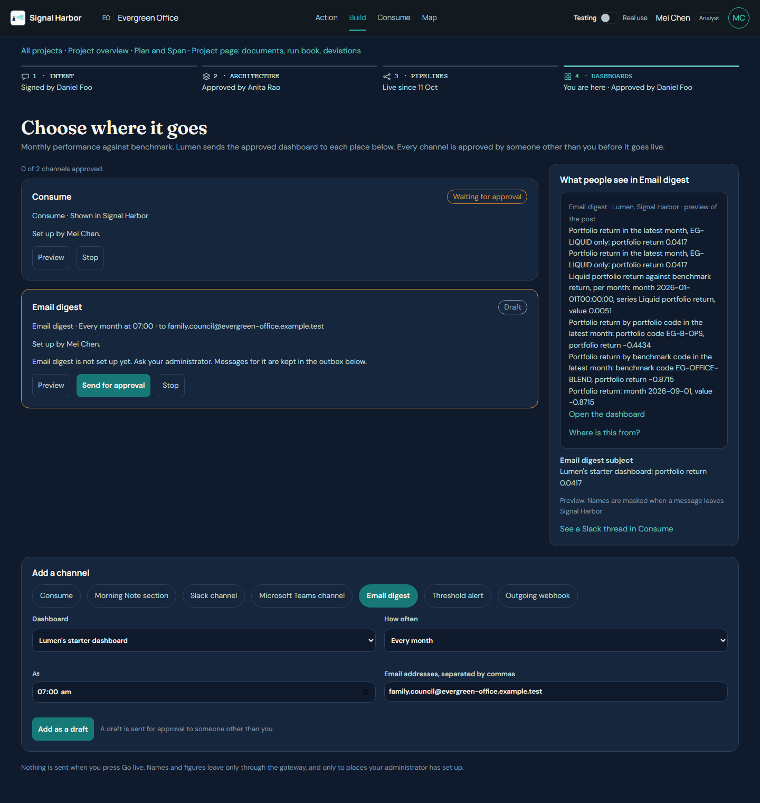

**Operations (data team only).** Operations asks: is everything arriving and running? It is under Build as a second tab, next to Projects. It has four tiles and four sections.

| Section | What it shows |
|---|---|
| **Sources** | Each source, who owns it, when it last arrived and whether it is late, with files turned away, old values and open breaks |
| **Live pipelines** | Each pipeline that has gone live, and whether its last run was healthy |
| **Runs** | Every run, with its run ID, a TEST or PRODUCTION badge, who started it, what triggered it and its steps. Click a run to see each step |
| **Deliveries** | The email and Slack previews and what is waiting to go out |

Anything wrong in Operations also lands in Action for the person who owns it.

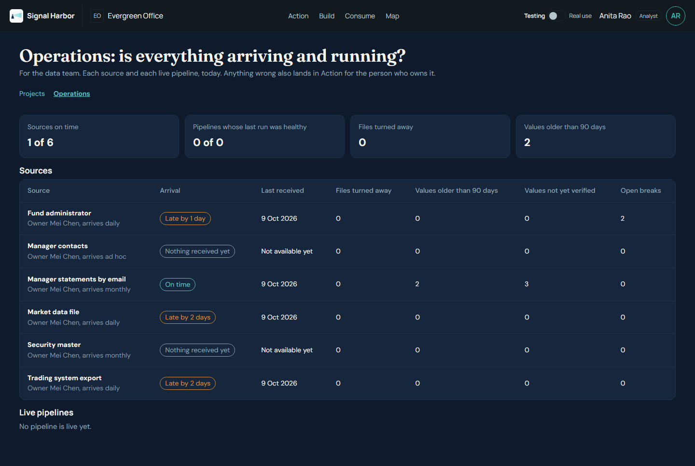

**Connect an API (Build).** Use this to add a public data service, such as exchange rates, government bond yields, market index levels or market news. It is also linked from Settings, then Connectors.

- Choose the service and the series you want.

| Service | What it gives | Key |
|---|---|---|
| **Frankfurter** (ECB reference rates) | USD/SGD, EUR/USD, EUR/SGD, GBP/USD | None |
| **FRED** (US Federal Reserve data) | US 10-year and 2-year Treasury yields, SGD per USD, Singapore CPI inflation | Free key stored by the administrator |
| **Finnhub** | Quotes for ACWI, AGG and EWS, and market news | Free key stored by the administrator |
| **MAS** (Monetary Authority of Singapore) | Singapore Government Securities auction yields, 2 to 30 years | None |

- SGS yields are the yield at the last auction of each term, not a daily curve. EWS stands in for the Straits Times Index, which is licensed. The daily Singapore overnight rate (SORA) is not connected yet.
- Run the test. You see real rows and the time it took.
- Save. The connection then appears under Connectors, where you can fetch it now. A daily pull runs by itself at 05:30.
- The office internet switch must be on (Settings, then Egress).
- Each service has a fixed address. Only those addresses can be reached. Where a service needs a key, the administrator stores it. You never see the key.

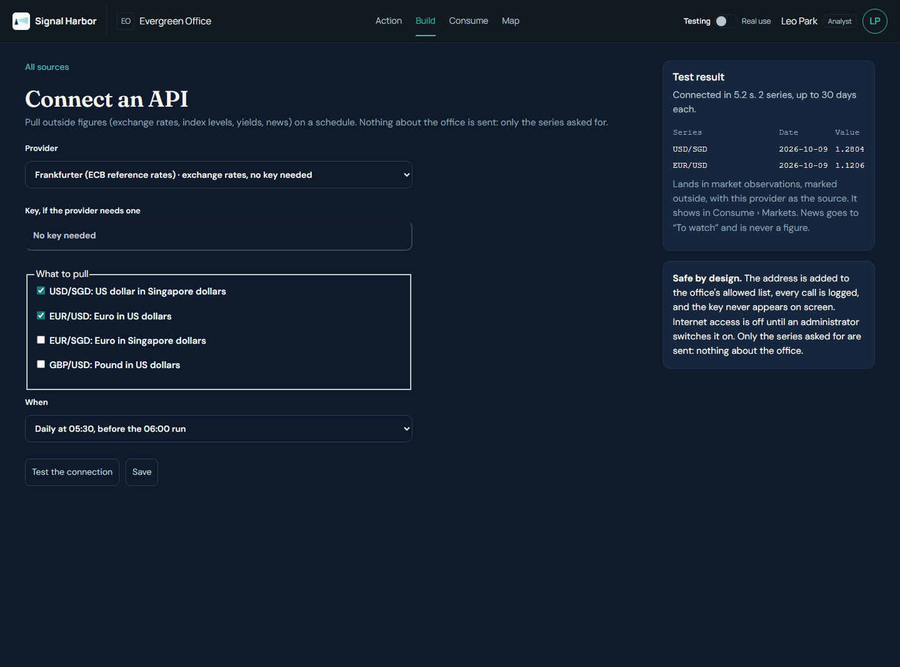

### Consume: read the results

Consume has five tabs. A currency switch sits at the top right and stays put as you move between pages. Switch between USD and SGD there.

| Tab | What it shows |
|---|---|
| **Today** | The Morning Note: one sentence, four key numbers (net asset value today, yesterday's profit and loss, this month's profit and loss, against the benchmark), what moved and the markets in one line. Comments and Ask Lumen sit at the foot. |
| **Financial health** | Daily profit and loss and net asset value, and fund performance in one table. Switch between By portfolio, By entity and By fund. Each line shows how much you can trust the value. |
| **Markets** | The market table, the office's own figures against it, and what to watch. Every outside line shows its source, its date and a tag: FILE or LIVE API. |
| **Reports** | The report library, shared with you and published dashboards. |
| **What if** | Attribution: what would have changed the result. |

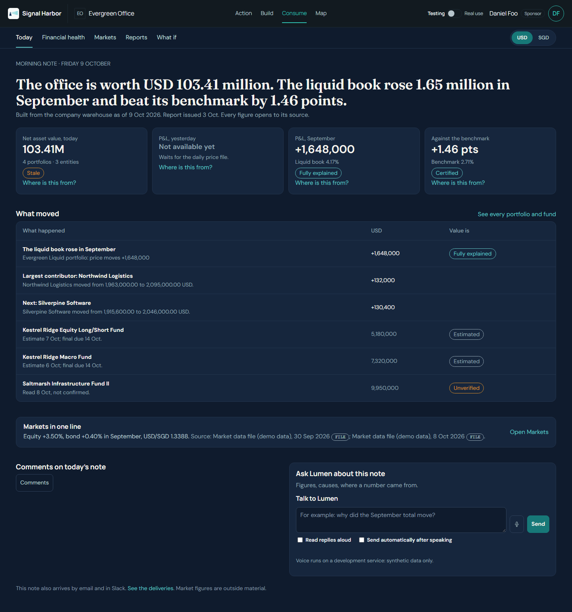

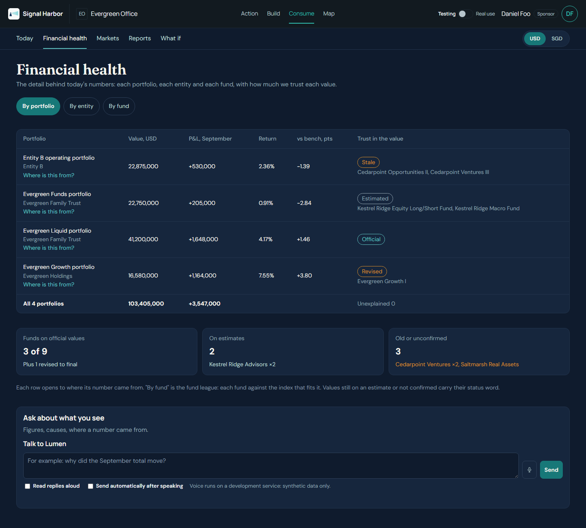

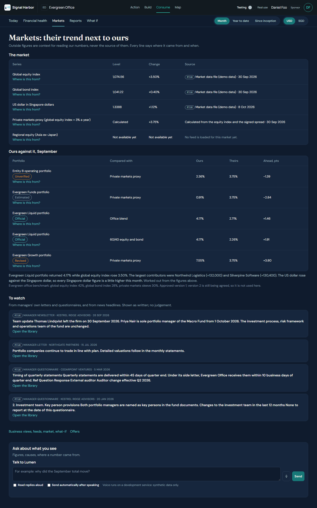

### Map: how it all fits together

Map is one page with four views, chosen with the switch at the top.

| View | What it shows |
|---|---|
| **Ontology** (the default) | The whole company as one graph: people, projects, sources, tables, dashboards and reports, cases and decisions. Click any node for its owner, its state and what it connects to. Zoom with the plus and minus buttons, or hold ctrl and use the wheel (or pinch) to zoom at the pointer. **Fit** resets the view. Drag to move around. |
| **Process map** | The steps of each project, one project at a time. |
| **Data model** | The data tables in three layers: bronze (as received), silver (cleaned and joined) and gold (what reports read). Each table shows its row count. |
| **Business glossary** | The signed definitions of each figure. |

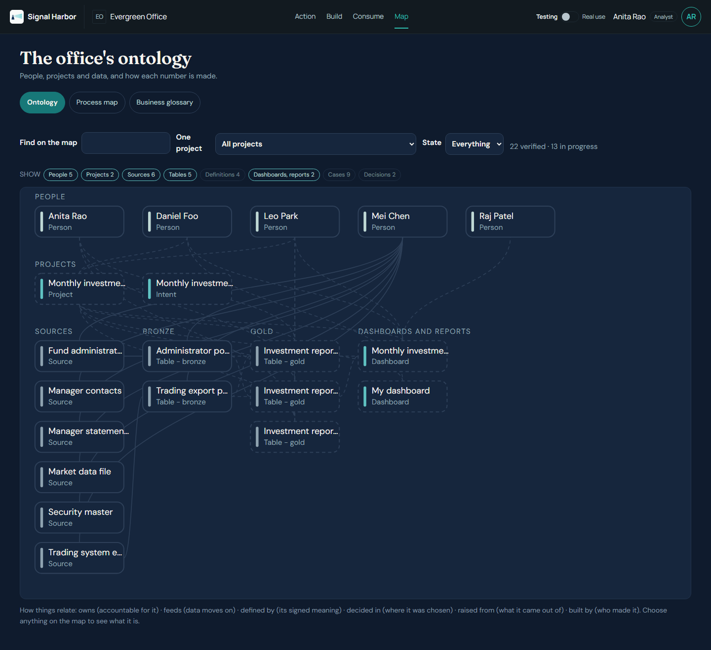

**Data model with impact.** Pick any table to see its columns and what each means, how many rows it holds, who owns it and what it reads. The page also shows **If this table changes**: the gold tables, dashboards, reports and projects that depend on it. Switch between **Loaded** (tables that hold rows today) and **Whole model** (every table, the empty ones dimmed). Tables added for this office after approval sit in their own group, **Added for this office**, with a dashed outline. The data team sees every layer. Other people see only the gold tables of the projects they may see.

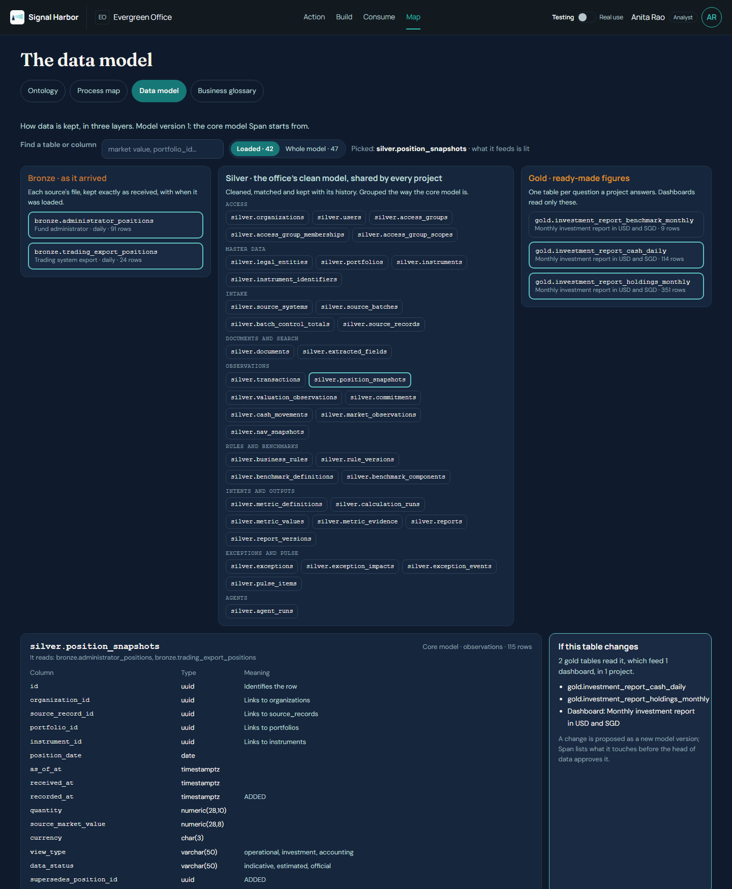

### Governance: run IDs and lineage

Every run, whether a test or a live one, gets a run ID such as `run-20261012-131500-ab12`. The data team sees them under Operations, Runs.

- A **TEST** run is on a copy. A **PRODUCTION** run is live.
- Runs cover pipeline runs, file loads, connector pulls and reconciliations.
- Each run records who started it, what triggered it (by hand, on schedule, when a file arrived, or by a connector) and its steps.
- Each gold table a run builds carries that run's ID.

Together with the source records, this gives the trail for any gold figure: the source file, its batch, each record, the bronze table, and the run that built the gold table.

## 4. A worked example: the monthly performance report

This is the walkthrough from the demo, run end to end in testing mode.

**The need.** Each month the family council wants one page. It shows how the liquid portfolio (EG-LIQUID) did against the family benchmark (EG-OFFICE-BLEND). It shows the portfolio return, the benchmark return and the difference in percentage points. It must be ready by the 5th business day, so the council can decide whether to rebalance.

**Today.** Mei builds it by hand in Excel over two days.

**With Signal Harbor.** The steps below took about 45 minutes from first words to delivery. About 10 minutes of that was the talk with North. The rest was handing work between people.

| # | Step | Who | Result |
|---|---|---|---|
| 1 | Open Build | Mei Chen | Four-step landing page |
| 2 | Start a new project | Mei Chen | Intent step opens with North |
| 3 | Describe the need | Mei Chen, with North | Intent and process map drafted, with the definitions for each figure |
| 4 | Sign the intent | Daniel Foo | Intent signed and read only |
| 5 | Hand over to the data engineer | Mei Chen, then Leo Park | Leo sees the work in his Action list |
| 6 | Confirm the systems | Leo Park, with Span | Four sources confirmed, not re-entered |
| 7 | Answer the few questions | Leo Park, with Span | Four questions answered with defaults |
| 8 | Upload samples | Leo Park, with Span | Spreadsheet and index file uploaded. PDF fields marked |
| 9 | Draft the design pack | Leo Park, with Span | Pack version 1 with two open rows, settled and sent |
| 10 | Approve the design pack and plan | Anita Rao, Leo Park | Locked for the builder |
| 11 | Connect and run on a copy | Span (automatic) | Four sources connected. Run on a copy |
| 12 | Check against last month's report | Leo Park, with Span | Every compared line matched |
| 13 | Correct the definitions | Leo Park | Pack version 2, a new version |
| 14 | Approve version 2 | Anita Rao, Leo Park | Span reruns and rechecks by itself |
| 15 | Go live | Leo Park | Runs every month at 06:00 on the pack schedule |
| 16 | Starter dashboard | Mei Chen, with Lumen | Six tiles proposed from the intent |
| 17 | Ask for one tile | Mei Chen, with Lumen | Specific tile requested from Lumen |
| 18 | Approve the dashboard | Daniel Foo | Approved |
| 19 | Set up delivery | Mei Chen, Daniel Foo | Consume and a monthly council email, both approved |
| 20 | Project complete | Mei Chen | Record of who signed, approved and delivered what |
| 21 | See the result | Daniel Foo, Anita Rao | Consume and Map show the result |

**What the check showed.** September's report was 4.17% for the portfolio, 2.71% for the benchmark and 1.46 points of difference. The builder's run gave 4.1667%, 2.7072% and 1.4595 points. Every line matched.

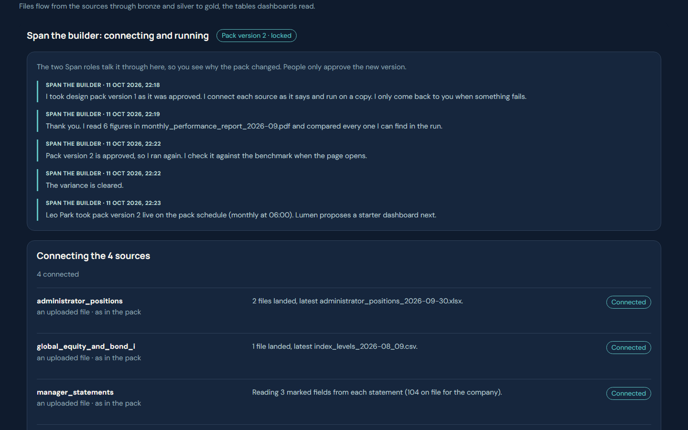

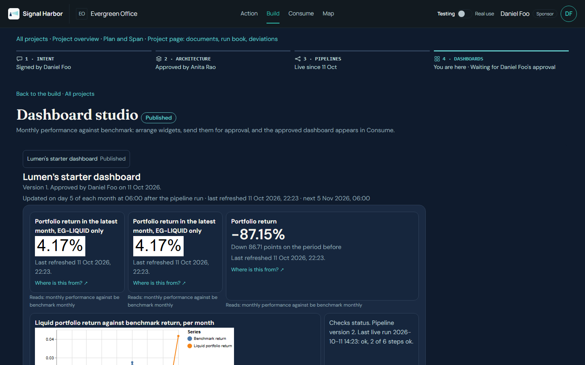

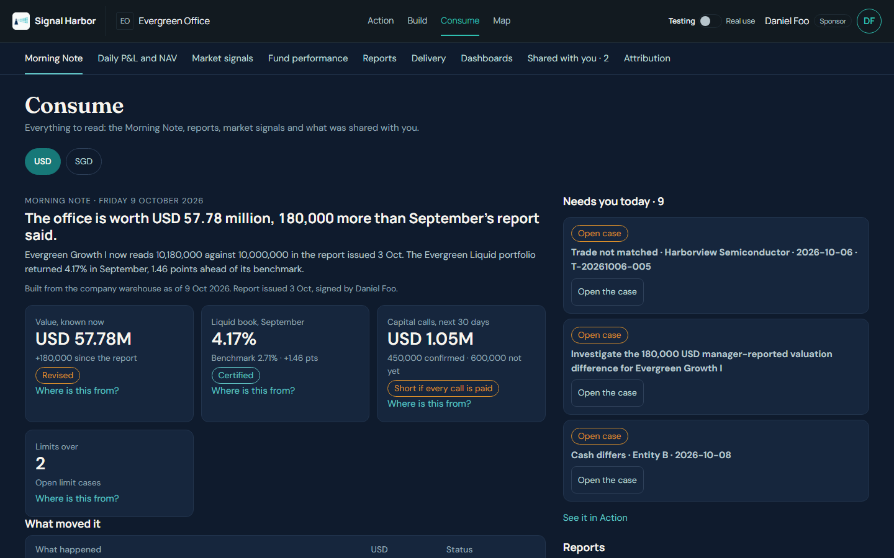

## 5. Everyday tasks

Each task names the place to go and the steps.

**Close a break.**
1. Open Action. Go to Reconciliations.
2. If the cause is timing and you are allowed, choose Close as timing.
3. Otherwise, choose Open the case. Take the case, resolve it, then close it.

**Confirm a figure.**
1. Open Action. Go to Figures to confirm.
2. Choose Confirm if the figure is right.
3. Choose Correct if it is not. This opens the review queue, where you enter the right value.

**Chase a statement.**
1. Open Action. Go to Statements to chase.
2. Choose Draft a follow-up. The draft appears on the page.
3. Copy it and send it from your own mail. Signal Harbor never sends it for you.

**Approve a design pack** (head of data).
1. Open Action. Go to Waiting for my approval.
2. Open the design pack and read the target model, catalogue, mapping sheet, rules and sources.
3. Choose Approve. The builder then takes the plan.

**Build and approve a dashboard.**
1. Open Build, then Dashboard studio. Lumen's starter is there when the pipeline is live.
2. Choose Accept as it is, or Add something specific and describe it to Lumen.
3. Choose Send for approval. Someone other than you approves it.

**Switch between USD and SGD.** Open Consume. Use the currency switch at the top right. It stays on that setting as you move between pages.

**Connect an API.** Open Build, then Connect an API. Choose the service and series, run the test, then save. Make sure the office internet switch is on in Settings, then Egress.

## 6. Trust and safety

- **Synthetic demo data.** Everything in this demo is invented. The public demo link is for demonstrations only. Do not load real client or family-office data into it.
- **The office's own space.** Each company's files and figures are kept in that company's own warehouse. They are not pooled with other companies.
- **Every run has an ID.** A TEST or PRODUCTION run ID is recorded for each pipeline run, file load, connector pull and reconciliation, and each gold table carries the ID of the run that built it.
- **Every number traces to a source.** Lumen's tiles name their source. Each market line shows its source, its date and whether it came from a file or a live feed. Map shows what feeds what.
- **Agents draft, people sign.** No agent approves, signs or sends anything on its own. Approval is by a named person, and the maker never approves their own work.
- **Changes are versioned.** Approved items are locked. A change is a new version, and the old one stays on record.
- **Access follows the role.** The data team sees every layer. Others see only the gold tables and dashboards they may open.
- **Testing and Real use.** The office runs in one of two modes. Testing uses low-cost test models and test data. Real use is the live mode. It is off unless the office turns it on.

## 7. Glossary

| Term | Plain meaning |
|---|---|
| **Action** | The page of things that need you today |
| **Benchmark** | The reference return a portfolio is measured against |
| **Bronze, silver, gold** | Three data layers: as received, cleaned and joined, and ready for reports |
| **Break** | A check that does not match, shown under Reconciliations |
| **Business glossary** | The signed definitions of each figure |
| **Case** | An open issue that someone needs to resolve |
| **Connector** | A link that brings data in from a file, a mailbox or a service |
| **Consume** | The reading centre: Today, Financial health, Markets, Reports and What if |
| **Design pack** | The versioned data design: target model, catalogue, mapping sheet, rules and sources |
| **Figure** | A number the report shows, such as a return or a value |
| **Go live** | Start the pipeline on its schedule |
| **Grain** | The level of a figure, such as per portfolio, per entity or per month |
| **Intent of work** | The signed statement of what the office needs, who reads it and how often |
| **Lineage** | The trail from a gold figure back to its run, its bronze table, its records, its batch and its source file |
| **Map** | The view of people, projects, data and numbers, and how they connect |
| **Morning Note** | The one-page summary at the top of Today |
| **Ontology** | The whole-company graph on the Map |
| **Operations** | The data team's page for arrivals, pipelines, runs and deliveries |
| **Percentage points** | The difference between two percentages, such as 4.17% and 2.71% gives 1.46 points |
| **Pipeline** | The automatic steps that bring data in, check it and build the tables |
| **Process map** | The steps of a project, as it runs today |
| **Run ID** | The identifier of one run, such as run-20261012-131500-ab12, shown in Operations |
| **Sample** | One example file shown to Span so it can read a new source |
| **Starter dashboard** | The first dashboard Lumen proposes from the signed intent |
| **Variance** | The gap between a run and a benchmark, line by line |
