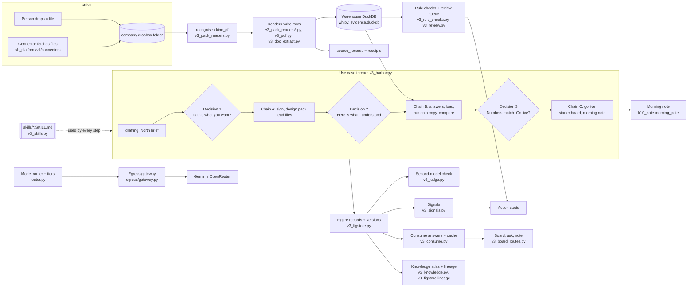

# How Harbor works: the machinery under one assistant

Audience: Nitin, to present. Plain English first; every claim points at the file and function that does it. Synthetic data only. Screenshots are in `docs/v3/top10/arch-shots/` (list at the end).

Harbor looks like one assistant. Underneath, it is one runner that works a thread through stages, calls small focused skills, reads files into a company warehouse, checks its own figures with a second model, and then turns the results into signals, answers, a board and a morning note.

## 1. The short version (10 lines)

1. A person drops a file, or a connector fetches one, into the office dropbox.
2. A reader recognises the file (`kind_of`, `recognise`) and loads its rows into the company warehouse (DuckDB), with a source record for each file (the receipt).
3. A use case is a thread that moves through stages: drafting, decision 1 (the brief), working (A), decision 2 (what Harbor understood), working (B), decision 3 (numbers match, go live?), live.
4. Each stage runs skills (`skills/<id>/SKILL.md`), and each skill call is logged. Models are called only through a tier router and the egress gateway.
5. The design pack (Span's gold tables) is built from the signed brief and from recipes first; a plan guard makes sure a plan exists before a run.
6. Each figure becomes a versioned figure record with its receipts and a tie-out; a second model from another family checks small judgement calls.
7. Live runs feed signals (rules over figures), rule checks on documents, a review queue for low-confidence fields, and Action cards for one named person.
8. Consume answers questions from verified figures, caches the answer per data version, and reuses it.
9. Knowledge shows the company's own map: people, entities, files, figures, use cases, decisions, with lineage from files to tables to figures.
10. The morning note and the board are the "dashboard" a person sees once a use case is live.

## 2. Data-flow diagram

## 3. The steps, one section each

### Step 1: File arrival and recognition

- **What it does.** Files land in the company's `dropbox` folder (`plane.path("dropbox", name)`, used in `sh_platform/v1/v3_harbor.py` and `v3_connections.py`). A file is recognised by its content and name. `recognise(plane, name)` in `sh_platform/v1/v3_pack_readers.py` remembers the answer while the file stays the same size and time; it calls `kind_of(name, data)` (same file, around line 1606) which returns a kind such as `deal_pipeline`, `market_data`, `fund_holdings`, `target_allocation`, `fund_documents`.
- **Thread-level recognition.** `recognise(plane, name, threads)` in `sh_platform/v1/v3_harbor.py` matches a file name against the sources of open threads by shared words. Ties are decided by a second model: `v3_judge.judged(...)` (see step 4). Unclear files become a question, never a guess.
- **Connectors.** `sh_platform/v1/connectors/base.py` defines the contract: a connector only fetches and hands back `Fetched(name, data, source)`; the file then goes into the dropbox like any file a person drops, so readers, receipts and rule checks apply. `files.py` covers an SFTP folder, an IMAP inbox and bank-file formats (MT940, camt.053, MT535/536, BAI2). `banksg.py`, `gocardless.py`, `plaid.py`, `saxo.py` turn API JSON into standard files. Network calls go through the egress gateway, off by default per company.
- **Intake marking.** `intake(x)` in `sh_platform/v1/v3_pack_readers.py` (around line 1874) marks each thread file a reader knows, so the generic paths do not read it twice.
- **What a person sees.** A "Files" view (`/v3/files`) and Decision 2 lines saying where each file goes.

### Step 2: Readers and the company warehouse

- **Readers.** `read_files(plane, items, standing, thread_id)` in `v3_pack_readers.py` (around line 1716) reads recognised files in one transaction per batch; a batch that fails is retried kind by kind, so one bad file does not hold the rest. A file already read (same hash) is not read twice (`_loaded_hashes`). Per-family readers live in `v3_pack_readers_family.py`, `_invest.py`, `_treasury.py`, `_controls.py`, `_feeds.py`, `_assets.py`.
- **Receipts.** The writer adds rows with a source record for each file: `source_records` gets the batch, record type, content hash and received date (around lines 275 and 721, `raw_payload_uri`, `content_hash`). Rows in other tables point back to that record with `source_record_id`. That is the receipt.
- **PDFs and documents.** `v3_pdf.py`: a PDF is registered as a document, read to text on this machine (OCR when it is a picture), and read by layout; a new layout costs one Decision 2 question, then is remembered per office. `v3_doc_extract.py` reads private-fund documents (capital call, distribution, NAV) by text layer, then layout fingerprint, then a model only when needed; only text leaves the machine, through the gateway. `v3_docs.py` takes emails, notes and Word files as documents, never as tables.
- **Warehouse.** `sh_platform/v1/wh.py`: one DuckDB file per company at `data/<company>/warehouse/evidence.duckdb` (`path`, line 45). `connect(plane)` (line 157) is the only way in. The schema is the 2.0 evidence-to-action model in `docs/v2/evidence-to-action-mvp.duckdb.sql` (61 `CREATE TABLE` statements), migrated by `e0a_catalogue.apply` when present.
- **Core tables.** The family-office pack's `packs/family_office/1/model.yaml` declares 12 model objects mapped to these warehouse tables: `legal_entities`, `portfolios`, `instruments`, `position_snapshots`, `valuation_observations`, `commitments`, `cash_movements`, `transactions`, `nav_snapshots`, `market_observations`, `documents`, `entity_ownership`. The loader's flush order (`FLUSH_ORDER`, `v3_pack_readers.py` around line 76) names about 33 tables, including `source_records`, `source_batches`, `documents`, `extracted_fields`, `bank_accounts`, `exceptions`, `deal_pipeline`.
- **What a person sees.** Trust > Industry model (`/v3/trust/model`, screenshot 01) shows the model in the office's own words; Trust > Workbench (`/v3/trust/workbench`, screenshot 03) shows the technical detail of a thread.

### Step 3: How a use case is built (the thread runner)

- **The thread.** `v3_harbor.py` holds a thread record with a `stage`: `drafting`, `decision1`, `working`, `question`, `decision2`, `decision3`, `live`, `discarded`. `summary(th)` (line 117) counts the stages that need a person.
- **Drafting and decision 1 (North).** `_north(x, text, first)` in `v3_harbor.py` calls the intent module's chat (`/api/v1/intents/chat`) with the `intent.restate-ask`, `intent.find-gaps` and `intent.fill-with-practice` skills. Open parts are filled with the usual practice and marked as suggested. Figures are bound to recipes by meaning (`v3_recipes.bind_brief`, line 341). `decide(... n=1, "confirm")` (line 1039) records the signed brief and starts chain A.
- **Chain A (after decision 1).** `CHAINS["A"]` in `v3_harbor.py` (around line 722): `a_sign` (sign the brief as the person, `intent.sign`), `a_handover` (send to build), `a_arch` (Span reads the systems), `a_samples` (reads sample files), `a_pack` (drafts and approves the design pack, see below), `a_intake` (Flow reads the dropped files). It ends at decision 2.
- **Decision 2 (`d2`, line 408).** "Here is what I understood": files and where each goes (reused or new), the tables each file feeds, and one-click questions the person must answer. Answers such as a file's reading are remembered (`_learn`).
- **Chain B (after decision 2).** `b_answers` (Span applies the answers), `b_load` (Flow accepts the mappings and loads), `b_run` (runs the plan on a copy, starting the builder in `/api/v1/build/p/<pid>/builder`), `b_compare` (compares with the report). Ends at decision 3.
- **Decision 3 (`d3`, line 633).** "Numbers match. Go live?": each line of the run against the report, with the evidence. Lines that do not match say so in plain words.
- **Chain C (after decision 3).** `c_live` (go live with the schedule, `/builder/go-live`), `c_lumen` (starter board, `/studio/starter`), `c_note` (the first morning note, line 697). Ends at `live`. Signals run after each chain (`SG.on_run`, end of `run_chain`).
- **Question stage.** Any failed step becomes a question with `ev(th, "question", ...)` and the thread waits; the person's reply resumes from that step (`th["at"]`, `th["resume"]`).
- **Chain M (monthly).** `CHAINS["M"]` loads new files and looks for exceptions (around line 1238).
- **The runner.** `run_chain(app, plane, tid, name, account_id, at)` (around line 740) runs each step in turn and saves after each one. Steps are in-process calls to the existing 2.0 routes through `Ctx.api` (line 144), made as the person (`me`) or a seat account (for example `leo`).
- **What a person sees.** The thread page (`/v3/thread/:id`), with "Working on it" notes from `th["now"]`, then the decision card.

#### Skills that run in a thread

Each step is wrapped in `_skill(x, sid, text)` (`v3_harbor.py`, line 222), which records the call with `v3_skills.record` into `<company>/v3/skill_runs.jsonl` (time, success, detail). The skills are listed in section 5.

#### Where models are called

- **Router.** `sh_platform/v1/router.py`. `pick_tier(agent, task, signals)` (line 81) picks one of three tiers: `fast` (extraction, doc reading, cleanup, summaries, short acknowledgements), `specialist` (default), `manager` (retries, failed checks, formula SQL, closing, design approval, redraft). `RoutedModel` (line 225) and `route(...)` (line 395) resolve the model for each call from the office's current mode. Retries go up a tier, never down, except to a fallback model when a provider is out of credit.
- **Testing and Real use.** `sh_platform/v1/model_modes.yaml`. Testing (the default): `fast` = `qwen/qwen3.7-flash`, `specialist` and `manager` = `openai/gpt-oss-120b`, all through OpenRouter. Real use: the models from the `.env` settings (`SH_MODEL_*`). The mode is saved per company (`mode_of` / `set_mode`, `router.py` lines 104 and 117); `real_mode_allowed()` keeps the public demo on the cheap models. The switch is in the header ("Testing / Real use"), backed by `POST /api/v1/router/mode` in `router_routes.py`.
- **Providers.** `sh_platform/egress/providers/__init__.py`: `select_provider` (line 49), `TIERS` (line 35). Adapters: `providers/gemini.py` (default `gemini-2.5-flash`) and `providers/openrouter.py`.
- **Egress gateway.** `sh_platform/egress/gateway.py`, `EgressGateway` (line 186), is the only exit. Order for each prompt: destination and URL checks, structure checks, tokenise names (`egress/names.py`, `protected_names` line 78), check the body for vault names and raw rows, write the log line, then send. Anything refused raises `EgressBlocked` before the network is touched. Internet access is off unless the company switches it on (`egress/policy.py`, `SH_EGRESS_DEFAULT`). Every call is logged; costs go to `model_costs.jsonl` (`router.py`, `COST_LOG`).

#### The design pack (Span)

- **Architecture step.** `sh_platform/v1/b10_pack.py` (Span): reads the systems, asks only what is missing, takes samples (`pack-samples.json`), drafts `pack-v<n>.json` (state draft, proposed, approved, superseded), and the head of data approves it. `a_pack` (in `v3_harbor.py`) calls `/architecture/pack/generate`, then `F.cover(x, "draft")` so each figure of the brief gets a ready table designed before submit.
- **Gold tables, designed by Span.** `sh_platform/v1/b10_design.py`: each figure the rules could not place gets a column of a gold table at the grain the brief states. Recipes first, then a saved design, then the model. With no model, rules draw the design from the figures' names, units, periods and "by" words. When the model has no table to read, a silver table is proposed as a model change (`e0a`), approved by the head of data.
- **Recipes.** `packs/family_office/1/recipes/` holds 8 YAML files (`_shared`, `cash`, `family`, `hold`, `invest`, `office`, `operate`, `report`). A recipe names the tables a figure may read and must never read, the formula in words, the SQL, and a tie-out. Matching and tie-out checks are in `sh_platform/v1/v3_recipes.py` (header; `finish` at line 633). Recipes are suggestions; an office edits them.
- **Plan guard.** `sh_platform/v1/v3_plan_guard.py`, `ensure_plan(x)` (line 15): when a pack is approved but the build plan is missing, Harbor approves the plan again, or asks a question that names the step that failed. `figures_gap` (line 38) lists figures with no ready table.
- **What a person sees.** Build > the project (`/v3/build/:id`), and the pack and tables on the Build page (screenshot 10).

### Step 4: Figures, receipts, versions and the second-model check

- **Figure records.** `sh_platform/v1/v3_figstore.py` keeps one record per figure: `<company>/v3/figures/<figure_id>.json`. `confirm(plane, th, who, reuse)` (line 159) runs at decision 1; `trial(x)` (line 210) runs the first numbers at decision 3. Each run appends a version; a version that fails its tie-out is held and the last verified version stays current. `rollback` (line 344) lets an admin go back.
- **Receipts and lineage.** `assumptions(...)` (line 103) gives "What I assumed"; `lineage(plane, rec)` (line 316) gives files, then tables, then figure, from the first thread that used the figure. `reuse_for(plane, th)` (line 143) offers an existing figure to the next brief that names the same figure.
- **Figure page.** `/v3/knowledge/figures/:id` (screenshot 08 is the list): "Built from", "Where this number comes from", "What I assumed", "Also used by".
- **Second-model check.** `sh_platform/v1/v3_judge.py`. `ask(...)` (line 262) and `judged(...)` (line 308): a small judgement call (which source a file is, which fund a name means, which amount a line is) goes to two models: the worker (fast tier) and a checker (specialist tier), chosen to be of different families. Agreement is trusted and recorded as an assumption; disagreement becomes one Decision 2 question quoting both. The answer is cached by input, and the cost per build is capped (`SH_JUDGE_BUDGET_USD`, default 0.25).

### Step 5: Signals, rule checks, review queue and Action cards

- **Signals.** `sh_platform/v1/v3_signals.py`. A signal is a declared catch: what arrives or exists, the condition, the one person who acts. The library is `packs/family_office/1/signals/` (237 YAML files, suggestions) plus the office's own `<company>/v3/signals/office/`. `evaluate(plane, ev)` (line 426) runs on a file load, on a run (`on_run`, line 489), after an earlier signal's action, and on a daily `tick` (line 537). The condition language is small and safe (`parse`, line 78; `evaluate_node`, line 96). The same signal for the same subject fires once.
- **Holds.** A fired signal can hold a named action until the card is acted on (`held`, line 260).
- **Rule checks.** `sh_platform/v1/v3_rule_checks.py`. A figure is read against the office's own signed rule: single-name concentration against the signed limit (`_over_limit`, line 82), cash breaks against the signed tolerance (`_breaks`, line 125), and documents (`check_documents`, line 189). A limit that is not on record is never invented; the answer says so.
- **Review queue.** `sh_platform/v1/v3_review.py`. Each field read from a document gets a confidence: high (a known layout read deterministically, or two models agree and every check passes), medium (agreement but no check ran), low (disagreement, a failed check, a poor scan). `score` (line 17) and `status_for` (line 36) decide it. A field below the signed `review_confidence_min` is stored as `held`, left out of the figures until a person confirms or corrects it (`resolve`, line 86). A correction is saved as a regression case.
- **Action cards.** `v3_signals.cards(plane)` (line 607) returns open cards: kind, severity, the person by role, the one action and its evidence. The Action centre (`/v3/action`, screenshot 13) lists them under Decisions, Exceptions, Questions, New skills and Signals. Acting on a card (`act`, line 552) is a hit; dismissing it is a miss, and both are counted per signal.
- **What a person sees.** The Action centre; the Desk (`/v3/desk`) shows the same cards. Screenshot 13 shows an empty queue, because no live signal is open in the demo office right now.

### Step 6: Answers in Consume, caching and reuse

- **Answering.** `sh_platform/v1/v3_consume.py`. `verified_answer(plane, viewer, text, pid, th)` (line 244) first reads the office's verified figures through their figure records (`figure_answer` in `v3_figures.py`, line 714), then the liquidity tool. A "not available yet" answer never stands over a figure the thread holds.
- **Cache.** `answer(plane, viewer, text, compute)` (line 101) keeps an answer per viewer, normalised question and data version (`_key`, line 97). The data version is the latest live run across threads, so a new live run stops every old answer from being served. `precompute` (line 122) answers the most-asked and golden questions ahead after each run. The cache is in memory: a restart answers the first ask live again (the module's own note).
- **Skills.** `consume.answer-from-cache` returns a cached answer for the same question on the same data; `consume.answer-question` answers from the ready tables; `consume.explain-number` says where a number comes from; `consume.understand-words` maps the office's own words to model terms.
- **Routes.** `sh_platform/v1/v3_board_routes.py`: `POST /api/v3/ask` (line 200) returns the answer, the figure, the trace and whether it was cached; `GET /api/v3/consume` (line 276) returns the Consume page.
- **What a person sees.** Consume (`/v3/consume`, with "Where this number comes from" linking to the figure page).

### Step 7: Knowledge map, lineage and the morning note

- **Knowledge map.** `sh_platform/v1/v3_knowledge.py`: `build(plane, accounts, today)` (line 201) builds the company's graph from its own records only: people (accounts), entities and funds (warehouse, read only), sources and figures (signed briefs), recognised files, use cases (live threads), decisions. Edges are plain words: decides, reads, feeds, commits to, uses, waits on. `v3_knowledge_office.py` adds rules, signals, documents and cards. `thing(plane, accounts, tid)` (line 237) gives one node and its neighbours.
- **Views.** `ui/src/v3/knowledge/KnowledgePage.tsx` has the view tabs: Atlas, Network, Lineage flow, Around a person, People and figures, Columns, List. Lineage flow shows files, sources, figures, use cases and people in columns, with the path of one chosen figure highlighted (screenshot 06).
- **Other Knowledge pages.** Skills (`/v3/knowledge/skills`, screenshot 07, 63 skills shown), Figures (screenshot 08), Signals (screenshot 09), Runs and proof (`/v3/trust/proof`, screenshot 04).
- **Morning note.** `sh_platform/v1/k10_note.py`, `morning_note(plane, viewer, currency, as_of)` (line 728). Nothing is worked out by a model here: every figure comes from an existing function that already filters by what the viewer may see; the words are built from those figures; a figure that cannot be worked out says "Not available yet", never zero. The note is written at go-live by `c_note` (`v3_harbor.py`, line 697) and served by `GET /api/v3/note` (`v3_board_routes.py`, line 251). Note: the note's own skill `consume.write-morning-note` is the spec for its content (headline, three points, who must decide).

### Step 8: The "dashboard" a person sees after go-live

When a use case goes live, the person sees:

1. **The board** (`/v3/board`, `GET /api/v3/board` in `v3_board_routes.py`, line 80): the live thread's published 2.0 dashboard (`cx_dash`), with figures, tiles and the time they were as at. It does no new chart logic.
2. **The starter board**, built by Lumen at go-live: `c_lumen` in `v3_harbor.py` posts to the studio's starter route. If no figure has a ready table yet, it says so and the board appears after a later live run.
3. **Ask.** `POST /api/v3/ask` answers questions in plain words with the number guard from `talk.py`.
4. **The figure page** for each number: built from, where it comes from, what was assumed, also used by.
5. **The morning note** (`/v3/note`).
6. **Reports.** `k10_note.report_pdf` and `report_pptx` build the report files from a report version. Excel sheets are built by 2.0 helpers (`g3_sheet.xlsx`, `t1_layout.to_xlsx`); I did not trace which of these the `consume.make-monthly-pack` skill calls, so treat the exact Excel path as unconfirmed.

## 4. Skills: the mechanism

- **What a skill is.** A folder `skills/<id>/` with `SKILL.md` (goal, when, steps, tools, checks, never) and optional `tests.jsonl`. `skill_loader.py` line 12 sets `SKILLS_DIR` to the repo's `skills/` folder. `v3_skills.py` (header) says an office's own `<company>/skills/<id>/` overrides the core one of the same id.
- **Listing.** `GET /api/v3/skills` and the Knowledge > Skills page (`/v3/knowledge/skills`) read `listing(plane)` (`v3_skills.py` line 219). The page shows 63 skills, which are the folders that have a `SKILL.md`. Nine older folders (briefing, consumer, flow, intake, investigation, lumen, north, span, tally) hold only playbook notes (examples, playbook, questions, traps) and no `SKILL.md`; they are the old agents' playbooks, kept as reference.
- **Writing a skill.** `write_skill(plane, thread, kind, evidence)` (line 363) drafts an office skill once a person has stepped in twice for the same kind of work. It is `waiting` until a person admits it (`admit`, line 285, signed, version plus 1) or rejects it (`reject`, line 295). A skill is tested on its known answers (`try_`, line 106; `tests.jsonl`).
- **Usage.** Every call is one line in `<company>/v3/skill_runs.jsonl` (`_log_run`, line 145), and `GET /api/v3/skills/usage` reports counts.

## 5. Skill table

"Centre" is the Harbor centre the skill serves (intent, build, consume, action, knowledge). "When it runs" is the skill's own "use when" line. The skill runs inside the thread step or screen that calls it (`_skill` in `v3_harbor.py`, or the route that calls the skill's function).

| Skill | Centre | What it does | When it runs |
|---|---|---|---|
| `action.close-with-reason` | action | Closes a card with the reason recorded | Closing an Action card |
| `action.detect-exception` | action | Finds a break, shortfall, late file or limit breach | When a signal or run shows an exception |
| `action.draft-message` | action | Drafts the email to the administrator or manager | When a person needs to chase someone |
| `action.investigate` | action | Works out why it happened, from the rows and documents | When an exception needs explaining |
| `action.route-owner` | action | Says who should act, and by when | When a card is raised |
| `action.size-impact` | action | Says how much is at stake and which reports it touches | When a card is raised |
| `action.suggest-next-step` | action | Suggests what a person could do (ask, mark timing, correct) | When a card is shown |
| `build.go-live` | build | Switches on the schedule and records who and when | Chain C, go-live |
| `build.order-and-schedule` | build | Orders the tables and sets the refresh | Before go-live |
| `build.write-formula-table` | build | Formula figures (returns, fee ratios) | When a figure is a formula |
| `build.write-ready-sql` | build | SQL for one ready table | When Span designs a gold table |

| `build.write-run-book` | build | How it runs and who is called when it breaks | Before go-live |
| `check.adds-up` | build | Checks parts add up, no figure untraced, reload unchanged | Decision 3 checks |
| `check.against-source` | build | Compares with an independent source (administrator, custodian) | Decision 3 checks |
| `check.explain-difference` | build | Explains why a figure differs (timing, late notice, sweep) | When a run does not match the report |
| `consume.answer-from-cache` | consume | Returns the cached answer for the same question on the same data | An ask in Consume |
| `consume.answer-question` | consume | Answers from the ready tables | An ask in Consume |
| `consume.attribution` | consume | Explains why returns moved (allocation, selection) | A question about returns |
| `consume.build-board` | consume | Builds a board from the brief's figures | The starter board at go-live |
| `consume.check-chart` | consume | Checks a chart is honest (no double counting, right scale) | Before a chart is shown |
| `consume.choose-chart` | consume | Offers three ways to show one figure | When a board is built |
| `consume.explain-number` | consume | Says where a number is from | The figure page and "Where this number comes from" |
| `consume.make-monthly-pack` | consume | Builds the month-end pack, PDF and Excel | Month-end |
| `consume.precompute-golden` | consume | Answers the most-asked questions ahead of time | After each live run |
| `consume.read-sketch` | consume | Turns a paper sketch into a board | When a sketch is dropped |
| `consume.understand-words` | consume | Turns the office's words into model terms (for example "dry powder" = uncalled) | An ask in Consume |
| `consume.write-morning-note` | consume | Writes the note: headline, three points, who must decide | Each morning note |
| `data.detect-duplicate` | build | Says whether a file is the same as before | When a file arrives |
| `data.match-identity` | build | Says which entity, fund or instrument a name means | When a name is read from a file |
| `data.profile-file` | build | Columns, types, examples, row count | When a file is first read |
| `data.read-pdf-fields` | build | Reads the marked fields of a PDF (notice, statement) | When a PDF is read |
| `data.recognise-file` | build | Says which source a file is | Intake (`recognise`) |
| `harbor.route` | knowledge | Says which outcome and milestones a request needs | When a new request starts |
| `harbor.test-skill` | knowledge | Runs a skill on its known answers | Before a skill is admitted |
| `harbor.write-skill` | knowledge | Drafts a new skill from repeated human steps | After a person steps in twice for the same work |
| `intent.ask-one-question` | intent | Picks the one most useful question to ask next | Decision 1 drafting |
| `intent.capture-benchmark` | intent | Records what was reported last period, or "none" | Decision 1 drafting |
| `intent.define-figure` | intent | Defines one figure: meaning, formula, unit, period, owner | Decision 1 drafting |
| `intent.draft-goal` | intent | Says why it matters, who reads, what they decide, when | Decision 1 drafting |
| `intent.draw-process-lanes` | intent | Who takes part today | Process map in the intent |
| `intent.draw-process-steps` | intent | The steps today, in order, with hand-overs | Process map in the intent |
| `intent.fill-with-practice` | intent | Fills an empty part with the usual practice, marked suggested | When Decision 1 has gaps |
| `intent.find-gaps` | intent | Says which required parts are still empty | Every North reply |
| `intent.list-figures` | intent | Names the figures the answer needs | Decision 1 drafting |
| `intent.map-decision-path` | intent | Who decides what, on which threshold, and who is told | Decision 1 drafting |
| `intent.match-use-case` | intent | Matches the ask to a known use case of the pack or office | The first North reply |
| `intent.name-sources` | intent | Which systems and files hold the inputs | Decision 1 drafting |
| `intent.read-company-doc` | intent | Takes facts from a document the person dropped | When a document is dropped in a thread |
| `intent.restate-ask` | intent | Says back what the person wants in one line | The first North reply |
| `intent.set-access` | intent | Who may see the result | Decision 1 drafting |
| `intent.set-retention-and-change` | intent | How long to keep it, who approves a change | Decision 1 drafting |
| `intent.sign` | intent | Signs in the confirming person's name and keeps the record | Chain A, sign step |
| `intent.write-sop` | intent | Standard operating procedure from the signed brief | Process-only threads |
| `knowledge.learn-word` | knowledge | Proposes a new word the office uses for the language list | When a word is not known |
| `knowledge.update-company-map` | knowledge | Adds what was just built to the company's graph | After a live run |
| `map.explain-doubt` | build | Says in plain words why a mapping is unsure | Decision 2 questions |
| `map.map-file` | build | Maps one file's columns onto the model | Decision 2 mapping |
| `model.design-ready-table` | build | One ready table for one figure | Span's figure design (`cover`) |
| `model.find-reusable` | build | Finds which of the office's clean tables already hold a figure | Before a new table is designed |
| `model.propose-clean-table` | build | Proposes a new shared clean table when none fits | When no table fits |
| `model.propose-ontology-addition` | build | Proposes a new object or property the office uses | When a word has no model term |
| `run.load-file` | build | Loads one file only when it adds up | Chain B, load |
| `run.on-copy` | build | Runs the plan on a copy | Chain B, run on a copy |

## 6. Old agent name to today

The old three agents were North, Span and Lumen; `sh_platform/v1/model_modes.yaml` (the `agents` map) also lists Flow, intake, data, investigation, briefing, consumer, nira, lens and Tally as aliases. Today there is one runner (`v3_harbor.py`) that calls skills.

| Old agent | What it did | Today |
|---|---|---|
| North | Drafted the intent (the brief, the SOW), asked questions, signed | Harbor's drafting and decision 1 in `v3_harbor.py` (`_north`, `decide`), with the `intent.*` skills (`skills/intent.*`). The brief itself is `i2_north.py` and `i4_sow.py`. Chain A's sign step is `intent.sign`. |
| Span | Read the systems, designed the data model and the pipeline, mapped files, proposed clean tables | `b10_pack.py` (architecture pack), `b10_design.py` (gold tables), `b6_span.py`, `span_tools.py`, `sh_platform/build/agents/span_design.py` and `span_model.py`, with the `build.*`, `model.*` and `map.*` skills. |
| Lumen | Answered questions, built boards and the morning note | Consume: `v3_consume.py`, `v3_board_routes.py`, `talk.py`, `lumen_tools.py`, `k10_note.py`, with the `consume.*` skills. |
| Flow (alias in the router's span group) | Read and loaded the dropped files, ran the plan on a copy | `v3_pack_readers.py` (`intake`, `read_files`), `v3_harbor.py` chain B (`b_load`, `b_run`), with the `run.*`, `check.*` and `data.*` skills. |
| Tally | Data analyst of the Action centre; exceptions and impact | `tally_tools.py`, `n1_tally.py`, with the `action.*` skills and `v3_signals.py` cards. |
| (none) | The orchestrator that ties the above together | `v3_harbor.py` (the thread runner), with `harbor.route`, `harbor.write-skill`, `harbor.test-skill` (decision of 15 Oct: one agent that uses and writes focused skills). |

## 7. Screenshots

All captured at 1440 x 900 viewport (not full page), signed in through the real login page: Daniel Foo for the Knowledge, Build and Action pages, Grace Ong for the Trust pages.

- `docs/v3/top10/arch-shots/01-trust-model.png`: Trust > Industry model; "This office runs on the Family office model, version 1", the three layers (your language, learned here, the shared model), how a new office starts, and the other industries.
- `02-trust-ontology.png`: Trust > What Harbor knows (`/v3/trust/ontology`); a box per kind of record with its row count and where it is kept (Legal entity 3 rows, Instrument 33, Commitment 5, Position and Transaction 0), the admission queue (nothing waiting), version history and coverage.
- `03-trust-workbench.png`: Trust > Workbench (`/v3/trust/workbench`); "Pick a thread" list, one thread shown as working, with the technical detail behind it.
- `04-trust-proof.png`: Trust > Runs and proof (`/v3/trust/proof`); one row per piece of work with its checks. Empty in this office ("No runs yet").
- `05-knowledge-atlas.png`: Knowledge (`/v3/knowledge`), the default Map with the Atlas view: people, entities, files, figures and use cases of "Evergreen Office" as boxes and links, with the side panel that explains a selected box.
- `06-knowledge-lineage-flow.png`: Knowledge > Lineage flow tab; files, sources, figures, use cases and people in columns, with links between them and a "Show the full path of" picker.
- `07-knowledge-skills.png`: Knowledge > Skills (`/v3/knowledge/skills`); "63 of 63 skills shown", each with centre, source (Core, Industry, This office), version, tested and used counts, and status (In use, Waiting for you, Retired).
- `08-knowledge-figures.png`: Knowledge > Figures (`/v3/knowledge/figures`); five figures this office uses, each Draft, with what it is built from (a recipe or a design), used-by count and last run ("Not yet").
- `09-knowledge-signals.png`: Knowledge > What Harbor watches for (`/v3/knowledge/signals`); the suggested signals from the industry (for example "A call due in 7 days cannot be covered", "The same capital call notice came in again"), each with the person it goes to and fired / acted / marked-not-right counts (all zero here).
- `10-build.png`: Build > Use cases (`/v3/build`); "For you, Head of Finance" with what the person acts on, the use cases Harbor suggests with a "Start this" button, a box to start a use case in one's own words, and the columns Brief, Understanding, Numbers, Live.
- `11-build-connections.png`: Build > Connections (`/v3/build/connections`); the feeds Harbor fetches from (BAI2, camt.053, MT535/536, MT940 files; email inbox, Plaid sandbox, GoCardless, Saxo simulation APIs; SFTP drop), each Connected or "Not connected yet: needs <environment variable names>", with "Run now".
- `12-build-onboarding.png`: Build > Onboarding (`/v3/build/onboarding`); ten steps from first conversation to go-live with a readiness score (40 of 100 here), each step Done or Waiting, with "Tick as done" where a person must act.
- `13-action.png`: Action centre (`/v3/action`); the Decisions, Exceptions, Questions, New skills and Signals filters, "Nothing needs a person right now" and a "Done this week" list (here: one thread confirmed on 21 Oct).

## 8. Caveats

- The `file_api` graft calls returned "no wiring graph"; the function and line references come from `graft ask` (lexical search) and from reading the files directly.
- The Action queue was empty when captured, so the Action card layout is described from `v3_signals.cards` and the component names, not shown with a live card.
- Which Excel export `consume.make-monthly-pack` uses is not traced.
- The Testing/Real mode and the model names are read from `model_modes.yaml` and the provider adapters, not from a live `.env`; the live run's actual keys are not read or printed.
