# Signal Harbor 3.0: user guide

For office users and management. It covers every page and every meaningful button in the 3.0 screens, the older screens still open under `/centre`, and the tasks people ask about most.

The screenshots come from the test office **Evergreen Office** (synthetic data, ten use cases live). Names, numbers and figures are made up. Your office will show its own.

**New this week** items are marked with a tag. They land on the main branch tonight. Their screenshots follow once they are live.

## Contents

1. [What Signal Harbor does](#1-what-signal-harbor-does)
2. [Quick start by role](#2-quick-start-by-role)
3. [The four places, and the controls around them](#3-the-four-places-and-the-controls-around-them)
   - [Header and controls](#header-and-controls)
   - [Home: the Desk](#home-the-desk)
   - [Action](#action)
   - [Build](#build)
   - [Consume](#consume)
   - [Knowledge](#knowledge)
   - [Trust](#trust)
   - [Family portal](#family-portal)
   - [Older screens still open (2.0)](#older-screens-still-open-20)
4. [How to do common tasks](#4-how-to-do-common-tasks)
5. [Hard-to-find features](#5-hard-to-find-features)
6. [Glossary](#6-glossary)

---

## 1. What Signal Harbor does

1. You say what you want to know, in your own words, and Harbor drafts a plan for it.
2. You confirm the plan, then drop in the files, or let a connection fetch them.
3. Harbor reads the files, builds the figures, checks them, and asks you three things at most.
4. Once the numbers match, the use case goes live and runs on its own when new files arrive.
5. You get answers, a board, a morning note and alerts, and every number shows where it came from.

---

## 2. Quick start by role

Job roles are set on the Desk ("Tell Harbor your role") or on Trust › People. Each role gets its own suggestions on the Desk. The names in brackets are the people in the test office.

### Principal (Mei Chen)

Daily:
- **Desk** (`/v3/desk`): read the greeting and "Act now". Answer the cards that need you.
- **Consume** (`/v3/consume`): ask "what is our cash by entity today?", then read the watchlist.
- **Note** (`/v3/note`): read this morning's note. Reach it from the **Read the note** link on Consume.
- **Action** (`/v3/action`): sign off what is waiting. Filter to **Decisions** when you are short of time.

If your family has access, also use the **Family portal** from your name in the header.

### Head of Finance (Daniel Foo)

Daily:
- **Desk**: "Act now" and "Being built".
- **Action**: confirm the cards marked **Needs you**. Use **Done this week** to check what was answered.
- **Consume**: ask about cash, calls and commitments. Click **Where this number comes from** to check a figure.
- **Build** (`/v3/build`): start a new use case when Finance needs a question answered regularly (**Start a use case**).

### Operations (Operations Lead Grace Ong, Operations Clerk Sam Lee)

Daily:
- **Action**: the review queue. **Check what I read** cards need a Confirm or a Correct. **Signals** need a choice.
- **Files** (`/v3/files`): drop anything that arrived by hand. Check **Questions** on the page.
- **Build › Connections** (`/v3/build/connections`): **Run now** when a feed looks late.
- **Build › the use case page**: open a live thread to see its next run and its files.
- **Case** (`/v3/case/<id>`): reached from an exception card's **Review the case**.

### Fund accountant (Helen Foo)

Daily:
- **Files**: drop the day's statements and notices.
- **Action**: answer **Check what I read** cards for fund figures.
- **Consume**: ask for a fund's position, calls and performance, and use **Excel** to take the figures into your own work.
- **Knowledge › Figures** (`/v3/knowledge/figures`): look up how a figure is built before you quote it.

### Analyst (Investment Analyst Sofia Reyes)

Daily:
- **Consume**: ask questions. The answer cards carry their source.
- **Board** (`/v3/board`): read the headline numbers and ask about the board.
- **Knowledge › Figures** and **Knowledge › Skills** (`/v3/knowledge/skills`): check what a figure assumes and what a skill does.
- **Build**: start a use case for a new question.

### Head of Data (Anita Rao)

Daily:
- **Trust** tabs (see [Trust](#trust)): **What Harbor knows**, **Industry model**, **Language**, **People**, **Runs and proof**, **Workbench**, **Connections**.
- **Action**: review new skills under **New skills**, and the **Check what I read** cards.
- **Knowledge › Signals** (`/v3/knowledge/signals`): accept or reject suggested signals.
- **Knowledge › Figure page**: roll back a figure version if a new version is wrong.

### Risk and compliance (Risk Officer Tom Hale)

Daily:
- **Action › Signals**: act on each signal, or mark it **Not right**.
- **Consume**: watch the watchlist and the **Stale** tags.
- **Board**: read the numbers and check the date they are as at.
- **Knowledge › What Harbor watches for** (`/v3/knowledge/signals`): see what fires, and how often it was right.

### Office administrator (company administrator: Grace Ong in the test office)

Daily or weekly:
- **Build › Audit log** (`/v3/build/audit`): check who signed in, what they read, and what changed. Export the CSV when asked.
- **Build › Onboarding** (`/v3/build/onboarding`): tick the manual steps as they are done.
- **Build › API keys** (`/v3/build/api-keys`): make, change or revoke keys for your own tools.
- **Build › Connections**: **Run now** when a feed is late.
- **Header › Testing / Real use**: only the decision maker can switch this (see [Header](#header-and-controls)).

### Family member

- **Family portal** (`/v3/portal`): your morning note, your share of each entity, your approvals and your documents. Read only, except for your own approvals.
- **Ask about your own share**: type "what is my share worth?" in the box on the portal. It answers only from your own share.
- **Approvals**: approve or decline the requests addressed to you.

---

## 3. The four places, and the controls around them

Harbor has four places in the top bar: **Action**, **Build**, **Consume**, **Knowledge**. The logo takes you to **Home: the Desk**. **Trust** is reached through links inside Knowledge, Setup and Welcome, and through the tabs that appear on every Trust page.

### Header and controls

Shown on every page.

**What it is for:** moving between the four places and setting how the app looks and behaves for you.

**Who it is for:** everyone.

**How to get there:** the top bar. On a phone the four places become a tab bar along the bottom, with **Home** first and a count of what needs you on **Action**.

**Parts of the header:**
- **Logo: Signal Harbor.** Goes to the Desk.
- **Date.** Today's date. Pages inside a section show a back link beside it.
- **Action, Build, Consume, Knowledge.** The four places.
- **Testing / Real use switch.** See below.
- **Theme (System, Light, Dark).** Follows the device by default. Your choice is kept on this device.
- **Your name (person menu).** See below.

**Testing and Real use.** Testing uses the free model tier, for trying things out. Real use uses the models the company has chosen. The switch applies to everyone in the company, and to the next message anyone sends. Everyone can see the setting. Only the decision maker (the company administrator or the sponsor) can change it. Other people see it greyed.

**The person menu.** Click your name.
- **Family portal.** Opens `/v3/portal`.
- **Install app.** Shown when your browser can install Harbor. On an iPhone it says: tap Share, then Add to Home Screen.
- **Notifications for new cards and approvals.** A switch. Shown only when the office has notifications switched on. A browser that cannot show notifications greys it out.

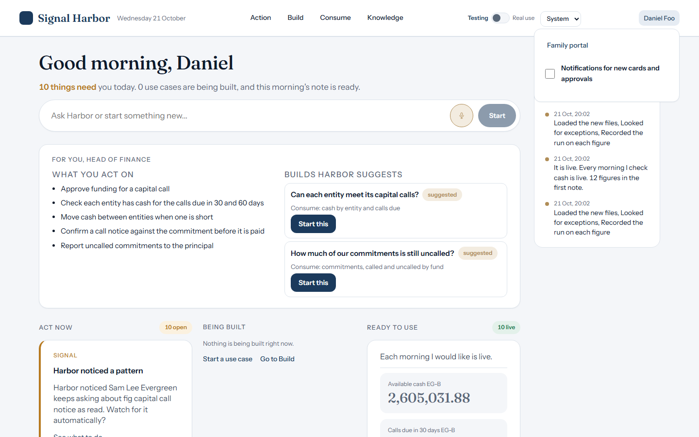

**Phone bar.** On a phone the four places sit at the bottom. The **Action** tab shows the number of items that need you.

**Install banner (phones only).** A line at the top offers to install Harbor on the phone. Tap **Install app**, or **Not now** to hide it.

**Tips:**
- If you only want to see the numbers, leave the switch on Testing. Testing is the default.
- The **Desk** and **Action** are the two pages to open first each morning.

---

### Home: the Desk

**What it is for:** your morning page. It shows what needs you today, what is being built, what is live, and what happened overnight.

**Who it is for:** everyone with a role in the office.

**How to get there:** the logo, or `/v3/desk`. Signing in lands here.

**What is on it:**
- **Greeting and count.** "N things need you today", then how many use cases are being built, and whether this morning's note is ready.
- **Ask box** with a microphone and **Start**. Typing here and pressing **Start** starts a new use case. It does not answer a quick question. For a quick answer, use **Consume**.
- **For you, [your job].** Suggested things to act on and suggested builds, with **Start this** or **Open**. Shown once you have a job set. If you have no job, **Tell Harbor your role** asks you to choose one.
- **Act now.** Up to three cards that need you. Each has its own buttons. **Go to Action** shows the rest.
- **Being built.** Use cases still in progress. Each shows its stage (Brief, Understanding, Numbers, Live). **Discard** removes one from the Desk and keeps it in the record.
- **Ready to use.** The live use cases count, and a short line from this morning's note with two figures.
- **Files this month.** How many files arrived, were recognised, and are waiting. **See them** goes to Files.
- **Overnight.** The last few things Harbor did while you were away.

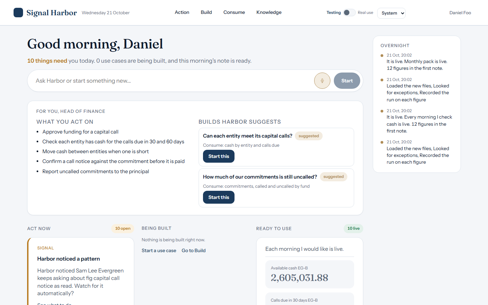

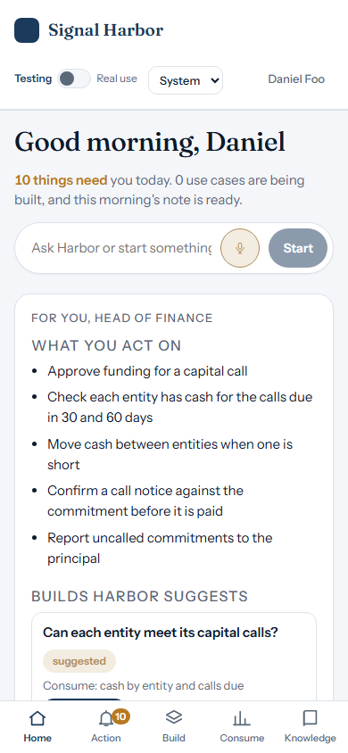

**Tips:**
- If the Desk is empty, it says "This office is new" and links to **Set up the office** (`/v3/welcome`).
- Cards on the Desk and on Action are the same cards. Acting on either one updates both.

---

### Action

**What it is for:** the list of things that need a named person. Each item is a decision, an exception, a question, a new skill to review, a signal, or a check on something Harbor read.

**Who it is for:** everyone. What you see depends on your role.

**How to get there:** **Action** in the top bar, or `/v3/action`. The Desk's **Go to Action** also goes here.

**How to use it, step by step:**
1. Use the filter buttons at the top: **All**, **Decisions**, **Exceptions**, **Questions**, **New skills**, **Signals**. Each shows a count.
2. Click a card, or its **Open** button. The right side shows the detail: what Harbor is asking, and the buttons for your answer.
3. Press the button that matches your answer. The card then leaves the list.
4. Use **Back to the list** on a phone to return.
5. **Done this week** at the bottom lists what was answered this week, and by whom.

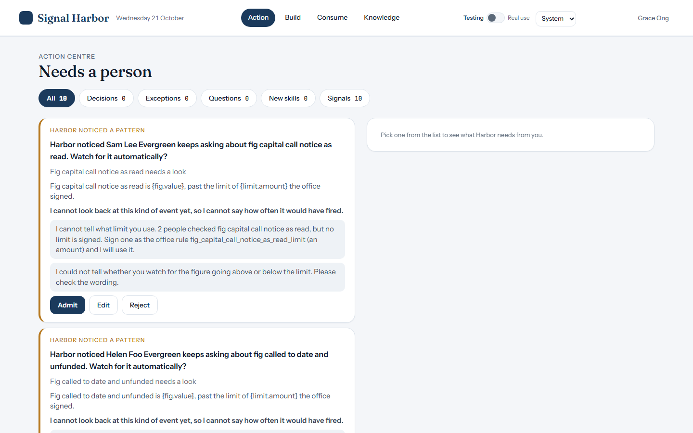

**The card types:**
- **Check what I read** (review card). Harbor read a field from a document and is not sure. **Confirm** accepts its reading. **Correct** opens a box for the right value, then **Save the correction**.
- **Harbor noticed a pattern** (draft signal). Harbor saw a person do the same thing more than once and suggests a watch for it. **Admit** starts the watch. **Edit** changes its name and its wording. **Reject** drops it. The card says how often it would have fired in the last six months.
- **Signal.** A watch that fired. It is labelled **Just so you know**, **Needs you** or **Something is wrong**, and says why it reached you. It has the choices the watch allows. **Not right** tells Harbor the signal was wrong. If the signal is held, you must type who you spoke to and when before the choice is saved. **Show the evidence** lists the figures, document lines and office rules behind it.
- **Decision and exception cards.** Their buttons are set by the use case. **Open the thread** goes to the full conversation. **Review the case** goes to the exception's case page.
- **New skill to review.** A new skill Harbor wrote. **Review** opens its review page (see [Skill review](#skill-review)).

**Tips:**
- Answer the **Needs you** cards first. Signals marked **Just so you know** can wait.
- A held signal asks for a note because a person has to say who was contacted. Keep the note short and factual.

#### Skill review

**What it is for:** checking a skill Harbor wrote before it is used on any file.

**Who it is for:** whoever the office has asked to review the skill. It appears on Action for those people, and under Knowledge › Skills while it waits.

**How to get there:** Action, then the **New skills** filter, then **Review**. Or Knowledge › Skills, then the waiting skill's name. The address is `/v3/skill/<id>`.

**How to use it:**
1. Read **Why Harbor wrote it** and the evidence on the left.
2. Read the skill on the right: goal, when to use it, what it needs, what it gives, steps, checks, and what it never does.
3. Click the pencil beside any line to change it. **Save** or **Cancel**.
4. Check **Tested on known answers**. Each row shows what Harbor expected and what it got.
5. Press **Admit (signs as you, version N+1)**, **Try it again**, or **Reject**. Reject needs a reason.

Admitting is recorded in **Runs and proof**. A skill that is not waiting can no longer be edited here.

#### Case page

**What it is for:** working one exception to its end: what happened, the evidence on each side, Harbor's suggested next steps, and the close.

**Who it is for:** whoever owns the exception (named on the page).

**How to get there:** an exception card on Action, then **Review the case**. The address is `/v3/case/<id>`. The test office has no open exceptions at the moment, so there is no screenshot.

**How to use it:**
1. Read **What happened**.
2. Compare **We have it** with **Not there** under **Evidence**.
3. Under **Harbor's suggested next steps**, press a step button. Its name is set for each case, but each one does one of three things:
   - It drafts an email. Harbor never sends it. Press **OK, keep this draft** to keep it on the case, or **Edit first** to change it, then send it yourself.
   - It closes the case as a timing difference that clears by itself, after **OK, close as timing**.
   - It asks for a note on what will be corrected, saved with **Save note**.
4. Use the box under **Ask Harbor about this case** to ask a question about it.
5. To close: type a reason, then press **Resolved**, **Timing** or **Not an exception**. The reason is required.

**Tips:** the **History** list keeps every step, closed cases included.

---

### Build

**What it is for:** starting, shaping and watching use cases, which are the questions Harbor works on until they are live. Build also holds the office's admin pages: connections, onboarding, the audit log and API keys.

**Who it is for:** everyone can start a use case. The audit log and API keys are for the office administrator.

**How to get there:** **Build** in the top bar, or `/v3/build`.

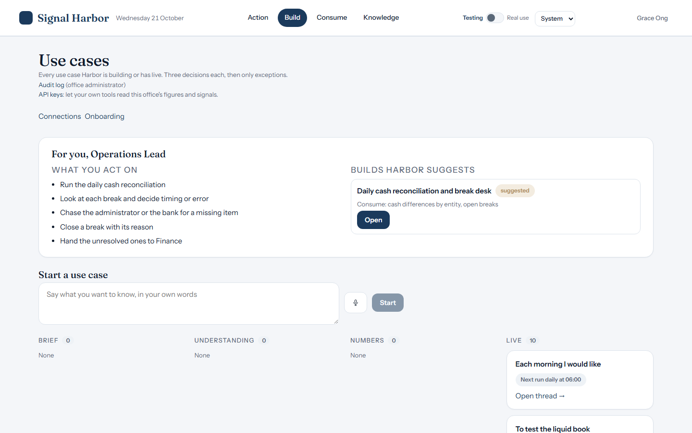

#### Build board

**What it is for:** the list of every use case, in four columns: **Brief**, **Understanding**, **Numbers**, **Live**. Cards show whether they are waiting for you, being worked on, or live with their next run.

**How to use it:**
1. Read the card for the use case. **Waiting for you** means you need to act.
2. Click **Open thread** to open it.
3. To start a new one, type in **Start a use case** and press **Start**. Press Enter to start. Shift+Enter starts a new line. The microphone button lets you speak it.
4. The **For you** card suggests builds for your job. **Open** or **Start this** starts one.
5. Links at the top: **Audit log** (office administrator), **API keys**, **Connections**, **Onboarding**.

**Tips:** a use case with no files yet says so on its page. It is waiting for files, not for you.

#### Use case page

**What it is for:** the conversation and the decisions for one use case, and where its files go.

**Who it is for:** the person who raised it, and anyone who signs for it.

**How to get there:** the Build board, then **Open thread**. The address is `/v3/build/<id>`. The same conversation also opens at `/v3/thread/<id>` from the Desk and Action (see [Thread page](#thread-page)).

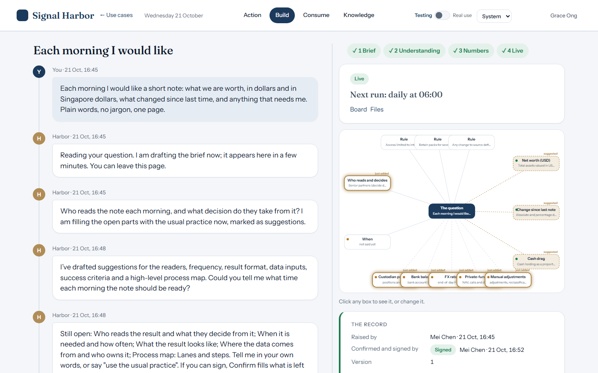

**How to use it, step by step:**
1. The progress bar at the top shows where the use case is: **1 Brief**, **2 Understanding**, **3 Numbers**, **4 Live**.
2. **Decision 1, the brief.** Harbor writes down what you want to know, who reads it, which sources it uses, and how often. Each line can be changed with the pencil. Press **Confirm the brief** to sign it in your name. If someone else must sign, the button reads **Send to <name> to confirm**. **Change something** moves you to the message box. You can also just type a change, for example "use 90 days".
3. **Working.** Harbor reads the files and builds the figures. Nothing is needed from you. **Stop** halts the work. **See the technical detail** shows the steps.
4. **Decision 2, what Harbor understood.** Each file is listed with what Harbor read it as and how sure it is. Answer the questions shown, then press **This is right, carry on**. **Something is off** lets you say what to change.
5. **Decision 3, the numbers.** A table lists each check: **Match** or **Needs a look**. Press **Go live** when the numbers agree with what you already trust, or **Not yet** to keep working on it.
6. **Live.** The use case runs on its own. **Next run** shows when. **Board** and **Files** are linked.
7. **Discard** (top right, while not live) stops the use case and removes it from the Desk. It stays in the record, with your name and the time. You can type an optional reason.

**The record card** (right side): who raised it, when it was sent, who signed it, the version, and a link to the signed intent document in Word.

**The file area** under the conversation:
- **Drop the files for this use case.** Drag files in, or press **Choose files**. PDF, Excel and CSV are read on this machine.
- **Expected from the graph.** Each source named in the brief shows **arrived, N files** or **waiting**.
- **Dropped so far.** The latest files, with the source Harbor matched them to.

**Tips:**
- You do not have to stay on the page. Harbor keeps working, and the Desk shows when it needs you.
- A confirm button that is greyed out explains why in a line under it.

#### Thread page

**What it is for:** the same conversation and decisions as the use case page, reached from the Desk, Action, Knowledge and Trust. It has no file area.

**How to get there:** `/v3/thread/<id>`, or **Open the thread** on an Action card, or **Open the use case thread** on a Knowledge item.

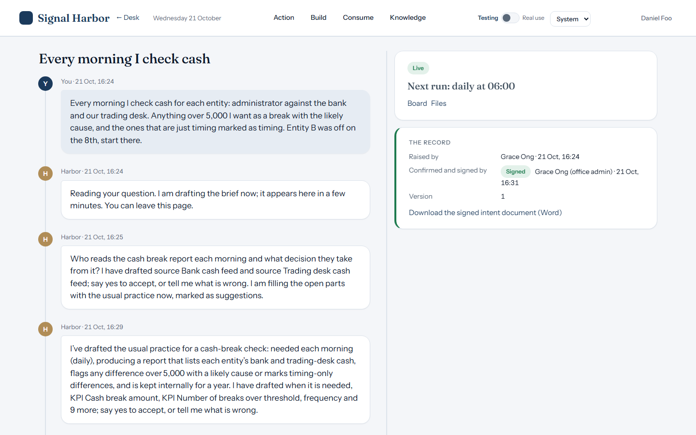

**How to use it:** as the use case page. In addition, once the numbers are confirmed, the record card links to the procedure document in Word or Markdown.

#### Start a use case

**What it is for:** writing the first question in your own words, and having Harbor draft the brief.

**Who it is for:** anyone with a role in the office.

**How to get there:** the Desk ask box, the **Start a use case** box on the Build board, or `/v3/start`.

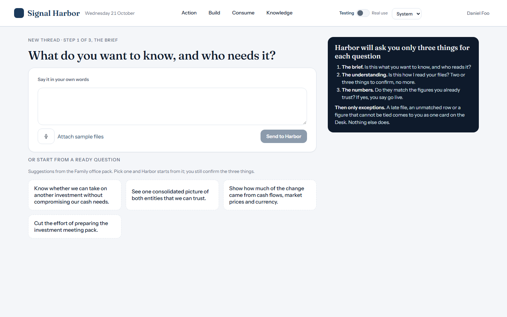

**How to use it:**
1. Type your question in **Say it in your own words**, or press the microphone and speak it.
2. Press **Send to Harbor**. Harbor opens the new use case and drafts its brief.
3. Or press one of the **ready questions** suggested from your industry pack. Harbor starts from it.
4. **Attach sample files** goes to Files, so you can give Harbor examples first.

Harbor asks you only three things for each question: the brief, the understanding, and the numbers. After that only exceptions reach you.

#### Files

**What it is for:** getting files into the office. Anything that arrives lands here first.

**Who it is for:** everyone who brings in files.

**How to get there:** **Files** on the Welcome and Start pages, or `/v3/files`. Use cases also have their own drop area (see [Use case page](#use-case-page)).

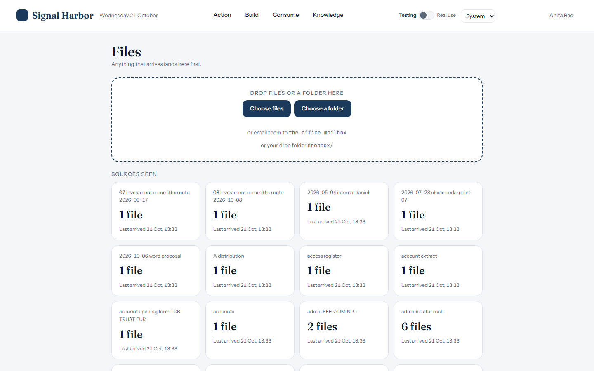

**How to use it:**
1. Drag files or a folder onto the box, or press **Choose files** or **Choose a folder**.
2. Or email them to the office mailbox address shown on the page, or drop them in the drop folder shown there.
3. A progress bar shows each upload. A file that is already in the office is skipped, and the page says so. Nothing is loaded twice.
4. **Questions** appear as cards: "What is this file?". A card appears when Harbor cannot tell which source a file belongs to, or when more than one use case uses that source. The file waits until the question is settled.
5. **Sources seen** counts the files from each source. **Recent files** shows each file's status: **Recognised**, **Loaded**, **Waiting** or **Question**.

Files are read on this machine. The original never leaves.

#### Welcome (first sign-in)

**What it is for:** setting up a new office in three steps.

**Who it is for:** the office administrator at first sign-in.

**How to get there:** `/v3/welcome`. The Desk's empty state links here.

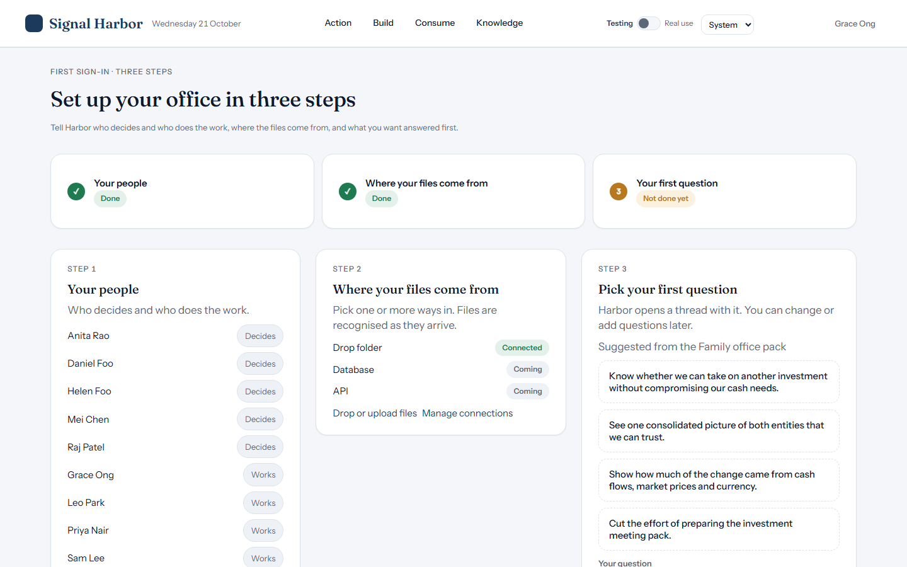

**How to use it:**
1. **Your people.** See who decides and who does the work. **Add a person to the office** opens the People page. See the note in [Trust › People](#people).
2. **Where your files come from.** See the connected sources. **Drop or upload files** and **Manage connections** are linked.
3. **Pick your first question.** Choose a ready question from your industry pack, or type your own, then **Start**.

#### Setup (day one)

**What it is for:** the day-one checklist, including choosing the industry pack the office starts from.

**Who it is for:** the office administrator.

**How to get there:** `/v3/setup`.

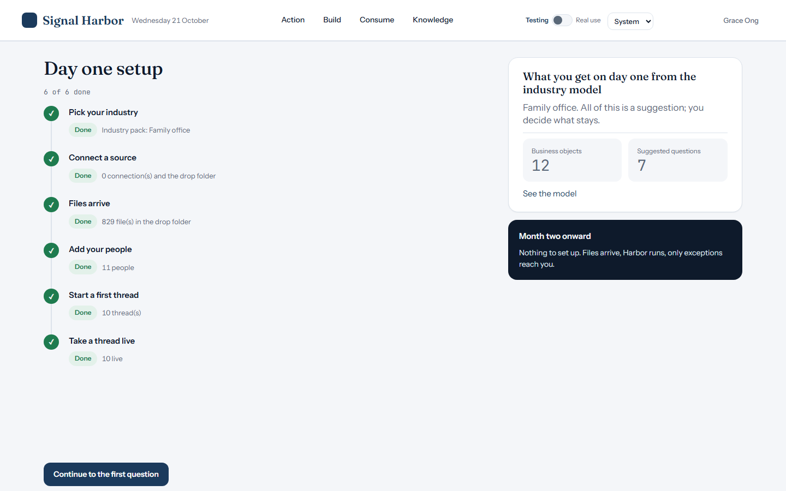

**How to use it:**
1. Read the steps. Each shows **Done**, **Needs you** or **Not started**.
2. If no industry pack is chosen, press the pack's name to choose it. A pack gives the office a starting model and suggested questions.
3. **See the model** shows what the chosen pack starts with.
4. **Continue to the first question** goes to `/v3/start`.

#### Build › Connections

**What it is for:** the fetchers that bring files in on their own. Whatever arrives lands in the drop folder and is read like any file you drop.

**Who it is for:** the office administrator and the data team.

**How to get there:** the **Connections** link on the Build board, or `/v3/build/connections`.

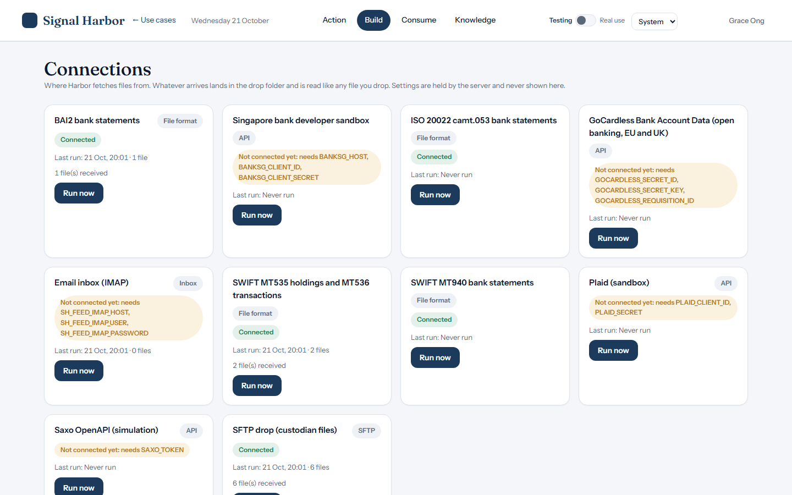

**How to use it:**
1. Each card shows its name, its type, and its state: **Connected**, **Not connected yet: needs <setting names>**, or the last error.
2. **Last run** shows when it ran and how many files it brought in.
3. Press **Run now** to fetch straight away. The button reads **Running...** while it works.

Settings are held by the server and are never shown on this page.

#### Build › Onboarding

**What it is for:** a ten-step checklist from the first conversation to go-live, with a health score out of 100.

**Who it is for:** the office administrator and whoever is onboarding the office.

**How to get there:** the **Onboarding** link on the Build board, or `/v3/build/onboarding`.

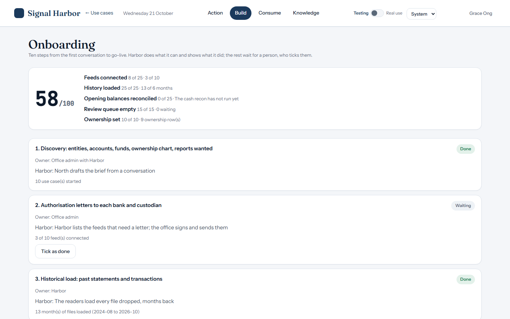

**How to use it:**
1. The score at the top adds up its parts. Each part says how many points it earned.
2. Each step shows its owner, what Harbor has done, and any detail.
3. Steps that a person must do have **Tick as done**. Press it when the step is finished. **Untick** reverses it. The page records who ticked it and when.

#### Build › Audit log

**What it is for:** the record of who signed in, what they read, exported, changed and signed. Entries cannot be edited, and each is linked to the one before, so a change would show.

**Who it is for:** the office administrator. Other people see an error.

**How to get there:** the **Audit log** link on the Build board, or `/v3/build/audit`.

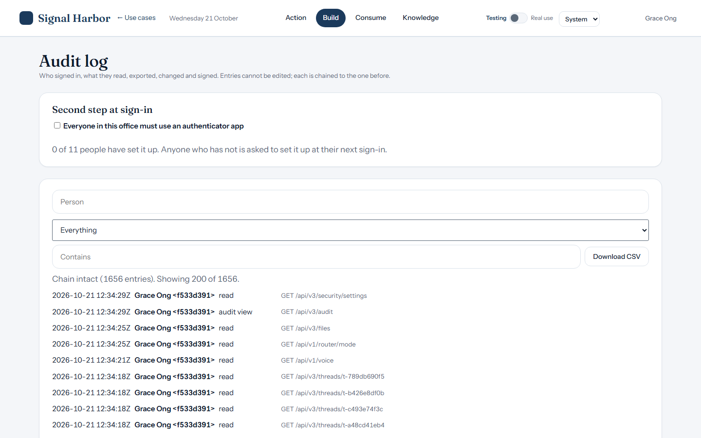

**How to use it:**
1. **Second step at sign-in.** Tick **Everyone in this office must use an authenticator app**. Each person is then asked to set up the app at their next sign-in. The line under it says how many people have done so.
2. Use the filters: **Person**, **What they did** (sign-in, failed sign-in, read, export, change, settings change, signed decision, and so on), and **Contains**.
3. The line above the entries says **Chain intact** with the count, or that the log was changed.
4. Press **Download CSV** to export the list as it is filtered.

#### Build › API keys

**What it is for:** giving your own tools a read-only key to the office's figures, signals and document list, and to ask questions.

**Who it is for:** the office administrator.

**How to get there:** the **API keys** link on the Build board, or `/v3/build/api-keys`.

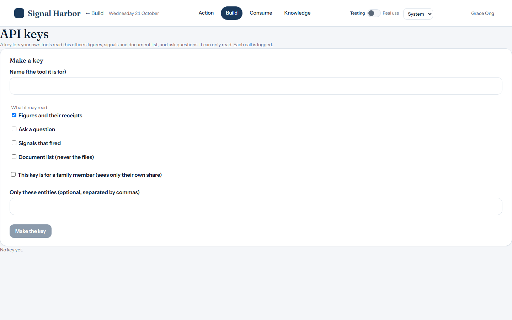

**How to use it:**
1. **Name (the tool it is for).** Type a name you will recognise.
2. **What it may read.** Tick any of: **Figures and their receipts**, **Ask a question**, **Signals that fired**, **Document list (never the files)**.
3. Optional: tick **This key is for a family member** and type the member's name. The key then sees only that member's share. Asking questions is switched off for these keys.
4. Optional: list entity names, separated by commas, to limit the key to those entities. A limited key cannot ask questions.
5. Press **Make the key**. The key is shown **once**. Press **Copy**, then **Done**. If it is lost, revoke it and make a new one.
6. For each key in the list:
   - **Add webhook** (or **Change webhook**) asks for an https address where Harbor sends "signal fired" messages. A signing secret is shown once. The receiving address's host must be on the webhook list in Settings, or nothing is sent.
   - **Remove webhook** stops it.
   - **Revoke** stops the key at once, after a confirmation.
7. **Recent calls** lists each call: when, which key, what it asked for, and the result.

Each key may make a limited number of calls a minute.

#### Build › Use case pages still open under 2.0

The **dashboard studio** and the project pages are in [Older screens still open (2.0)](#older-screens-still-open-20).

---

### Consume

**What it is for:** the numbers. Ask a question and get an answer with its source, read the watchlist, the board, the morning note and the reports.

**Who it is for:** everyone. Each figure is filtered by what that person may see.

**How to get there:** **Consume** in the top bar, or `/v3/consume`.

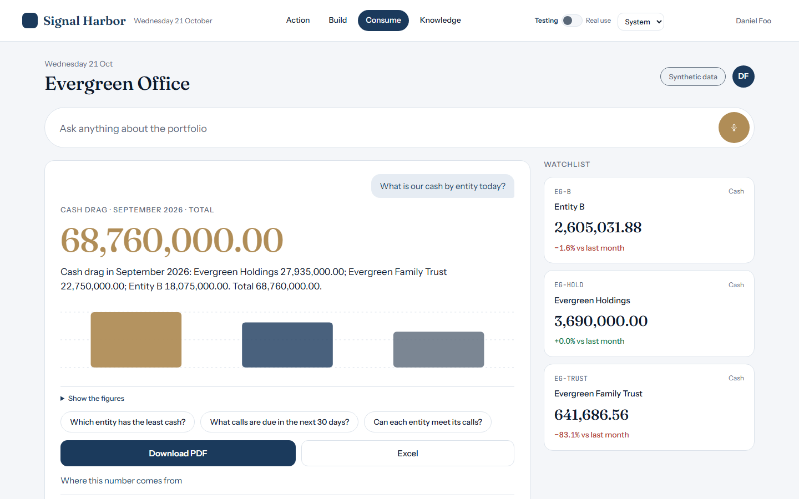

**How to use it, step by step:**
1. Type a question in **Ask anything about the portfolio** and press **Ask**. Or press the microphone and speak it.
2. Harbor answers with a headline figure, a short sentence, and a chart where one fits.
3. Under the answer:
   - **Show the figures** opens the rows behind the sentence.
   - Follow-up questions appear as buttons. Press one to ask it.
   - **Download PDF** prints the answer (use your browser's save-as-PDF).
   - **Excel** downloads a CSV file, which opens in Excel.
   - **Where this number comes from** opens the figure's page (see [Figure](#figure)).
   - **Source** names the figures and the date they are as at.
   - **Answered in N ms (from memory)** means the answer was kept from earlier. The figures are the same as the signed data.
4. **Watchlist** on the right shows the figures the office watches. A tile marked **Stale** has not been updated yet, and says when its value was dated.
5. **Your boards** lists the boards you can open. A board thumbnail opens **Board**.
6. **This morning's note** links to **Read the note**.
7. **Reports** lists the reports ready for download.
8. The tabs at the top (**Ask**, **Boards**, **Note**, **Reports**) jump to each part.

**Tips:**
- Start with the questions the office asks often. They are the suggestions shown when no answer is on the screen.
- If an answer seems wrong, press **Where this number comes from** before you use it.
- "Total family exposure" shows "Not available yet" until net worth is reliable.

#### Board

**What it is for:** one page with the office's headline numbers, its tiles, and a box to ask about it.

**Who it is for:** everyone who has a board.

**How to get there:** **Your boards** on Consume, or `/v3/board`.

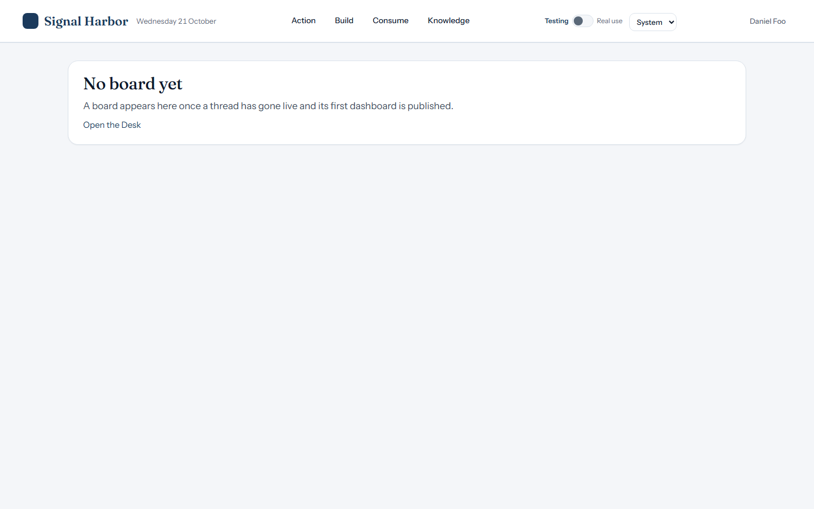

**How to use it:**
1. The title and the date the numbers are as at are at the top.
2. Headline figures come next. Each one shows its change.
3. The tiles follow. Each tile is a chart or table.
4. **Ask about this board** takes a question and answers from the signed numbers, with its source.

**The test office has no published board yet.** The page says so, as it does for any office in that state. A board appears once a use case has gone live and its first dashboard is published.

> **NEW THIS WEEK. Board picker.** When the office has more than one board, a **Board** list at the top switches between them. The page address then carries the choice.
>
> **NEW THIS WEEK. Edit this board.** Makers (the company administrator and analysts) see **Edit this board**. It opens the dashboard studio for that board's project (see [Older screens still open](#older-screens-still-open-20)).
>
> **NEW THIS WEEK. Add to board.** Shown on Consume answers and on figure pages, for makers. Choose a board and press **Add to this board**. It adds the figure as a draft tile on that board. Someone else must approve it in the studio before it shows on the board.
>
> **NEW THIS WEEK. See the data model.** Links at the bottom of the board go to **What Harbor knows** and **See the data model** (see [Trust](#trust)).

#### Boards list

**NEW THIS WEEK.** Lists every board, one for each live use case, with its use case, owner, last refresh, and whether a change is waiting in the studio. **Edit** appears for makers. Reached from **Consume › Your boards › All boards, owners and drafts**, or at `/v3/consume/boards`. There is no screenshot yet, because the test office does not run this build.

#### Ask

**What it is for:** asking a question on its own page, with the questions people here ask often beside it.

**Who it is for:** everyone.

**How to get there:** `/v3/ask`. Type a question in the box on Consume, or the box on the board page, to get the same kind of answer.

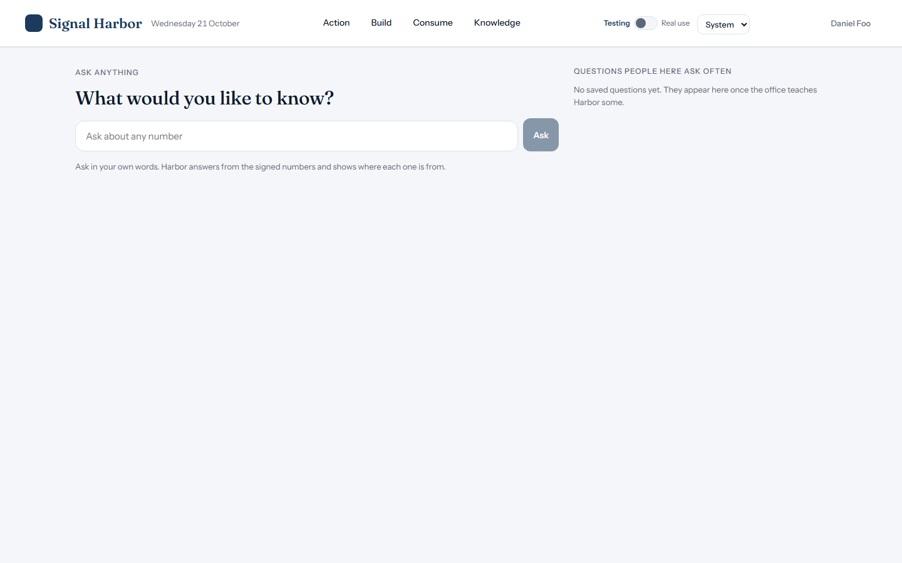

**How to use it:**
1. Type a question in **Ask about any number**, and press **Ask**.
2. While it works, the page says **Working it out…**.
3. Pick a question from **Questions people here ask often** to ask that one instead.

If there are no saved questions yet, the page says they appear once the office teaches Harbor some.

#### Note

**What it is for:** the morning note. A short text with its figures, and past notes.

**Who it is for:** everyone.

**How to get there:** **Read the note** on Consume, or `/v3/note`.

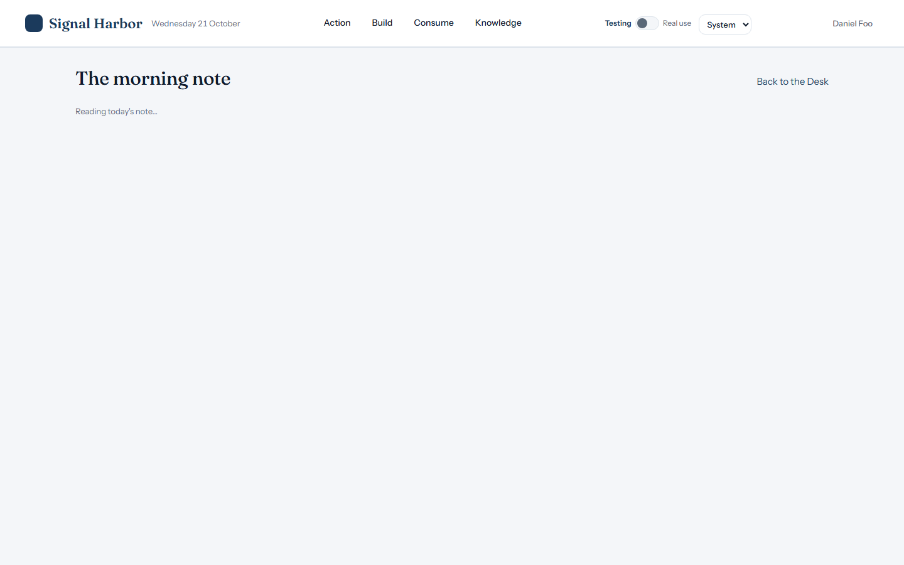

**How to use it:**
1. Read today's note at the top.
2. Each figure in the note is numbered. Hover over a number to see where it comes from.
3. **Past notes** lists earlier notes by date. Read the headline under each.

The first note is written when a use case goes live. It is refreshed after each live run.

---

### Knowledge

**What it is for:** what the office knows about itself, from its own records only. Its people, funds, entities, files, figures, signals, rules and decisions, and how they connect. It also holds the skills Harbor uses and the signals it watches for.

**Who it is for:** everyone can look. The skills and signal settings are for the people who maintain them.

**How to get there:** **Knowledge** in the top bar, or `/v3/knowledge`.

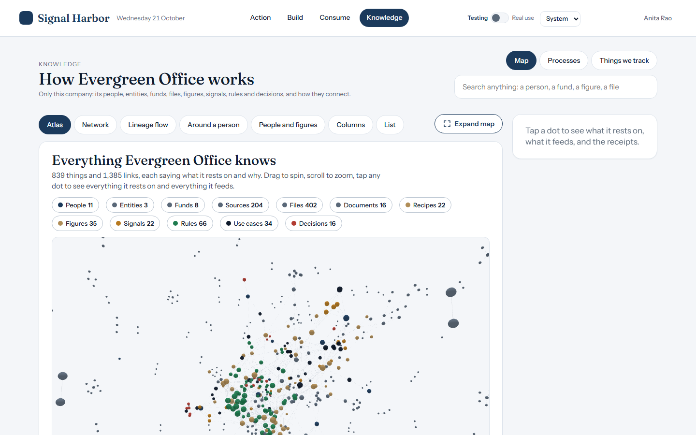

#### Knowledge map

**How to use it, step by step:**
1. The three views at the top are **Map**, **Processes** and **Things we track**.
2. In **Map**, pick a map view. **Atlas** is the default. The others are **Network**, **Lineage flow** (files to tables to figures), **Around a person**, **People and figures**, **Columns**, and **List**. On a phone, only the views that suit it are offered.
3. Click any box to select it. The panel beside the map shows what it is, what Harbor knows about it, and where it connects.
4. Type in **Search anything: a person, a fund, a figure, a file** to find something on the map.
5. **Expand map** opens the map over the whole window. **Full screen** asks the browser for full screen. **Collapse map** or Esc returns.
6. Links at the bottom go to **Figures**, **Skills Harbor uses**, **What Harbor watches for**, **Runs and proof**, **People**, and **Connections**.

**Tips:** if you are looking for a number, search for the figure's name, then open its page.

#### Figures

**What it is for:** every figure the office has defined, with its status, what it is built from, and who uses it.

**Who it is for:** anyone who quotes a figure.

**How to get there:** **Figures** on the Knowledge links, or `/v3/knowledge/figures`.

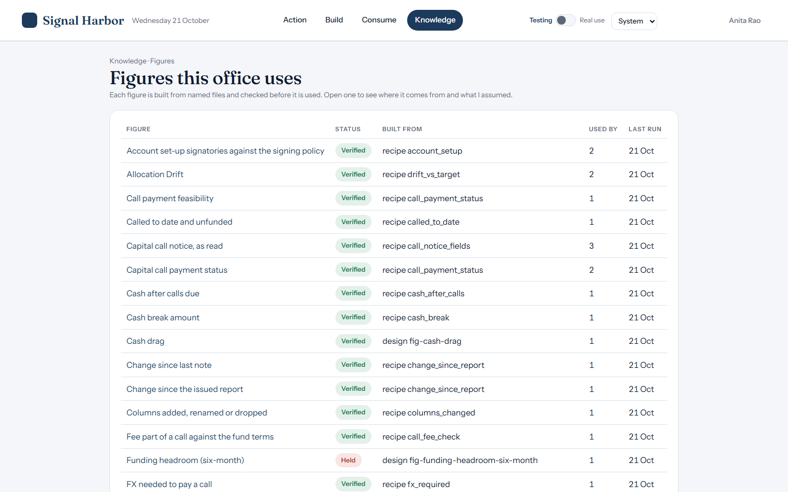

**How to use it:** the table shows each figure with its status. **Verified** is checked and in use. **Held** is held back. **Draft** is not yet in use. Click a name to open its page.

#### Figure

**What it is for:** where one number comes from, what Harbor assumed, its runs, its versions, and who else uses it.

**Who it is for:** anyone who needs to check or defend a number.

**How to get there:** **Where this number comes from** on a Consume answer, a figure's name on the Figures list, or `/v3/knowledge/figures/<id>`.

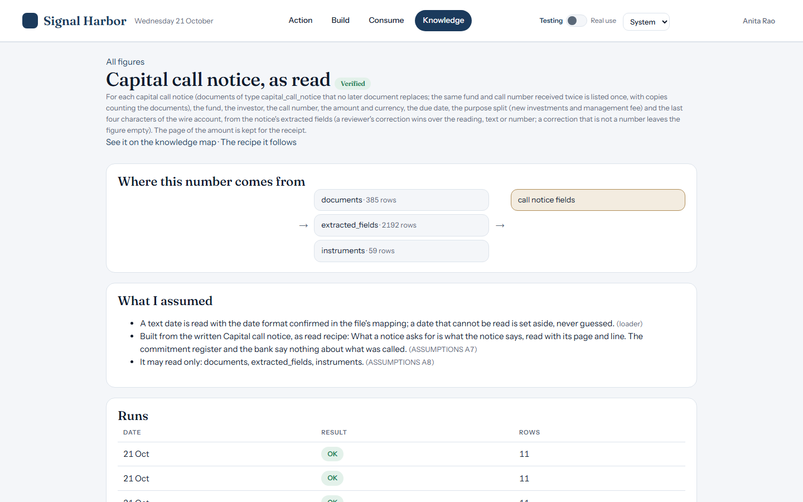

**How to use it:**
1. Read the definition at the top. **See it on the knowledge map** and **The recipe it follows** link on.
2. **Where this number comes from** draws the trail from files, to tables, to the figure.
3. **What I assumed** lists each assumption, with where it was set.
4. **Runs** shows each run, its result and its row count.
5. **Versions** lists each version, its status, and who approved it. To go back to an earlier verified version, press **Roll back**, then **Yes, roll back** to confirm. Everything that uses the figure reads the new version from then on.
6. **Also used by** lists the use cases and people that use this figure.

> **NEW THIS WEEK. Add to board.** Makers see **Add to board** under the figure's name. It works as described under [Board](#board).

#### Skills Harbor uses

**What it is for:** the library of skills Harbor uses, what each one does, how well it was tested, and which ones wait for a person.

**Who it is for:** the head of data and the company administrator, and anyone who wants to know what Harbor does.

**How to get there:** **Skills Harbor uses** on the Knowledge links, or `/v3/knowledge/skills`.

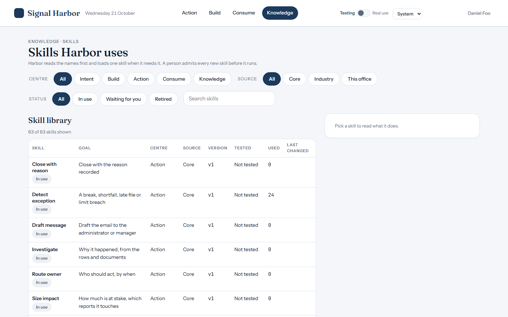

**How to use it:**
1. Filter by **Centre**, **Source** (Core, Industry, This office) or **Status** (In use, Waiting for you, Retired). Each filter is a row of buttons. **All** clears it. The search box finds a skill by name or goal.
2. Click a skill to read it on the right: its goal, when Harbor uses it, what it needs, what it gives, steps, tools, checks, what it never does, its cache, and its version history.
3. Skills waiting for you are listed at the top. **Review and admit it before Harbor uses it** opens the review page (see [Skill review](#skill-review)).

#### What Harbor watches for

**What it is for:** the signals Harbor watches, who each one goes to, how often each one fired and was acted on, and what fired lately.

**Who it is for:** the people who set signals up, and whoever receives them.

**How to get there:** **What Harbor watches for** on the Knowledge links, or `/v3/knowledge/signals`.

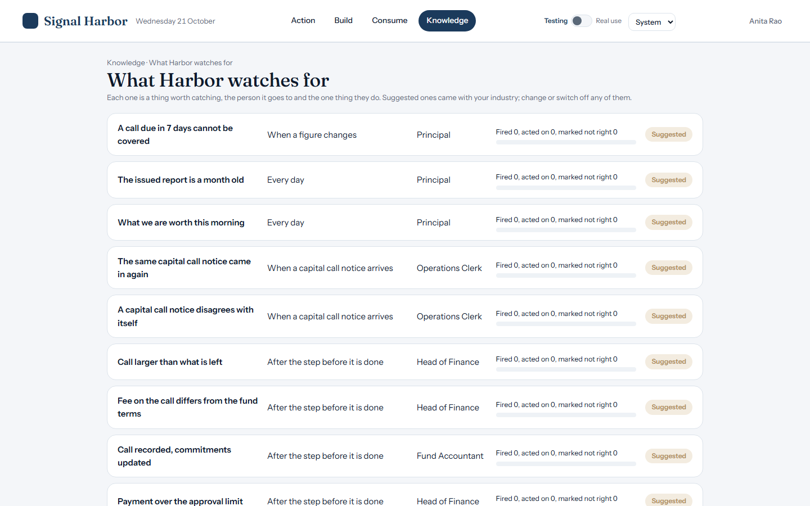

**How to use it:**
1. Each row shows the signal's title, what triggers it, who it goes to, and the bar of **Fired / acted on / marked not right**. **Suggested** rows came with the industry pack. **Your office** rows were set by the office.
2. **Suggested by Harbor** shows drafts with the same **Admit**, **Edit** and **Reject** buttons as on Action.
3. **Recently fired** shows the last signals, and their outcome: **Waiting for a person**, **Done**, or **Marked as not right**.

#### Thing

**What it is for:** one item from the knowledge map: a person, fund, file, figure, use case, signal, or rule. It shows what is known about it, and what sits either side of it.

**Who it is for:** anyone.

**How to get there:** click a box on the knowledge map and follow its link, or `/v3/knowledge/thing/<kind>:<id>`.

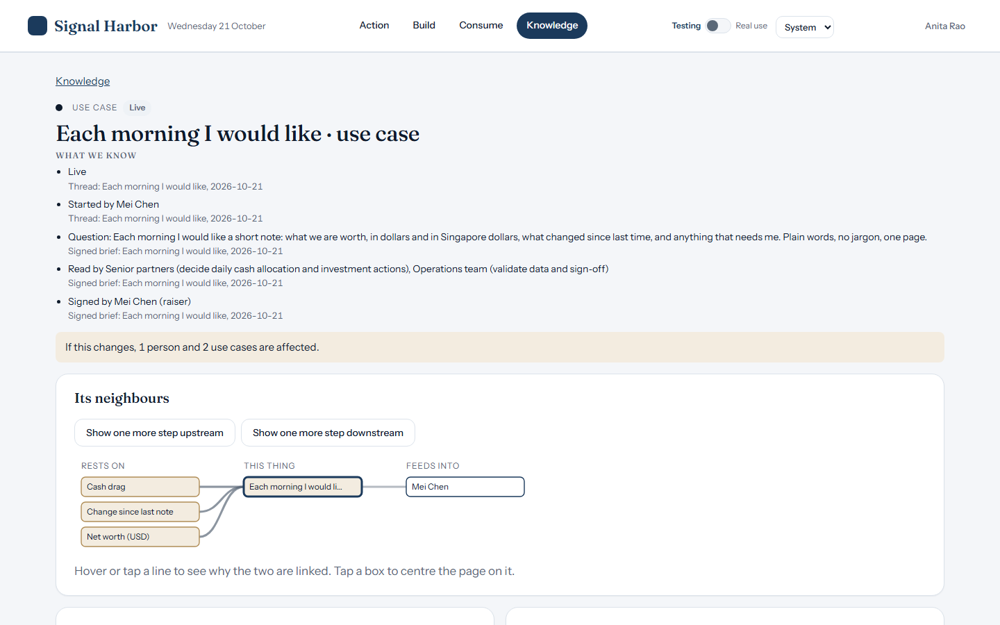

**How to use it:**
1. Read **What we know**. Each fact says where it came from. **+N more facts** shows the rest.
2. The sentence under the facts says what depends on this item, for example "If this changes, 1 person and 2 use cases are affected."
3. **Its neighbours** draws the items one step either side. **Show one more step upstream** and **Show one more step downstream** widen the picture. **Back to one step** returns.
4. The lists below say everything it **rests on** and everything that **depends on it**.
5. Click a line to see why two items are linked. Click a box to centre on it.

---

### Trust

**What it is for:** how Harbor knows what it knows: the data model, the office's words, who decides, the proof of each run, the workings behind a use case, and the sources connected to the office.

**Who it is for:** the head of data and the data team, primarily. Others may read the pages, but most of what is on them is for the data team.

**How to get there:** Trust is not in the top bar. Go through the links on Knowledge (**People**, **Connections**, **Runs and proof**), on Setup (**See the model**), or on Welcome (**Add a person to the office**). Every Trust page then shows its tabs across the top: **What Harbor knows**, **Industry model**, **Language**, **People**, **Runs and proof**, **Workbench**, **Connections**.

#### What Harbor knows

**What it is for:** the data model. Each box is a kind of record, with how many rows Harbor holds and where they are kept. This is the "data model" the office sees.

**Who it is for:** the head of data, the analysts, and anyone checking what the data means.

**How to get there:** the first tab under Trust, `/v3/trust/ontology`.

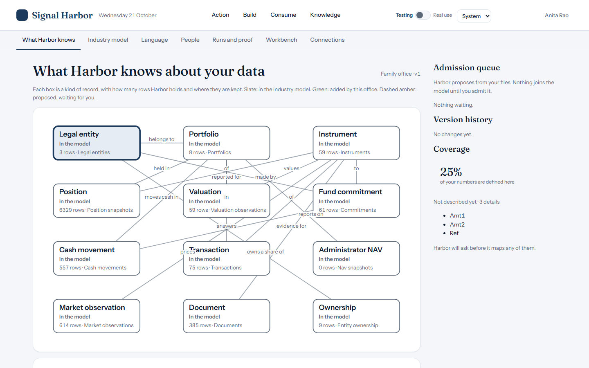

**How to use it:**
1. Click a box to see its detail table: each property, and where it came from.
2. The colours mean: slate for records in the industry model, green for records the office added, and dashed amber for proposals waiting for you.
3. **Admission queue** (right) lists the proposals. Harbor proposes from your files. **Admit** adds it to the model. **Reject** drops it. Nothing joins the model until admitted.
4. **Version history** lists each change.
5. **Coverage** shows what percent of the office's numbers are defined. **Not described yet** lists the details Harbor has not mapped. Harbor asks before it maps any of them.

#### Industry model

**What it is for:** the industry model the office runs on, in three layers: **Your language**, **Learned here, stays here**, and **Comes with the pack**.

**Who it is for:** the head of data, and anyone starting a new office.

**How to get there:** the second tab, `/v3/trust/model`. **See the model** on Setup links here.

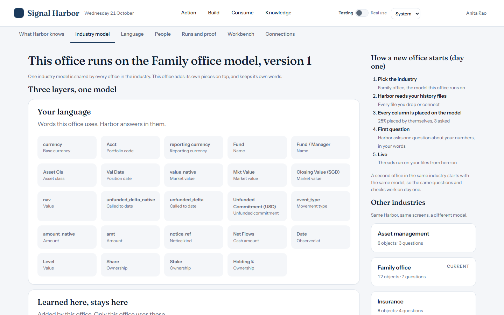

**How to use it:** read the three layers. Words the office uses are in the first. Records the office added are in the second. The shared pack is the third. On the right, **How a new office starts (day one)** shows the steps, and **Other industries** lists the packs installed.

#### Language

**What it is for:** the office's words, the approved questions and answers, the corrections Harbor suggests, and what has been taught to Harbor.

**Who it is for:** the head of data, and anyone who teaches the office's terms.

**How to get there:** the third tab, `/v3/trust/language`.

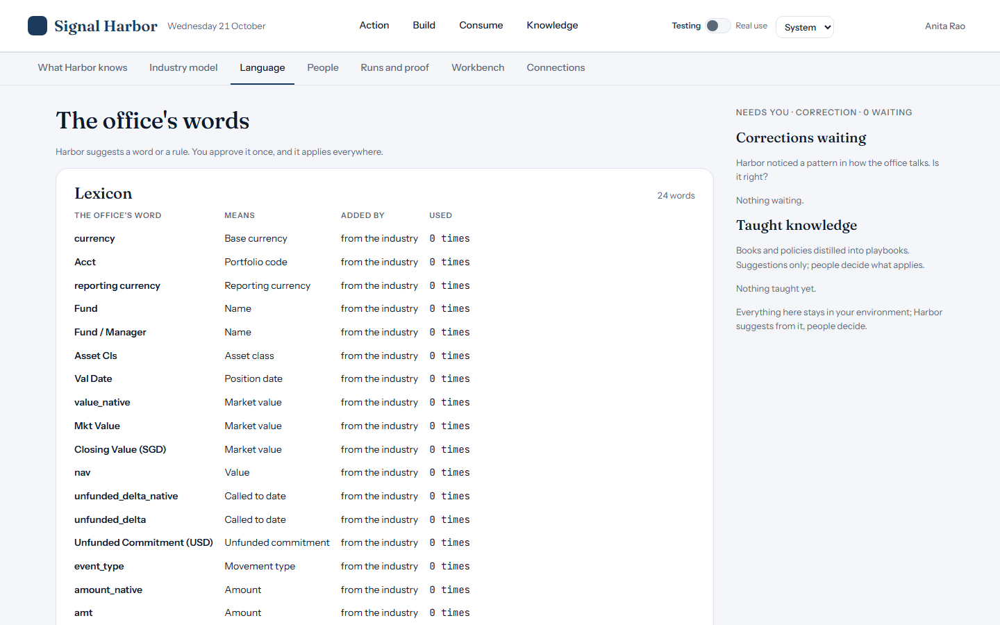

**How to use it:**
1. **Lexicon.** Type a word in **Add a word**, then what it **Means**, and press **Add**. The word then applies everywhere.
2. **Golden questions.** Approved question and answer pairs. Harbor checks new answers against these first.
3. **Corrections waiting.** Harbor noticed a pattern in how the office talks. Press **Admit** if it is right, or **Not right** if it is not.
4. **Taught knowledge.** Books and policies turned into suggestions, each switched **On** or **Off**. People decide what applies.

#### People

**What it is for:** who decides, who does the work, who reads, what each job is given, when Harbor must ask a person, and how far Harbor acts alone on each use case.

**Who it is for:** the office administrator and the head of data.

**How to get there:** the fourth tab, `/v3/trust/people`. Welcome and Setup link here too.

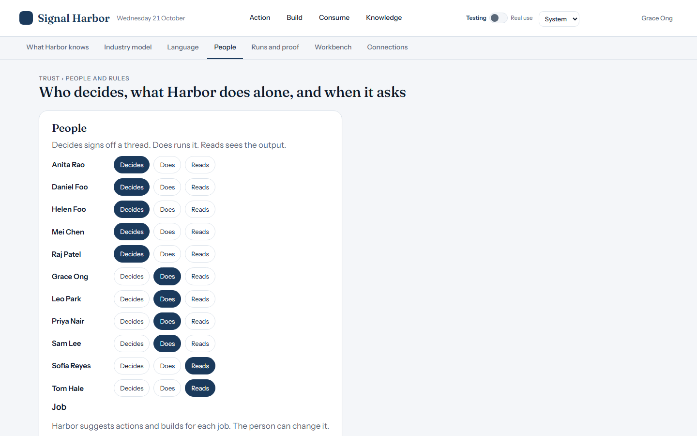

**How to use it:**
1. **People** lists each person's role in the office: **Decides**, **Does** or **Reads**.
2. **Job** lets you pick a job for each person from the list. Harbor suggests actions and builds for each job, and the person can change it.
3. **Second signer for go live** shows whether a second person must sign before a use case goes live.
4. **When Harbor must ask a person** lists the rules.
5. **Autonomy per thread** sets the level Harbor works at on each use case: **Assist**, **Auto** or **Silent**. The buttons apply at once. The screen does not spell out the difference between the three, so ask the head of data before you change one. Harbor steps up after two clean months, and down after an unexplained break.
6. **AI usage and cost** counts the questions and builds, and the mode.

**Note on adding people:** this page lists who is in the office and what their job is. It does not create a new sign-in; the data team does that. In the older screens, who can open which centre is under Settings › People and access (`/centre/settings/people`). Invitations to an intent (an older screen) are in its **People and roles** tab, at `/centre/intent/<id>/people`.

#### Runs and proof

**What it is for:** the proof behind every run, for an auditor. Each row is one piece of work Harbor did.

**Who it is for:** the auditor, the head of data, and the sponsor.

**How to get there:** the fifth tab, `/v3/trust/proof`.

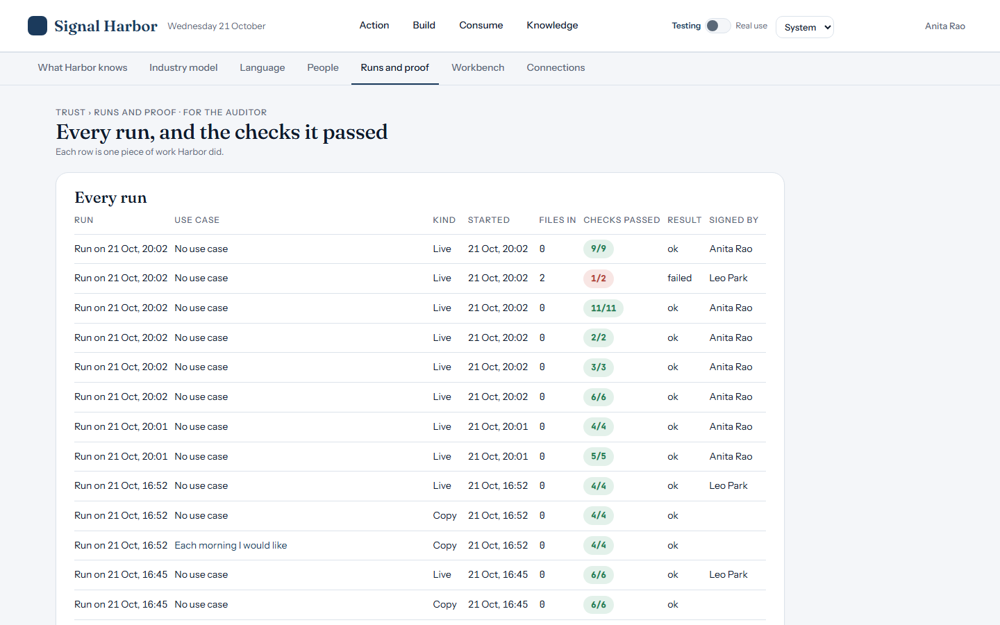

**How to use it:**
1. **Accuracy over time** charts two things: answers right, by round, and wrong answers that got through.
2. **Every run** lists each run: its use case (linked), whether it was **Live** or a **Copy**, when it started, the files it read, the checks passed (in red if any failed), the result, and who signed.
3. A figure on the board shows the run behind it, the files it came from, and the checks it passed.

#### Workbench

**What it is for:** the steps Harbor took for one use case, the tables it built, and the rules it works under. Built for the data engineer. The business user never has to come here.

**Who it is for:** the data engineer and the head of data.

**How to get there:** the sixth tab, which asks you to pick a use case first, or **See the technical detail** on a working use case. The address is `/v3/trust/workbench?thread=<id>`.

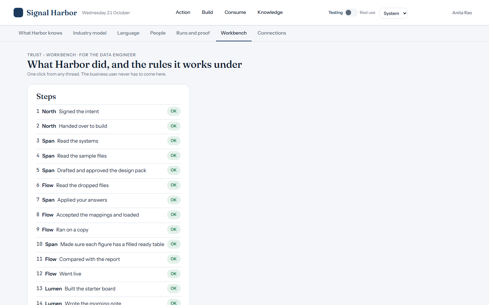

**How to use it:** read the **Steps**, each marked **OK** or **Failed**, with the helper that did it. Then the tables in three layers: **Raw · as received**, **Clean · shared by the office**, and **Ready · this thread**, each with its row count. **When Harbor must ask a person** lists the rules.

#### Connections (Trust)

**What it is for:** the sources the office's data comes from, and adding a new one. Each one pulls on its own schedule. Nobody uploads anything.

**Who it is for:** the head of data and the data engineer.

**How to get there:** the seventh tab, `/v3/trust/connections`, or **Connections** on Knowledge.

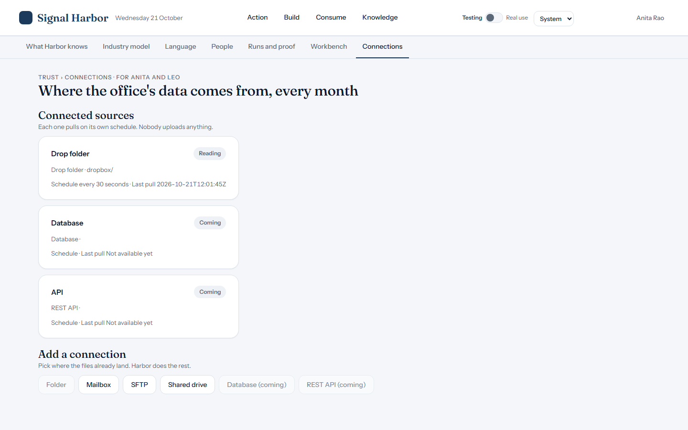

**How to use it:**
1. **Connected sources** lists each one, with **Reading**, **Failing** or **Coming**, its schedule and its last pull. A failing source has a red edge, and says what to check.
2. **Add a connection** lists the types: **Folder** (already set up), **Mailbox**, **SFTP** and **Shared drive**. **Database** and **REST API** are shown as coming.
3. Choose a type. Fill in **Name**, **Source code (what these files are)**, the type's own settings, **File pattern**, and **Schedule**. A secret is write-only: it is held by the server, never shown again, and cleared once sent.
4. Press **Test the connection** to check the source can be reached. Then **Save connection**.

Connections are read-only. Harbor pulls files on the schedule you set.

---

### Family portal

**What it is for:** a read-only view for a family member: their morning note, their share of each entity, their approvals, their documents, and a question box that answers only from their own share.

**Who it is for:** family members of the office. Office staff who open it see the message "This page is for the family members of the office."

**How to get there:** your name in the header, then **Family portal**. The address is `/v3/portal`.

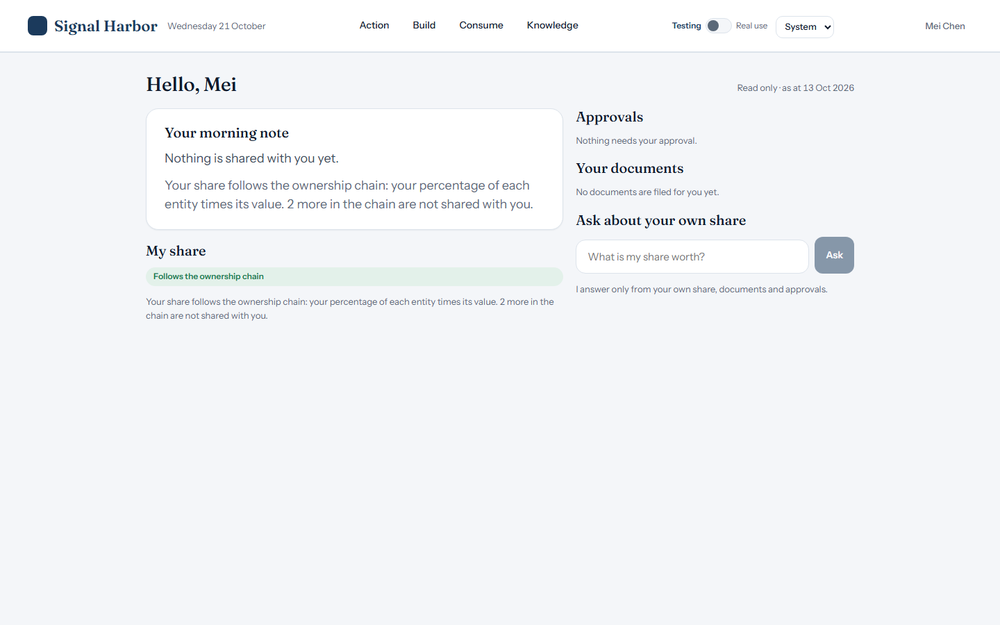

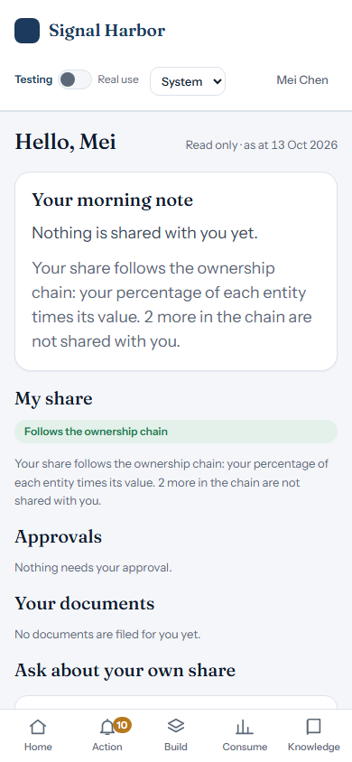

**How to use it:**
1. **Your morning note** lists what changed, in plain words.
2. **My share** shows your share in all, and each entity you may see. The tag reads **Follows the ownership chain** when your share is worked out from the ownership, or **Entity level view** when only the whole value is shown. **Full view** means you see all of the entity; **Summary** means you see part. **Portfolios** under an entity opens the detail.
3. **Approvals** lists requests addressed to you. Press **Approve** or **Decline**. Staff raise approvals; only the person addressed decides.
4. **Your documents** lists the documents filed for you.
5. **Ask about your own share.** Type a question, such as "what is my share worth?", and press **Ask**. It answers only from your share, documents and approvals.

The company administrator can look at a member's portal in read-only preview, by adding `?member=<name>` to the address. The preview cannot approve or decline anything.

---

### Older screens still open (2.0)

Some screens from the earlier version are still open. They are under `/centre/…`. The 3.0 pages link to very few of them. The only link is **Edit this board** (new this week), which opens the dashboard studio. For the rest, type the address after the site address. Your role decides what you can open. A screen you may not open sends you to your start page.

| Screen | Address | What it is for |
|---|---|---|
| Dashboard studio | `/centre/build/p/<project>/studio` | Builds and edits a project's board. **Start a dashboard**, **Build from a sketch**, a widget library, an inspector for each widget, and **Waiting for your approval** for changes. Reached from **Edit this board** (new this week). |
| Dashboards for a project | `/centre/build/p/<project>/dashboards` | The project's dashboards, each with its studio. |
| Pipelines for a project | `/centre/build/p/<project>/pipelines` | The data pipelines feeding the project. |
| Projects | `/centre/build` | The list of projects. **Build something new, one step at a time** starts one. |
| Project overview | `/centre/build/p/<project>/overview` | Status of one project, its steps, and its owners. |
| Pulse (old home) | `/centre/home` | The older home page with the office's pulse. |
| Operations | `/centre/operations` | Whether everything is arriving and running: deliveries and runs. |
| Map and review queue | `/centre/map`, `/centre/map/review` | The office's map, and the queue of readings to review. |
| Register | `/centre/register` | The office's register. Some people are refused it, and the page says so. |
| Memory | `/centre/memory` | What the agents remember about you. |
| Settings | `/centre/settings`, `/centre/settings/<section>` | Settings. The sections shown depend on your role: for example **People and access**, **Rules**, **Delivery channels**, and **Data model**. |
| Delivery channels | `/centre/build/delivery-settings` | Where reports are sent. Administrator only. |
| Feeds | `/centre/consume/feeds` | The feeds the office reads, one page for each. |
| Market forces | `/centre/consume/market` | Outside market material. |
| What-if | `/centre/consume/what-if` | Scenarios you can try without changing the numbers. |
| Consume views | `/centre/consume/health`, `/centre/consume/markets`, `/centre/consume/reports` | The fuller health, market and report views. |
| Data intake | `/centre/data/intake` | Files waiting to be read, one at a time. |
| Evidence | `/centre/evidence` | Documents held as evidence, with their pages. |
| Tickets | `/centre/tickets` | Requests raised from the office. |
| Library | `/centre/library` | Reference documents. |
| Rules | `/centre/admin/rules` | The office's signed rules, and **Import signed limits**. |
| Data model | `/centre/admin/model` | The data model in use. The 3.0 **What Harbor knows** page shows the same model in plainer words. |
| Agents and templates | `/centre/admin/agents` | The helpers and their templates. Administrator only. |
| Jobs and events | `/centre/settings/jobs` | Scheduled jobs and the events they raise. |
| Prove and release | `/centre/build/prove` | For the tester: the proofs, and their release by the sponsor. |
| Control | `/centre/control` | Super administrator only: the platform's own control screen, not for office users. |

Links that need no sign-in: `/interview/<token>` (a person's own interview), `/join/<code>` (joining an intent), `/answer/<token>` (an owner's answer), and `/intake/<token>` (a source owner's upload). Each one is sent by the office.

---

## 4. How to do common tasks

### Ask a question and check where a number comes from

1. Open **Consume** (`/v3/consume`).
2. Type your question in **Ask anything about the portfolio**, press **Ask**.
3. Read the headline figure and its sentence. Press **Show the figures** to see the rows.
4. Read the **Source** line for the figures and their date.
5. Press **Where this number comes from**. The figure page shows the trail from files, to tables, to the figure.
6. Check **What I assumed** on that page. If an assumption is wrong, say so to whoever runs the use case.
7. For proof of the run itself, open **Runs and proof** (`/v3/trust/proof`).

### Start a new use case and take it live (Decisions 1 to 3)

1. Go to **Build** (`/v3/build`). Type your question in **Start a use case**, press **Start** (or press Enter).
2. **Decision 1, the brief.** Read each line. Change any line with the pencil, or type a change in the box, for example "use 90 days". When it reads right, press **Confirm the brief**. If someone else must sign, press **Send to <name> to confirm**.
3. Drop the files for the use case in the file area (**Choose files** or drag them in). Watch **Expected from the graph** turn to **arrived**.
4. **Working.** Nothing is needed. Harbor reads the files and builds the figures.
5. **Decision 2, what Harbor understood.** Check each file and its reading. Answer the questions under it, then press **This is right, carry on**.
6. **Decision 3, the numbers.** Read the checks. Every row should say **Match**. Press **Go live** when the numbers agree with what you already trust. Press **Not yet** to keep working.
7. **Live.** The use case runs on its own. **Next run** shows when.

If Harbor asks you a question in the middle, it appears in the conversation and on the Desk. Answer it in the box, then press **Send**.

### Handle an Action card

**The review queue (Check what I read):**
1. Open **Action** (`/v3/action`). Choose **All** or **Decisions** in the filters.
2. Read the field, the reading, and the quoted line with its page.
3. Press **Confirm** if the reading is right. Press **Correct**, type the right value, then **Save the correction** if it is not.

**A rule check (Signal):**
1. Read the title and who it is for. Press **Show the evidence** if you want the figures and the office rule behind it.
2. Press the choice that matches what you did. If the signal is held, type who you spoke to and when, then press the choice.
3. If the signal is wrong, press **Not right**.

**A decision or exception card:**
1. Read **What Harbor is asking**.
2. Press the button that answers it. For an exception, use **Review the case** first.

**A new skill (New skills filter):** press **Review**, read the skill, then **Admit**, **Try it again**, or **Reject**.

### See, create, edit and add to a dashboard

**See a board:**
1. Open **Consume** and find **Your boards**, or go to `/v3/board`.
2. A board with no published dashboard says so. Ask the person who runs the use case when it will be published.

**Create or edit a board:**
- Dashboards are built in the dashboard studio, in the older screens. Open `/centre/build`, pick the project, then **Dashboards**, then **Studio**.
- Start from **Start a dashboard**, or **Build from a sketch**. Add widgets from the widget library, and set each one's details in the inspector.
- Changes wait for approval under **Waiting for your approval**. Someone else approves them before they are published.

**Edit this board (new this week):** from the board page, makers press **Edit this board**. It opens the studio for that board's project.

**Add a figure or an answer to a board (new this week):**
1. On a Consume answer, or on a figure's page, press **Add to board**.
2. Choose the board, then press **Add to this board**.
3. The figure is added as a draft tile. It shows on the board once someone else approves it in the studio.

### See the data model

1. Open **Trust** through **Knowledge** (**Connections** or **Runs and proof**), then the first tab, **What Harbor knows** (`/v3/trust/ontology`).
2. Click a box to see its properties and where each one came from.
3. For the industry's standard model and how a new office starts, open **Industry model** (`/v3/trust/model`).

> **NEW THIS WEEK.** Board pages have a **See the data model** link, which goes straight to the model.

### Connect a feed

**To bring files in by hand:** open **Files** and drop them, or email them to the office mailbox address, or put them in the drop folder shown on the page.

**To connect a source that fetches on its own:**
1. Open **Trust › Connections** (`/v3/trust/connections`).
2. Under **Add a connection**, choose **Mailbox**, **SFTP**, or **Shared drive**. (**Folder** is already set up.)
3. Fill in the name, what the files are, the source's settings, the file pattern, and the schedule.
4. Press **Test the connection**, then **Save connection**.
5. Check the card's state: **Reading** is good, **Failing** needs its sign-in checked.

To fetch a connector now, open **Build › Connections** and press **Run now**.

### Onboard a new office

1. **Setup** (`/v3/setup`): choose the industry pack. Work down the steps.
2. **Welcome** (`/v3/welcome`): add your people, connect where files come from, and pick the first question.
3. **Start** (`/v3/start`): send the first question, or pick a ready one.
4. **Onboarding** (`/v3/build/onboarding`): work through the ten steps. Tick each manual step when it is done. Aim for a health score above 85 before go-live.
5. Your team's full playbook for this is in `docs/v3/ONBOARDING-PLAYBOOK.md`.

### Make an API key

1. Open **Build › API keys** (`/v3/build/api-keys`). You must be the office administrator.
2. Type a **Name** for the tool.
3. Tick what it may read. Tick **This key is for a family member** and name the member if the key is for one.
4. Optional: limit it to some entities.
5. Press **Make the key**. Press **Copy** at once. The key is shown only once.
6. To send "signal fired" messages to your tool, press **Add webhook**, give an https address, and copy the signing secret that is shown once.

### Turn on MFA (a second step at sign-in)

1. Open **Build › Audit log** (`/v3/build/audit`). You must be the office administrator.
2. Tick **Everyone in this office must use an authenticator app**.
3. Each person, at their next sign-in, is asked to press **Set up my authenticator app**, add the key shown to their authenticator app, type the six-digit code, and keep the recovery codes shown. Then **Done, sign in**.
4. The line under the tick shows how many people have set it up.

### Export the audit log

1. Open **Build › Audit log**.
2. Use **Person**, **What they did** and **Contains** to narrow the list, if you want.
3. Press **Download CSV**. The file contains the list as filtered.
4. Check that the line above the list says **Chain intact**.

### Install the app on a phone

- **Android (Chrome or Edge):** open Harbor in the browser. Tap **Install app** on the banner at the top, or from your name in the header, then **Install app**.
- **iPhone (Safari):** open Harbor. Tap the Share button, then **Add to Home Screen**.

### Switch between Testing and Real use

1. Look at the **Testing / Real use** switch in the header.
2. Only the decision maker (the company administrator or the sponsor) can change it. Everyone else sees it greyed.
3. Press the switch. It applies to everyone, and to the next message anyone sends.
4. Testing uses the free model tier. Real use uses the company's chosen models.

### Give a family member portal access

1. The data team links the member's sign-in to their family member record on the server. There is no screen for this yet in 3.0.
2. Once linked, the member signs in, opens their name in the header, and chooses **Family portal**.
3. A staff member who opens the portal sees "This page is for the family members of the office."
4. To give a family member's tool a read-only key limited to their share, use **Build › API keys** and tick **This key is for a family member**.

---

## 5. Hard-to-find features

| Feature | Where it lives | Why you would use it |
|---|---|---|
| Discard a use case | Use case page, top right; **Discard** on the Desk | To stop a use case you no longer want. It stays in the record. |
| See the technical detail | **Working** on a use case page, or `/v3/trust/workbench?thread=<id>` | To see every step Harbor took, and the tables it built. |
| Autonomy per thread | Trust › People, **Autonomy per thread** | To set how far Harbor acts alone on each use case. |
| Roll back a figure | Knowledge › figure page, **Roll back** on an older verified version | To put back a figure version that was right. |
| Edit a skill line by line | Skill review page, the pencil beside each line | To change what a skill does before admitting it. |
| Taught knowledge on or off | Trust › Language, **Taught knowledge** | To switch a taught book's suggestions on or off. |
| Corrections waiting | Trust › Language, **Corrections waiting** | To accept or reject a pattern Harbor saw in how the office talks. |
| Accuracy over time | Trust › Runs and proof, top of the page | To show how many answers were right, round by round. |
| Expand the knowledge map | Knowledge, **Expand map**; **Full screen** when expanded | To see a large map with room to explore. Esc returns. |
| Lineage flow | Knowledge map, view **Lineage flow** | To follow a figure back from its files, through its tables. |
| Around a person | Knowledge map, view **Around a person** | To see everything one person is connected to. |
| Show more steps around a thing | Thing page, **Show one more step upstream / downstream** | To see what a thing depends on, or what depends on it, further out. |
| Suggested signals | Knowledge › What Harbor watches for, **Suggested by Harbor** | To accept a watch Harbor suggests after seeing a task done by hand. |
| Resize the talk and brief panels | The divider between conversation and side panel on a use case page | Drag it, or focus it and use the arrow keys. Double-click to reset. The width is remembered on this device. |
| Show the figures under an answer | Consume answer, **Show the figures** | To see every row behind the sentence. |
| Excel export | Consume answer, **Excel** | Downloads a CSV of the answer, which opens in Excel. |
| Download PDF of an answer | Consume answer, **Download PDF** | Prints the answer. Choose "Save as PDF" in the print window. |
| Overnight feed | Desk, right side | To see what Harbor did while you were away. |
| Notifications | Your name in the header, the switch | To get a message when a card or approval needs you. Shown only when the office has it on. |
| Admin look at a member's portal | Family portal address with `?member=<name>` | Read-only preview of what a family member sees. |
| Second signer for go live | Trust › People, shown under **Job** | To see whether a second person must sign before go-live. |
| Chain check on the audit log | Build › Audit log, the line above the entries | To confirm nothing in the log was changed. |
| Recent API calls | Build › API keys, bottom | To see what each key asked for, and when. |
| Old screens | `/centre/...` (see [Older screens](#older-screens-still-open-20)) | For dashboard studio, pipelines, operations, feeds, rules, data model and settings. |
| Production answer cache and leader (admin and IT only) | Server side; no screen | Production runs share one answer cache, and only one copy runs background work. Nothing to click. |

**New this week (lands tonight):** board picker, Edit this board, Add to board (on answers and figure pages), Consume › Boards at `/v3/consume/boards`, and the See the data model links.

---

## 6. Glossary

**Action.** The place for things that need a named person. Also the top-bar place that holds them.

**Admit.** Accept a suggestion or a new skill so it can be used. Records who admitted it and when.

**Admission queue.** Proposals to the data model waiting for a person to admit or reject them.

**API key.** A read-only key that lets your own tool read the office's figures, signals and document list, and ask questions.

**Autonomy.** The level Harbor works at on one use case: **Assist**, **Auto** or **Silent**. Set per use case on Trust › People. The screen does not define the three levels.

**Board.** The page of headline numbers and tiles for one live use case. Edited in the dashboard studio.

**Brief.** The written version of what you asked for, which you confirm in Decision 1.

**Build.** The place where use cases are started, shaped and watched, and where the office's admin pages sit.

**Case.** One exception, worked to its close with a reason.

**Connection.** A source that fetches files on a schedule, such as a mailbox, a shared drive, or an SFTP server.

**Consume.** The place for the numbers: asking questions, the board, the note and the reports.

**Decision.** One of three checkpoints in a use case: 1 the brief, 2 what Harbor understood, 3 the numbers. Each needs a person to press a button. Also a card type on Action.

**Drop folder.** A folder in the company's shared storage where files are put to be read.

**Exception.** Something that does not match and needs a person: a late file, an unmatched row, or a figure that cannot be tied.

**Figure.** A named number, such as "Net worth" or "Cash drag", built from files in a recorded way. Each has versions, runs and a trail back to its files.

**Figure version.** One saved form of a figure. The current one is used everywhere; an older verified version can be rolled back to.

**Golden question.** A question and an approved answer. Harbor checks new answers against these first.

**Held.** A figure or signal that is held back and not used until it is checked.

**Harbor.** The assistant. Everything the screens do is done by Harbor, with a named person signing each result.

**Industry pack.** The starting model and suggested questions for an industry. Its content is a suggestion, never the office's own rule.

**Knowledge.** The place that shows what the office knows about itself, and the skills and signals Harbor uses.

**Lexicon.** The office's own words and what they mean. Set on Trust › Language.

**Live.** A use case that has passed its three decisions and now runs on its own when new files arrive.

**Morning note.** A short daily text with the day's key figures, and the list of past notes.

**Receipt.** The record of where a number came from: the files, the rows and the rules behind it, shown on the figure page and under each answer as **Source**.

**Recipe.** The written method that builds a figure, such as how net worth is added up. Shown on a figure page as **The recipe it follows**.

**Run.** One piece of work Harbor did on a use case, such as a load or a calculation. Listed under **Runs and proof**.

**Signal.** A watch that Harbor fires when something happens, such as a call due in seven days, and that asks a named person to act.

**Skill.** A written method Harbor uses for one kind of step. New skills wait for a person to admit them.

**Source.** Where a figure's data came from: a file, a connection, or an administrator's feed.

**Stage.** Where a use case is: Brief, Understanding, Numbers, or Live.

**Testing and Real use.** The model setting for the whole company. Testing uses the free tier; Real use uses the chosen models.

**Use case.** A question you want answered regularly, taken from brief to live. Also called a thread in some screens.

**Verified / Held / Draft.** The status of a figure. Verified is checked and in use. Held is set aside. Draft is not yet in use.

**Watchlist.** The figures Consume keeps in view on its right side.

**Workbench.** The technical view of one use case: its steps and tables.
